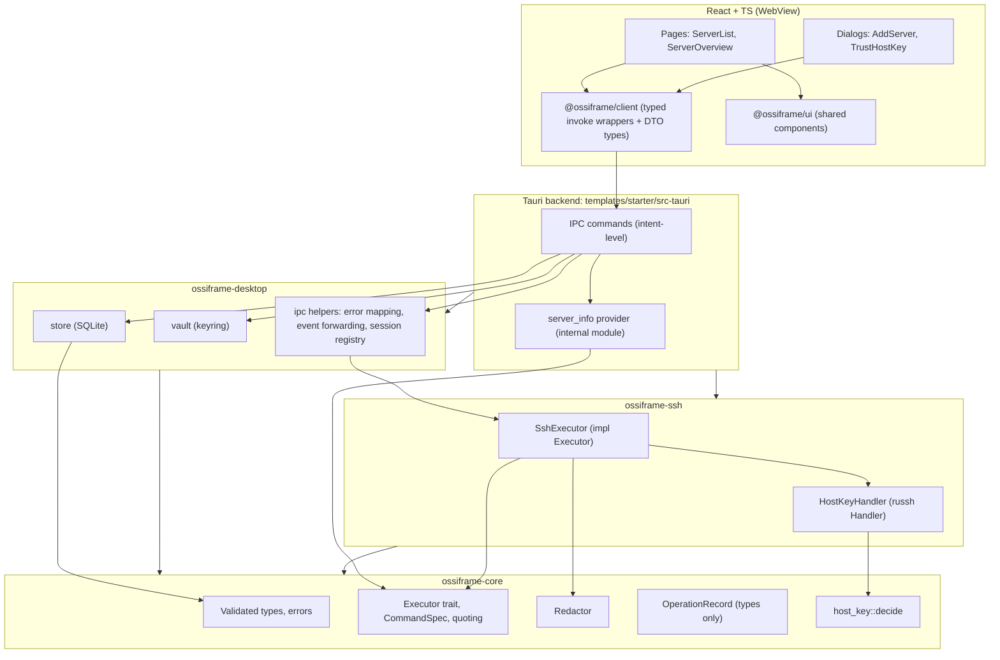
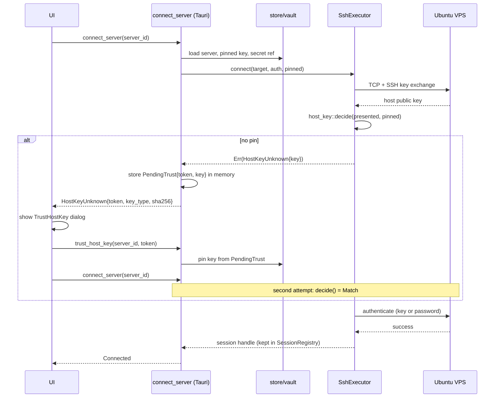
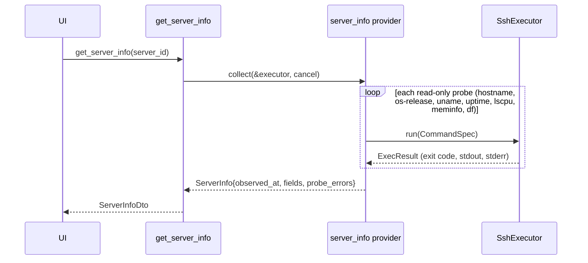

# Design Document: 01-skeleton-foundation (S01)

## Overview

S01 is the first vertical slice of Ossiframe. It delivers a working Tauri 2 desktop app that stores server entries, connects to an authorized Ubuntu 24.04 VPS over SSH with a pinned host key, runs read-only commands through a structured executor, and shows real server information (hostname, OS, kernel, architecture, uptime, CPU, memory, root disk usage) with an observation timestamp.

The slice creates the three skeleton crates (`ossiframe-core`, `ossiframe-ssh`, `ossiframe-desktop`), the two frontend packages (`@ossiframe/ui`, `@ossiframe/client`), and one minimal app. It also validates russh against a real server. The decisions in ADR-0001 to ADR-0004 are followed as written. This document only adds S01-level choices and lists the ones still open.

Language: Rust for backend and contracts, TypeScript for the frontend. Pseudocode for algorithms uses `pascal` blocks. APIs marked **(verified)** were checked against official docs while writing this design. Everything else that depends on an external API is an **assumption** to confirm during implementation.

## Scope boundaries

In: monorepo init, add/list/remove server, host key trust and pinning, optional keychain storage, executor with streaming/timeout/cancel/redaction, read-only server info, minimal UI, typed IPC, quality gates, manual verification on a disposable VPS.

Out: provisioning, any server mutation, sudo/root execution (enum modeled only), module registry and generator (S02), `apps/deploy`, `apps/doctor`, SFTP, terminal, SSH agent, `~/.ssh/config`, key generation, non-macOS verification, release CI.

## Architecture



Dependency direction follows engineering.md: App → (modules, later) → Core. In S01 the starter app depends on `ossiframe-desktop`, `ossiframe-ssh` and `ossiframe-core` directly. `ossiframe-core` has no dependency on russh, Tauri, SQLite or keyring.

### Decision: app location is `templates/starter/`

The S01 app lives in `templates/starter/` (`src/` React, `src-tauri/` Tauri). Reasons: structure.md already names it as the starter template source; S02 turns it into the generator input without moving files; `apps/deploy` and `apps/doctor` are explicitly not created in S01. Trade-off: it is a template directory that must build in place. It does so as a workspace member, with `{{name}}` placeholders deferred to S02 (S01 uses a fixed name `ossiframe-starter`). How generated projects reference Core stays with ADR-0007.

### Decision: the server-info provider is an internal module of the starter backend

`templates/starter/src-tauri/src/server_info/` holds the command list and parsers. It takes `&dyn Executor` and returns a plain struct. It uses nothing app-specific, so S02 can lift it into `modules/linux-inventory` by moving the folder and adding a manifest. No registry, manifest or trait for "modules" is created in S01.

### Repository layout created in S01

```text
Cargo.toml                    workspace: crates/*, templates/starter/src-tauri
pnpm-workspace.yaml           packages/*, templates/starter
package.json                  root scripts: typecheck, lint, build
rust-toolchain.toml           pinned stable
crates/ossiframe-core/
crates/ossiframe-ssh/
crates/ossiframe-desktop/
packages/ui/                  @ossiframe/ui
packages/client/              @ossiframe/client
templates/starter/            src/ (React), src-tauri/ (Tauri 2)
docs/verification/s01-skeleton-foundation.md   written after the manual run
```

Lockfiles (`Cargo.lock`, `pnpm-lock.yaml`) are committed (security.md, supply chain).

## Sequence diagrams

### Connect with first-time host key trust



### Get server info



A failing probe does not fail the page. Its field is `None` and the error appears in `probe_errors`. The page shows what it could get.

## Components and Interfaces

### `ossiframe-core`

Pure Rust, no I/O beyond the trait definitions. Dependencies kept minimal: `thiserror`, `serde`, `time`, `uuid`; `proptest` as a dev-dependency.

Modules: `ident` (validated types), `command` (CommandSpec, quoting), `executor` (trait, result, events), `redact`, `host_key` (types and `decide`), `operation` (types only), `error`.

### `ossiframe-ssh`

russh wrapper. Exposes `SshExecutor` (implements `Executor`) and `SshConnector` (connect + authenticate). No russh type appears in a public signature. Dependencies: `russh`, `tokio`, `async-trait` (or native async-in-trait; see assumptions).

### `ossiframe-desktop`

Contains `store` (SQLite), `vault` (keyring), and `ipc` helpers (error mapping to `IpcError`, event forwarding to the WebView, `SessionRegistry`). Only this crate touches SQLite and the keychain.

### Starter app backend (`templates/starter/src-tauri`)

`main.rs` builds the Tauri app, opens the store, registers commands. `commands.rs` holds the intent-level commands. `server_info/` holds the provider.

### Frontend

- `@ossiframe/client`: one typed async function per IPC command and the shared DTO types. No other code calls `invoke` directly.
- `@ossiframe/ui`: shadcn/ui-based components used by more than one app (Dialog wrappers, `StatusBadge`, `ErrorPanel`, `KeyValueList`, `Fingerprint`). Create a component here only when the starter uses it; otherwise keep it in the app.
- Starter `src/`: `ServerListPage`, `AddServerDialog`, `TrustHostKeyDialog`, `ServerOverviewPage`.

## Data Models

### Validated types (`ossiframe-core::ident`)

All constructors return `Result<_, ValidationError>`. Serde deserialization goes through the same constructors (`#[serde(try_from = "String")]`), so IPC input is validated at the trust boundary.

| Type | Rule |
|---|---|
| `ServerName` | 1..=64 chars after trim; no control characters |
| `Hostname` | IPv4/IPv6 literal, or DNS name: total ≤ 253, labels 1..=63, `[A-Za-z0-9-]`, no leading/trailing `-`, no whitespace, no `/`, no leading `-` |
| `Port` | 1..=65535, default 22 |
| `SshUser` | `^[a-z_][a-z0-9_-]{0,31}$` (POSIX portable login), no `-` prefix |
| `KeyPath` | Non-empty, absolute after `~` expansion, no NUL; existence is checked at connect time, not at validation |
| `ProgramName` | Non-empty, no NUL, no `/` unless an absolute path; must not start with `-` |

### SQLite schema (in `ossiframe-desktop::store`)

```sql
CREATE TABLE schema_version (version INTEGER NOT NULL);

CREATE TABLE servers (
  id            TEXT PRIMARY KEY,          -- UUID v4
  name          TEXT NOT NULL,
  host          TEXT NOT NULL,
  port          INTEGER NOT NULL,
  username      TEXT NOT NULL,
  auth_kind     TEXT NOT NULL CHECK (auth_kind IN ('key_file','password')),
  key_path      TEXT,                      -- only for key_file
  secret_ref    TEXT,                      -- keychain entry id, NULL if not saved
  created_at    TEXT NOT NULL,             -- RFC 3339 UTC
  updated_at    TEXT NOT NULL
);

CREATE TABLE host_keys (
  server_id     TEXT PRIMARY KEY REFERENCES servers(id) ON DELETE CASCADE,
  key_type      TEXT NOT NULL,             -- e.g. ssh-ed25519
  public_key    BLOB NOT NULL,             -- wire-format public key (public data)
  sha256        TEXT NOT NULL,             -- "SHA256:<base64 no padding>"
  pinned_at     TEXT NOT NULL
);
```

Rules: no secret column exists. `secret_ref` is an opaque ID (`ossiframe/<app>/<server-uuid>`), not the secret. Deleting a server deletes its keychain entry first, then the row. Migrations are a numbered list of SQL strings applied in a transaction; S01 has migration 1 only. Server info is not cached in SQLite in S01 (see decisions); the UI holds the last result in memory with its `observed_at`.

### Operation record (`ossiframe-core::operation`)

Types only, no persistence in S01. S01 performs no mutating work, so nothing needs a durable record.

```rust
pub enum OperationStatus {
    Pending, Running, Verifying, Succeeded, Failed, Cancelled, UnknownOutcome,
}

pub struct OperationRecord {
    pub id: Uuid,
    pub server_id: Uuid,
    pub kind: String,                 // "server_info" in S01
    pub status: OperationStatus,
    pub created_at: OffsetDateTime,
    pub started_at: Option<OffsetDateTime>,
    pub finished_at: Option<OffsetDateTime>,
    pub output: String,               // sanitized, size-capped
    pub exit_code: Option<i32>,
    pub error: Option<String>,
}
```

`get_server_info` does not create records in S01. The type exists so S04 and S02 compile against a stable shape. Persistence and locks are deferred.

### Connection state (in memory, `ossiframe-desktop::ipc`)

```rust
pub enum ConnectionState { Disconnected, Connecting, AwaitingHostKeyTrust, Connected, Failed }
```

`SessionRegistry` maps `server_id` to `{ executor: Arc<SshExecutor>, state }` and `PendingTrust` entries `{ token: Uuid, server_id, key: PresentedHostKey, created_at }`. Pending trust entries expire after 5 minutes and are removed on use.

### IPC DTOs (serialized with serde, camelCase)

```rust
pub struct ServerDto { id, name, host, port, username, auth: AuthDto, has_saved_secret: bool, pinned_fingerprint: Option<String> }
pub enum AuthDto { KeyFile { key_path: String }, Password }
pub struct NewServerDto { name, host, port, username, auth: NewAuthDto, save_secret: bool }
pub enum NewAuthDto {
    KeyFile { key_path: String, passphrase: Option<SecretString> },
    Password { password: SecretString },
}
pub struct HostKeyPromptDto { token: String, key_type: String, sha256: String }
pub struct ServerInfoDto { observed_at: String, hostname: Option<String>, os: Option<OsInfo>, kernel: Option<String>,
    arch: Option<String>, uptime_seconds: Option<u64>, cpu: Option<CpuInfo>, memory: Option<MemoryInfo>,
    root_disk: Option<DiskInfo>, probe_errors: Vec<ProbeErrorDto> }
```

Secrets appear only in inbound DTOs (`NewServerDto`, `ConnectSecretDto`), never in an outbound one. `SecretString` is a wrapper (from `secrecy` or a small local type) whose `Debug` and `Serialize` output is `"<redacted>"`, and which zeroizes on drop.

TypeScript mirrors are in `@ossiframe/client`; see the decision on type generation below.

## Low-Level Design

### Core: commands and quoting

```rust
pub enum Privilege { User, RunAs(SshUser), Root }   // S01 executes User only

pub struct CommandSpec {
    pub program: ProgramName,
    pub args: Vec<String>,        // arbitrary text; quoted by core, NUL rejected
    pub privilege: Privilege,
    pub timeout: Duration,
    pub stdin: Option<SecretBytes>, // secrets go here, never in args
    pub mutating: bool,
}

impl CommandSpec {
    pub fn read_only(program: &str, args: &[&str], timeout: Duration) -> Result<Self, ValidationError>;
    /// Single command line for the SSH exec request.
    pub fn to_command_line(&self) -> Result<String, CommandError>;
}

/// POSIX single-quote escaping. Always quotes; never returns an unquoted token.
pub fn quote_arg(arg: &str) -> Result<String, CommandError>;
```

```pascal
ALGORITHM quote_arg(arg)
INPUT: arg of type String
OUTPUT: quoted of type String (POSIX sh single-quoted word)

BEGIN
  IF arg CONTAINS NUL THEN
    RETURN Error(NulInArgument)
  END IF

  out ← "'"
  FOR each character c IN arg DO
    IF c = "'" THEN
      out ← out + "'\\''"        // close quote, escaped quote, reopen quote
    ELSE
      out ← out + c
    END IF
  END FOR
  out ← out + "'"
  RETURN out
END
```

```pascal
ALGORITHM to_command_line(spec)
INPUT: spec of type CommandSpec
OUTPUT: line of type String

BEGIN
  ASSERT spec.mutating = false OR policy allows mutation       // checked by executor policy, not here
  parts ← [quote_arg(spec.program)]
  FOR each a IN spec.args DO
    parts.append(quote_arg(a))
  END FOR
  line ← join(parts, " ")

  CASE spec.privilege OF
    User:       RETURN line
    RunAs(u):   RETURN "sudo -n -u " + quote_arg(u) + " -- " + line     // modeled; rejected by S01 policy
    Root:       RETURN "sudo -n -- " + line                              // modeled; rejected by S01 policy
  END CASE
END
```

The program is quoted too, so a malformed value cannot become shell syntax. No shell operators (`;`, `|`, `&&`, redirects) exist in the model, so every probe is one program with arguments. A probe that needs a pipe is replaced by reading a file (`/proc/meminfo`) and parsing locally.

**Preconditions:** no argument contains NUL. **Postconditions:** the result parsed by `sh -c` yields exactly the original argv; the output has no unquoted metacharacter. **Loop invariant:** after each character, `out` is a prefix of a valid single-quoted sequence.

### Core: executor contract

```rust
#[derive(Clone)]
pub struct CancelToken(/* tokio_util::sync::CancellationToken or a local equivalent */);

pub enum OutputStream { Stdout, Stderr }

pub struct ExecResult {
    pub exit: ExitStatus,           // Code(i32) | Signal(String) | Unknown
    pub stdout: String,             // redacted, size-capped, lossy UTF-8
    pub stderr: String,             // redacted, size-capped
    pub truncated: bool,
    pub duration: Duration,
}

pub enum ExecError {
    Timeout { after: Duration },
    Cancelled,
    ConnectionLost,                 // disconnect during run; outcome unknown
    PolicyRejected(String),         // e.g. mutating or privileged command under S01 policy
    Channel(String),                // sanitized transport error
}

#[async_trait]
pub trait Executor: Send + Sync {
    async fn run(
        &self,
        spec: &CommandSpec,
        on_output: Option<&(dyn Fn(OutputStream, &str) + Send + Sync)>,
        cancel: &CancelToken,
    ) -> Result<ExecResult, ExecError>;
}

pub trait ExecutionPolicy: Send + Sync {
    fn check(&self, spec: &CommandSpec) -> Result<(), ExecError>;
}
```

A non-zero exit code is an `Ok(ExecResult)`, not an `ExecError`. The caller decides whether it is a failure. `ConnectionLost` means the outcome is unknown. S01 never retries it automatically (engineering.md).

S01 installs `ReadOnlyUserPolicy`: rejects `mutating = true` and any `Privilege` other than `User`. This keeps the "no mutation, no sudo" scope enforced in code rather than by convention.

### Core: redaction

```rust
pub struct Redactor { /* secrets: Vec<String>, kept private, zeroized on drop */ }

impl Redactor {
    pub fn new() -> Self;
    pub fn add_secret(&mut self, secret: &str);          // ignores empty and < 4 chars? see note
    pub fn redact(&self, text: &str) -> String;           // replaces every occurrence with "[REDACTED]"
    pub fn streaming(&self) -> StreamRedactor;            // handles secrets split across chunks
}
```

```pascal
ALGORITHM StreamRedactor.push(chunk)
INPUT: chunk of type Bytes
OUTPUT: safe of type String

BEGIN
  buffer ← buffer + chunk
  keep ← max_secret_length - 1                  // longest possible partial match

  IF length(buffer) <= keep THEN
    RETURN ""                                   // hold back; may be a partial secret
  END IF

  emit_end ← length(buffer) - keep
  text ← buffer[0 .. emit_end]
  buffer ← buffer[emit_end ..]

  FOR each s IN secrets DO
    text ← replace_all(text, s, "[REDACTED]")
  END FOR
  RETURN text
END

ALGORITHM StreamRedactor.finish()
BEGIN
  text ← buffer; buffer ← ""
  FOR each s IN secrets DO text ← replace_all(text, s, "[REDACTED]") END FOR
  RETURN text
END
```

Known limits, to be written into the code comments and docs: redaction replaces exact occurrences of secrets the app registered (passphrase, password, and any value added later). It does not detect unknown secrets or transformed copies (base64, split by newlines). The S01 probes do not echo secrets anyway; the redactor is the safety net and is tested on its own. A secret that occurs across the boundary of a chunk emit point is covered by holding back `max_len - 1` bytes. A match that straddles `emit_end` after a replacement cannot happen because held-back bytes are never emitted before a full scan. Secrets shorter than 4 characters are still redacted (a short password must not leak); the trade-off is over-redaction, accepted.

**Postconditions:** the concatenated output of `push` and `finish` contains no registered secret as a substring. `redact(redact(x)) = redact(x)` as long as `[REDACTED]` contains no secret.

### Core: host key decision

```rust
pub struct PresentedHostKey {
    pub key_type: String,         // "ssh-ed25519", "ecdsa-sha2-nistp256", "ssh-rsa", ...
    pub public_key: Vec<u8>,      // wire format
    pub sha256: String,           // "SHA256:<base64 no padding>"
}

pub struct PinnedHostKey { pub key_type: String, pub public_key: Vec<u8>, pub sha256: String }

pub enum HostKeyDecision {
    Trusted,                                     // matches the pin
    Unknown(PresentedHostKey),                   // no pin: ask the user
    Mismatch { pinned: PinnedHostKey, presented: PresentedHostKey }, // hard failure
}

pub fn decide(pinned: Option<&PinnedHostKey>, presented: &PresentedHostKey) -> HostKeyDecision;
pub fn fingerprint_sha256(public_key_wire: &[u8]) -> String;
```

```pascal
ALGORITHM decide(pinned, presented)
INPUT: pinned of type Option<PinnedHostKey>, presented of type PresentedHostKey
OUTPUT: decision of type HostKeyDecision

BEGIN
  IF pinned = None THEN
    RETURN Unknown(presented)
  END IF

  // Compare the key bytes, not the display string and not only the type.
  IF pinned.key_type = presented.key_type
     AND constant_time_equal(pinned.public_key, presented.public_key) THEN
    RETURN Trusted
  END IF

  RETURN Mismatch(pinned, presented)       // includes a different key type for the same server
END

ALGORITHM fingerprint_sha256(wire)
BEGIN
  digest ← SHA256(wire)
  RETURN "SHA256:" + base64_standard_no_padding(digest)
END
```

`Unknown` is the only state in which the UI offers "Trust". `Mismatch` offers no "continue" button. The user must choose "Replace pinned key" in the server settings, which shows both fingerprints and requires a typed confirmation of the host name, then calls `replace_host_key`. This follows ADR-0003: hard fail until an explicit replace.

### SSH: connect and host key callback

The russh `client::Handler::check_server_key` callback (**verified**: it receives the server public key, and the default implementation rejects all keys) cannot wait for UI input without holding the handshake open. S01 uses a two-attempt flow instead: the callback decides immediately from the pin, records what the server presented, and returns `false` unless the key is `Trusted`. The connect function then converts the recorded state into a typed error.

```rust
pub struct ConnectTarget { pub host: Hostname, pub port: Port, pub user: SshUser }

pub enum AuthMethod {
    KeyFile { path: KeyPath, passphrase: Option<SecretString> },
    Password(SecretString),
}

pub struct ConnectOptions {
    pub connect_timeout: Duration,     // default 10 s
    pub auth_timeout: Duration,        // default 15 s
    pub keepalive_interval: Duration,  // default 15 s
    pub keepalive_max_misses: u32,     // default 3
}

pub enum ConnectError {
    Unreachable(String),               // DNS, refused, no route
    ConnectTimeout,
    HostKeyUnknown(PresentedHostKey),
    HostKeyMismatch { pinned: PinnedHostKey, presented: PresentedHostKey },
    AuthFailed,                        // wrong key, passphrase, or password; no detail that helps an attacker
    KeyFileUnreadable(String),         // missing, permissions, not OpenSSH format
    PassphraseRequired,
    Protocol(String),                  // sanitized russh error
}

pub struct SshConnector;

impl SshConnector {
    pub async fn connect(
        target: &ConnectTarget,
        auth: &AuthMethod,
        pinned: Option<&PinnedHostKey>,
        opts: &ConnectOptions,
        redactor: Redactor,
    ) -> Result<SshExecutor, ConnectError>;
}
```

```pascal
ALGORITHM SshConnector.connect(target, auth, pinned, opts)
INPUT: target, auth, pinned of type Option<PinnedHostKey>, opts
OUTPUT: Result<SshExecutor, ConnectError>

BEGIN
  shared ← new SharedHostKeyState(observed = None)
  handler ← new HostKeyHandler(pinned, shared)

  result ← WITH TIMEOUT opts.connect_timeout:
              russh.client.connect(config, (target.host, target.port), handler)

  IF result is Timeout THEN RETURN Error(ConnectTimeout) END IF

  IF result is Error THEN
    // The handler returned false (not Trusted), so russh aborts the handshake.
    // Classify using what the handler recorded, not the russh error text.
    CASE shared.observed OF
      Some(Unknown(key)):            RETURN Error(HostKeyUnknown(key))
      Some(Mismatch(pin, key)):      RETURN Error(HostKeyMismatch(pin, key))
      None:                          RETURN Error(Unreachable(sanitize(result.error)))
    END CASE
  END IF

  session ← result.value
  // From here the host key is Trusted.

  CASE auth OF
    KeyFile(path, passphrase):
      key ← load_secret_key(path, passphrase)          // may fail: KeyFileUnreadable / PassphraseRequired
      outcome ← WITH TIMEOUT opts.auth_timeout: session.authenticate_publickey(user, key_with_hash_alg)
    Password(pw):
      outcome ← WITH TIMEOUT opts.auth_timeout: session.authenticate_password(user, pw)
  END CASE

  IF outcome is not Success THEN
    session.disconnect()
    RETURN Error(AuthFailed)
  END IF

  RETURN Ok(SshExecutor(session, redactor, opts))
END
```

```rust
struct HostKeyHandler { pinned: Option<PinnedHostKey>, shared: Arc<Mutex<Option<HostKeyDecision>>> }

impl russh::client::Handler for HostKeyHandler {
    type Error = russh::Error;
    async fn check_server_key(&mut self, key: &PublicKeyOrCertificate) -> Result<bool, Self::Error> {
        // 1. Convert to PresentedHostKey (type, wire bytes, sha256). Certificates: reject (S01 supports plain keys only).
        // 2. decision = host_key::decide(self.pinned.as_ref(), &presented)
        // 3. *self.shared.lock() = Some(decision.clone())
        // 4. Ok(matches!(decision, HostKeyDecision::Trusted))
    }
}
```

**Preconditions:** `pinned` is the value stored for this exact server ID. **Postconditions:** an `SshExecutor` is returned only if the presented key matched the pin; no credential is sent to a server whose key was `Unknown` or `Mismatch`, because the handler returns `false` before authentication starts. **Verification point V2** confirms that authentication does not begin after `false` is returned.

Keepalive: russh `Handle` offers send-keepalive and send-keepalive-and-wait methods (**verified**). The executor uses a background task that pings every `keepalive_interval`; `keepalive_max_misses` consecutive failures mark the session dead, emit `connection-lost`, and fail running commands with `ConnectionLost`. The exact `Config` fields for inactivity and keepalive are an **assumption** to confirm during S01 (V7).

### SSH: executor run

```pascal
ALGORITHM SshExecutor.run(spec, on_output, cancel)
INPUT: spec of type CommandSpec, on_output callback, cancel of type CancelToken
OUTPUT: Result<ExecResult, ExecError>

BEGIN
  policy.check(spec)                                  // may return PolicyRejected
  line ← spec.to_command_line()
  channel ← session.channel_open_session()
  channel.exec(want_reply = true, line)

  IF spec.stdin IS Some THEN
    channel.data(spec.stdin); channel.eof()
  ELSE
    channel.eof()                                     // commands must not wait on stdin
  END IF

  out ← StreamRedactor(redactor); err ← StreamRedactor(redactor)
  stdout_buf, stderr_buf ← capped buffers (max 256 KiB each; set truncated = true beyond)
  exit ← Unknown
  deadline ← now + spec.timeout

  LOOP
    SELECT FIRST OF
      msg ← channel.wait():
        CASE msg OF
          Data(bytes):                emit(Stdout, out.push(bytes)); append to stdout_buf
          ExtendedData(1, bytes):     emit(Stderr, err.push(bytes)); append to stderr_buf
          ExitStatus(code):           exit ← Code(code)
          ExitSignal(name):           exit ← Signal(name)
          Eof:                        CONTINUE
          Close:                      EXIT LOOP
          None (stream ended):        RETURN Error(ConnectionLost) IF exit = Unknown
        END CASE
      now >= deadline:
        channel.close()                               // best effort; remote process may still run
        RETURN Error(Timeout(spec.timeout))
      cancel.cancelled():
        channel.close()
        RETURN Error(Cancelled)
    END SELECT
  END LOOP

  flush out.finish(), err.finish()
  RETURN Ok(ExecResult(exit, stdout_buf, stderr_buf, truncated, elapsed))
END
```

Timeout and cancellation close the channel. They do not prove that the remote process stopped (engineering.md). For the read-only S01 probes this is harmless. The UI states "command was abandoned; the server may still be running it" for those two errors, and S01 never retries automatically. The exit-status message may arrive before the output is fully drained, so the loop ends on `Close`, not on `ExitStatus` (assumption, validated in V4). Output is lossy UTF-8 and size-capped; the UI shows it as plain text.

### Desktop: store, vault, session registry

```rust
// store (rusqlite, see decisions)
pub struct Store { /* Mutex<Connection> or a single-writer thread */ }
impl Store {
    pub fn open(app_data_dir: &Path) -> Result<Store, StoreError>;      // creates dir, runs migrations
    pub fn add_server(&self, s: &NewServerRecord) -> Result<ServerRecord, StoreError>;
    pub fn list_servers(&self) -> Result<Vec<ServerRecord>, StoreError>;
    pub fn get_server(&self, id: Uuid) -> Result<Option<ServerRecord>, StoreError>;
    pub fn remove_server(&self, id: Uuid) -> Result<(), StoreError>;
    pub fn get_host_key(&self, server_id: Uuid) -> Result<Option<PinnedHostKey>, StoreError>;
    pub fn pin_host_key(&self, server_id: Uuid, key: &PresentedHostKey) -> Result<(), StoreError>;     // insert only; fails if a pin exists
    pub fn replace_host_key(&self, server_id: Uuid, key: &PresentedHostKey) -> Result<(), StoreError>; // explicit replace
}

// vault (keyring crate)
pub struct Vault { service: String }          // e.g. "ossiframe-starter"
impl Vault {
    pub fn save(&self, entry_id: &str, secret: &SecretString) -> Result<(), VaultError>;
    pub fn load(&self, entry_id: &str) -> Result<Option<SecretString>, VaultError>;
    pub fn delete(&self, entry_id: &str) -> Result<(), VaultError>;
}
```

`pin_host_key` refuses to overwrite an existing pin so a bug in the connect path cannot silently re-pin. Only `replace_host_key` replaces, and only the `replace_host_key` IPC command calls it.

Secret handling at connect: if the user opted in, the secret is loaded from the vault. If not, the frontend sends it in the `connect_server` call (`ConnectSecretDto`), it lives in memory for the duration of the connect, and is dropped after. The `Redactor` for the session gets the secret registered.

### IPC commands (Tauri 2)

All commands are `#[tauri::command]` async functions returning `Result<T, IpcError>`. They accept typed DTOs only; there is no command that takes a command line, path to read, or URL.

| Command | Input | Output | Notes |
|---|---|---|---|
| `add_server` | `NewServerDto` | `ServerDto` | Validates into typed values; saves secret to keychain only if `save_secret`; rolls back the row if the keychain write fails |
| `list_servers` | none | `Vec<ServerDto>` | `has_saved_secret` boolean only |
| `remove_server` | `server_id` | `()` | Disconnects, deletes keychain entry, then the row |
| `connect_server` | `server_id`, `Option<ConnectSecretDto>` | `ConnectOutcome` | `Connected`, or `HostKeyUnknown(HostKeyPromptDto)`; other failures return `IpcError` |
| `trust_host_key` | `server_id`, `token` | `()` | Pins the key stored in `PendingTrust`; fails if token unknown, expired, or for another server |
| `replace_host_key` | `server_id`, `token`, `confirm_host: String` | `()` | Only valid after a `HostKeyMismatch` response created a pending replace token; `confirm_host` must equal the server host |
| `disconnect_server` | `server_id` | `()` | Closes the session |
| `get_server_info` | `server_id` | `ServerInfoDto` | Requires a connected session; read-only probes |
| `cancel_operation` | `server_id` | `()` | Cancels the running probe set via its `CancelToken` |

`trust_host_key` takes a token, not a fingerprint, so a compromised frontend cannot pin a key the backend did not actually see. For `HostKeyMismatch`, `connect_server` returns an `IpcError::HostKeyMismatch` carrying both fingerprints and a replace token.

```rust
pub enum IpcError {            // serialized as { kind, message, details }
    Validation { field: String, message: String },
    NotFound,
    Unreachable { message: String },
    ConnectTimeout,
    HostKeyMismatch { pinned_sha256: String, presented_sha256: String, key_type: String, replace_token: String },
    AuthFailed,
    KeyFileUnreadable { message: String },
    PassphraseRequired,
    NotConnected,
    CommandFailed { program: String, exit_code: i32, stderr_excerpt: String },
    CommandTimeout,
    Cancelled,
    ConnectionLost,
    Keychain { message: String },
    Storage { message: String },
    Internal,
}
```

`stderr_excerpt` is redacted and capped at 2 KiB. `Internal` carries no detail to the UI; details go to a redacted local log.

Events (backend → frontend), typed: `connection-state` `{ server_id, state }`, `connection-lost` `{ server_id }`. Per-probe output streaming is not shown in the S01 UI; the executor supports `on_output`, and the backend uses it only to tee into the redacted log. This is intentional: streaming is validated at the executor level (V4) without building a UI that nothing needs yet.

### Tauri configuration

- **CSP** (`tauri.conf.json` → `app.security.csp`): `default-src 'none'; script-src 'self'; style-src 'self'; img-src 'self' data:; font-src 'self'; connect-src ipc: http://ipc.localhost` (the IPC origin entries are an **assumption**; confirm against the Tauri 2 CSP docs when implementing). No remote origins, no `unsafe-eval`. If Tailwind/shadcn in dev mode needs `'unsafe-inline'` for styles, allow it only in the dev config. The production build fails the check if CSP contains `unsafe-eval`.
- **Capabilities** (`src-tauri/capabilities/default.json`): window `main` only; core defaults for event listening; no `fs`, `shell`, `http`, `opener` or `dialog` plugins. The key-file path is typed in a text field in S01 (a native file picker would need the dialog plugin; deferred to avoid widening capabilities).
- **App command allow-list**: restrict app commands to the list above via the `tauri-build` app manifest (`AppManifest::new().commands(&[...])`) with a matching permission set. This is **unverified** in this design; confirm in Tauri 2 docs. If it is not workable, rely on registering only these commands in `generate_handler!`.
- `devtools` disabled in release builds.

### Server info provider

```rust
pub struct ServerInfo {
    pub observed_at: OffsetDateTime,
    pub hostname: Option<String>,
    pub os: Option<OsInfo>,            // id, version_id, pretty_name from /etc/os-release
    pub kernel: Option<String>,        // uname -r
    pub arch: Option<String>,          // uname -m
    pub uptime_seconds: Option<u64>,   // /proc/uptime first field
    pub cpu: Option<CpuInfo>,          // count (nproc), model (lscpu "Model name")
    pub memory: Option<MemoryInfo>,    // total_kb, available_kb from /proc/meminfo
    pub root_disk: Option<DiskInfo>,   // df -P -B1 /: total, used, available bytes, use percent
    pub probe_errors: Vec<ProbeError>, // { probe: &'static str, message }
}

pub async fn collect(exec: &dyn Executor, cancel: &CancelToken) -> ServerInfo;
```

Probes (each one `CommandSpec::read_only`, 10 s timeout, `Privilege::User`):

| Probe | Program and args |
|---|---|
| hostname | `hostname` |
| os | `cat /etc/os-release` |
| kernel | `uname -r` |
| arch | `uname -m` |
| uptime | `cat /proc/uptime` |
| cpu count | `nproc` |
| cpu model | `lscpu` |
| memory | `cat /proc/meminfo` |
| disk | `df -P -B1 /` |

Parsers are pure functions `fn parse_os_release(&str) -> Option<OsInfo>` and similar. They bound input size, reject lines they do not understand, and never panic on malformed text. `observed_at` is taken on the desktop clock when the first probe starts. Probes run sequentially over one session in S01 (simple, ordered, enough for 9 short commands).

### Frontend: `@ossiframe/client`

```ts
export type ServerId = string;

export type NewAuth =
  | { kind: "keyFile"; keyPath: string; passphrase?: string }
  | { kind: "password"; password: string };

export interface NewServer {
  name: string; host: string; port: number; username: string;
  auth: NewAuth; saveSecret: boolean;
}

export type IpcError =
  | { kind: "validation"; field: string; message: string }
  | { kind: "hostKeyMismatch"; pinnedSha256: string; presentedSha256: string; keyType: string; replaceToken: string }
  | { kind: "authFailed" } | { kind: "unreachable"; message: string } | { kind: "connectTimeout" }
  | { kind: "commandFailed"; program: string; exitCode: number; stderrExcerpt: string }
  /* ...remaining variants mirror the Rust enum */;

export type ConnectOutcome =
  | { kind: "connected" }
  | { kind: "hostKeyUnknown"; token: string; keyType: string; sha256: string };

export const api = {
  addServer: (s: NewServer) => invoke<ServerDto>("add_server", { server: s }),
  listServers: () => invoke<ServerDto[]>("list_servers"),
  removeServer: (id: ServerId) => invoke<void>("remove_server", { serverId: id }),
  connectServer: (id: ServerId, secret?: ConnectSecret) => invoke<ConnectOutcome>("connect_server", { serverId: id, secret }),
  trustHostKey: (id: ServerId, token: string) => invoke<void>("trust_host_key", { serverId: id, token }),
  replaceHostKey: (id: ServerId, token: string, confirmHost: string) => invoke<void>("replace_host_key", { serverId: id, token, confirmHost }),
  disconnectServer: (id: ServerId) => invoke<void>("disconnect_server", { serverId: id }),
  getServerInfo: (id: ServerId) => invoke<ServerInfoDto>("get_server_info", { serverId: id }),
  cancelOperation: (id: ServerId) => invoke<void>("cancel_operation", { serverId: id }),
};
```

The wrapper normalizes thrown values into `IpcError`. Passwords and passphrases exist only in function arguments, are never stored in React state longer than the dialog, and are cleared on submit.

### UI states

| Screen | States shown |
|---|---|
| Server list | empty, list with status badge (disconnected, connecting, connected, failed), pinned fingerprint prefix |
| Add server dialog | field-level validation messages (from `IpcError.validation`), auth switch (key file / password), "Save secret in OS keychain" checkbox, off by default |
| Trust host key dialog | server name, host:port, key type, full `SHA256:` fingerprint in monospace, instruction to compare with the provider console or `ssh-keygen -lf`, buttons Trust and Cancel |
| Host key mismatch panel | red error, pinned vs presented fingerprint, no Continue button, link "Replace pinned key..." leading to typed host confirmation |
| Overview page | key-value list of info, "Observed at <time> (<n> s ago)", Refresh button, per-field "unavailable" with probe error tooltip |
| Error panel | message by error kind: auth failed, unreachable, timeout, command failed with exit code and stderr excerpt (plain text in `<pre>`), cancelled, connection lost |

Remote output is rendered only as React text nodes; `dangerouslySetInnerHTML` is banned via ESLint (`react/no-danger`).

## Example Usage

```rust
// Backend: executor use inside the server_info provider
let spec = CommandSpec::read_only("cat", &["/etc/os-release"], Duration::from_secs(10))?;
let res = exec.run(&spec, None, &cancel).await?;
if let ExitStatus::Code(0) = res.exit {
    info.os = parse_os_release(&res.stdout);
} else {
    info.probe_errors.push(ProbeError::from_exec("os", &res));
}
```

```ts
// Frontend: connect flow
const outcome = await api.connectServer(id, secretIfNotSaved);
if (outcome.kind === "hostKeyUnknown") {
  const ok = await showTrustDialog(outcome);      // user compares fingerprint
  if (ok) {
    await api.trustHostKey(id, outcome.token);
    await api.connectServer(id, secretIfNotSaved);
  }
}
const info = await api.getServerInfo(id);
```

## Correctness Properties

### Property 1: Quoting round-trip

For any UTF-8 string without NUL, `sh -c "printf %s " + quote_arg(s)` prints `s`. For any `args: Vec<String>` without NUL, the argv recovered by POSIX shell word splitting of `to_command_line` equals `[program] + args`.

**Validates: Requirements 3.1, 3.6**

### Property 2: Quoting rejects NUL

`quote_arg(s)` returns an error iff `s` contains NUL.

**Validates: Requirements 3.2**

### Property 3: Identifier validation

For all inputs, a validated `Hostname`, `SshUser`, `Port`, `ServerName` satisfies its rule; for all inputs that violate a rule the constructor returns an error. A validated `Hostname` or `SshUser` never begins with `-` and never contains whitespace or shell metacharacters.

**Validates: Requirements 2.1, 2.2, 2.3, 2.4, 2.5, 2.6, 2.7, 2.8**

### Property 4: Redaction completeness

For any set of non-empty secrets and any text split into arbitrary chunks, the concatenation of `StreamRedactor::push` outputs plus `finish` contains no secret as a substring, and equals `Redactor::redact(text)` on the whole text.

**Validates: Requirements 5.1, 5.2, 5.3, 5.4, 5.5**

### Property 5: Host key decision

`decide(None, k) = Unknown(k)`. `decide(Some(p), k) = Trusted` iff `p.key_type = k.key_type` and `p.public_key = k.public_key`. Otherwise `Mismatch`. `decide` never returns `Trusted` when the pin is absent.

**Validates: Requirements 6.1, 6.2, 6.3, 6.4**

### Property 6: Fingerprint format

`fingerprint_sha256(w)` starts with `SHA256:`, has no `=` padding, and its base64 part decodes to 32 bytes.

**Validates: Requirements 6.5**

### Property 7: No credentials to unverified hosts

Authentication is attempted only after `check_server_key` returned `true` for the current handshake (verified by V2 on a real server).

**Validates: Requirements 6.6, 6.7, 6.8, 7.1, 7.2**

### Property 8: No secret leaves the backend

No outbound IPC DTO, event payload, SQLite column or log line contains a secret value (reviewed by type: outbound DTOs have no secret field; checked in verification by searching the SQLite file and log for the test passphrase).

**Validates: Requirements 8.5, 9.5**

### Property 9: Pin immutability

`pin_host_key` fails if a pin exists; the only path that replaces a pin is `replace_host_key` after a mismatch token and typed host confirmation.

**Validates: Requirements 6.12, 6.13, 6.14**

### Property 10: Read-only

Under `ReadOnlyUserPolicy`, `run` returns `PolicyRejected` for every spec with `mutating = true` or `privilege != User`.

**Validates: Requirements 4.3, 4.4, 4.5**

### Property 11: Unknown outcome is not retried

`ConnectionLost`, `Timeout` and `Cancelled` are never followed by an automatic re-run of the same command.

**Validates: Requirements 4.6, 4.7, 4.8, 4.11**


## Error Handling

| Scenario | Condition | Response | Recovery |
|---|---|---|---|
| Invalid input | Constructor rejects a field | `IpcError::Validation{field}`; dialog shows the message under the field | User edits |
| Unreachable | DNS failure, refused, no route | `Unreachable`; status Failed | Retry; check host and port |
| Connect timeout | No TCP/SSH banner within 10 s | `ConnectTimeout` | Retry |
| Unknown host key | No pin | `HostKeyUnknown` outcome; Trust dialog | User confirms or cancels; nothing is stored on cancel |
| Host key mismatch | Presented key differs from pin | `HostKeyMismatch`; no credential sent | Verify with provider; replace pin explicitly |
| Auth failed | Server rejects key or password | `AuthFailed` (no hint which part) | Edit server credentials |
| Key file unreadable | Missing file, wrong format, permissions | `KeyFileUnreadable{message}` (path included, content not) | Fix path or file |
| Passphrase missing or wrong | Encrypted key, no/incorrect passphrase | `PassphraseRequired` or `AuthFailed` | Prompt for passphrase |
| Command failed | Non-zero exit code | `CommandFailed{program, exit_code, stderr_excerpt}` when the provider treats it as fatal; otherwise a `probe_errors` entry | Shown in overview |
| Command timeout | No exit before the deadline | `CommandTimeout`, channel closed; UI says the remote command may still run | User refreshes manually |
| Cancelled | User cancels | `Cancelled`; no retry | None needed |
| Connection lost | Keepalive misses or channel stream ends without exit status | Session removed, `connection-lost` event, status Failed; outcome unknown | User reconnects and re-requests |
| Keychain failure | OS denies access or entry missing | `Keychain{message}`; `add_server` rolls back its row | User retries or declines saving |
| Storage failure | SQLite open/write error | `Storage{message}`; app shows a startup error if the DB cannot open | Check disk and permissions |

Error text is sanitized: no secrets, no raw russh debug dumps in the UI.

## Testing Strategy

Automated tests only for the high-risk logic named in engineering.md. No UI or broad integration suites.

| Area | Approach | Library |
|---|---|---|
| `quote_arg`, `to_command_line` | Property test of properties 1 and 2, including a round trip through a real `sh -c` on the dev machine for generated strings (unit + property) | `proptest` |
| Identifier validation | Table tests for known bad inputs (`-oProxyCommand=x`, whitespace, `;`, empty, overlong labels) plus property test of property 3 | `proptest` |
| Redaction | Property test of property 4 with random chunk splits; fixed cases for secret at chunk boundary and overlapping secrets | `proptest` |
| Host key decision | Property test of property 5 and 6; small table of Unknown/Trusted/Mismatch, including same bytes with different type | `proptest` |
| Remote output parsers | A few fixture-based tests (os-release, meminfo, df, lscpu) using text captured from the verification server, plus malformed input must return `None` without panic | plain `#[test]` |
| Everything else | Not unit tested. Covered by the manual verification run | |

Quality gates before the slice is done: `cargo fmt --check`, `cargo clippy -- -D warnings`, `cargo check`, `cargo test` (the above), `pnpm typecheck`, `pnpm lint`, production build of the starter (`pnpm --filter starter tauri build` or equivalent), and `shellcheck` if any script is added.

### Manual verification (real disposable Ubuntu 24.04 VPS, macOS)

Recorded in `docs/verification/s01-skeleton-foundation.md` with date, app commit, server image, and what was observed. Nothing is written until it is run. The user names the disposable server.

| ID | Verification point | Expected |
|---|---|---|
| V1 | Key auth with Ed25519 key, with and without passphrase | Connects; wrong passphrase fails as `AuthFailed` or `PassphraseRequired` |
| V2 | Host key callback ordering: unknown key | Connect returns `HostKeyUnknown`; server auth log shows no authentication attempt on that handshake |
| V3 | Password auth | Connects; wrong password gives `AuthFailed` |
| V4 | Exec streaming, separate stderr, real exit code | A probe with output and `ls /nonexistent` shows stdout/stderr split and exit code 2; exit status is seen before channel close and all output is drained |
| V5 | Timeout | `sleep 30` with a 2 s spec timeout returns `Timeout` and the app stays usable (test-only call from a Rust integration harness; not exposed in the UI) |
| V6 | Cancellation | Cancel during `sleep 30` returns `Cancelled` promptly |
| V7 | Disconnect detection | Block the connection (for example `systemctl stop ssh` is not allowed: use a firewall rule on the disposable VPS or network off on the laptop); the app reports `connection-lost` within `keepalive_interval × max_misses` |
| V8 | Host key mismatch | After pinning, change the VPS host key (or edit the pin in a scratch DB); connect fails hard, no credentials sent, replace flow works only with typed host |
| V9 | Keychain on unsigned dev build | Save and load a secret; note whether macOS prompts on each rebuild |
| V10 | Server info matches the server | Values equal `cat /etc/os-release`, `uname -a`, `free -b`, `df /` typed manually |
| V11 | No secret leakage | Search the SQLite file, the app log and IPC traces for the test password and passphrase: none found |
| V12 | Offline/unreachable and wrong port | Clear `Unreachable` or `ConnectTimeout` error |

V5, V6 and V7 need a way to run arbitrary specs that the UI does not expose. They are run by a `#[ignore]` integration test in `ossiframe-ssh` that reads host, user and key path from environment variables and is never run in default `cargo test`.

### Fallback if russh fails a requirement

If V1 to V7 show a blocking limitation in russh (for example no usable exit status ordering or unreliable disconnect detection that keepalives cannot fix), record it in the verification doc and revisit ADR-0003 with the finding. The documented fallback is `ssh2` (libssh2) implementing the same `Executor` trait and the same `SshConnector::connect` signature inside `ossiframe-ssh`. S01 does not implement it. Because russh types are private to `ossiframe-ssh` and `HostKeyHandler` only calls `host_key::decide`, the fallback replaces one crate's internals only. (libssh2 would need a different host key hook; the decision logic in core is reused.)

## Open Decisions and Recommendations

| Topic | Options | Recommendation |
|---|---|---|
| SQLite library | `rusqlite` (sync, bundled SQLite) vs `sqlx` (async, macros, migrations) | `rusqlite` with `bundled`. The data is small and local; calls run in `spawn_blocking` or behind a mutex. No async DB, no compile-time query checks needed. Hand-written numbered migrations. |
| IPC type generation | hand-written TS vs `ts-rs` vs `tauri-specta` | Hand-written types in `@ossiframe/client` for S01 (about 15 types). Revisit `ts-rs` when DTO count grows. Tauri-specta adds a dependency tied to Tauri versions; avoid for now. A `typecheck` plus a short review catches drift in a slice this small. |
| Async trait style | `async-trait` crate vs native `async fn` in trait | `async-trait` because `dyn Executor` is needed for the provider and later modules; native async traits are not dyn-compatible. |
| Server info cache | Persist in SQLite vs memory only | Memory only in S01. ADR-0001's rule "observed state is the source of truth; cached data shows its age" is satisfied by showing `observed_at`. Persistence can be added with the first feature that needs offline display. |
| Operation records | Persist now vs types only | Types only. S01 has no mutating work. |
| Key file selection | Native picker vs typed path | Typed path. Avoids the dialog plugin and a wider capability set. |
| Secret string type | `secrecy` crate vs local wrapper | `secrecy` plus `zeroize` (maintained, permissive license). Confirm license and maintenance status when adding. |
| Host key algorithms | Accept any russh-supported type vs restrict | Accept what russh negotiates (type is stored and compared); show the type in the dialog. Certificates are rejected in S01. |
| Concurrency | Parallel probes vs sequential | Sequential over one channel at a time. Simple and ordered. |
| Starter name | `{{name}}` placeholders vs fixed | Fixed `ossiframe-starter` in S01; placeholders arrive with the generator in S02. |

## Assumptions to Confirm During Implementation

- russh `client::Handler::check_server_key` receives the server key and a `false` return aborts the handshake before authentication (**verified** signature and default-reject behavior; the abort-before-auth behavior is checked by V2).
- russh `Handle` provides `authenticate_publickey`, `authenticate_password`, `channel_open_session`, keepalive send methods (**verified** at the doc level; exact signatures, the RSA hash selection helper, and `Config` keepalive/inactivity fields to be read from the version pinned in `Cargo.lock`).
- Computing the SHA-256 fingerprint: use the key type's own fingerprint helper if the pinned russh/`ssh-key` version exposes it, otherwise hash the wire-format bytes with `sha2` and base64-encode (algorithm above). Compare with `ssh-keygen -lf` output in V2.
- Loading OpenSSH-format private keys with optional passphrase through russh's key loading API (V1).
- Tauri 2 CSP `connect-src` entries for IPC, app-manifest command permissions, and capability schema (check `v2.tauri.app` docs during setup).
- `keyring` crate behavior on unsigned macOS builds (V9, already an open item in ADR-0003).
- `tokio-util` `CancellationToken` is acceptable as the cancel primitive (or a small local equivalent).

## Performance Considerations

Nine short commands over one SSH session finish in under a few seconds on a normal link. Output is capped at 256 KiB per stream so a runaway command cannot exhaust memory. The app has no background polling in S01 (refresh is manual), which keeps it light on 8 GB machines.

## Security Considerations

- Host key pinning with hard failure on mismatch, replace only through an explicit typed flow.
- No credential is sent before the host key is `Trusted`.
- Secrets only in the OS keychain (opt-in) or in memory for one connect; zeroized wrappers; never in SQLite, IPC responses, events or logs.
- Typed intent-level IPC; trust token prevents the frontend from pinning a key the backend did not see.
- Argument quoting through one function; no shell operators in the model; validated identifiers reject option-like and whitespace-bearing values.
- Executor policy rejects mutating and privileged specs in S01.
- Strict CSP, minimal capabilities, no `unsafe-eval`, no `dangerouslySetInnerHTML`; remote output is text.
- Remote output and key-file errors are sanitized before display.
- Supply chain: committed lockfiles; `cargo audit` run once locally and the result noted in the verification doc (CI wiring is S06).

## Dependencies

Rust: `tauri` 2, `tokio`, `russh`, `rusqlite` (bundled), `keyring`, `secrecy`, `zeroize`, `serde`, `serde_json`, `thiserror`, `uuid`, `time`, `sha2`, `base64`, `async-trait`, `tokio-util`; dev: `proptest`. Frontend: React, TypeScript, Vite, Tailwind CSS, shadcn/ui (Radix), `@tauri-apps/api`, ESLint, `eslint-plugin-react`. Each is added only when the code using it lands. Licenses and maintenance are checked when adding (tech.md).

External: one disposable Ubuntu 24.04 VPS named by the user, reachable over SSH from the development Mac.
