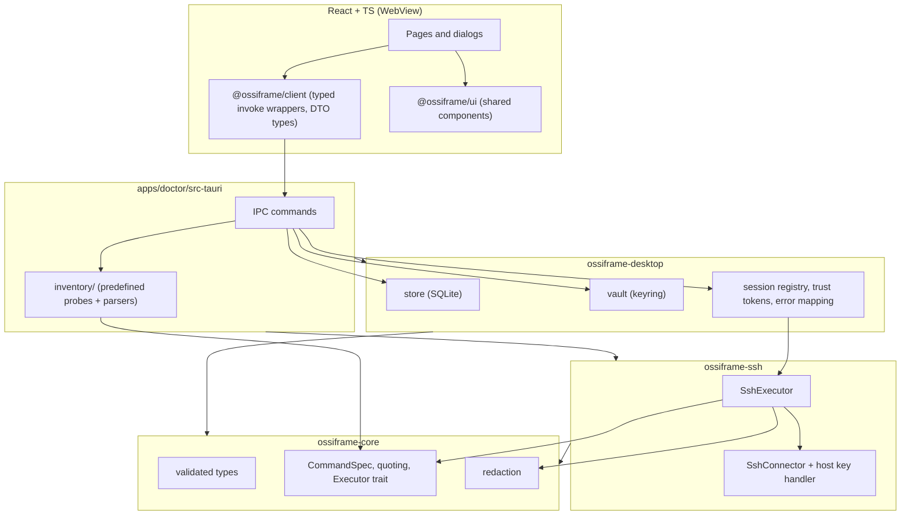

# Design Document: 01-skeleton-foundation (S01)

## Overview

S01 delivers Ossiframe Doctor, a Tauri 2 desktop app in `apps/doctor/`. It manages server profiles, connects to an authorized Ubuntu 24.04 VPS over SSH with a pinned host key, and shows basic inventory (hostname, OS, kernel, architecture, uptime, CPU count and model, memory, root filesystem) with an observation timestamp.

Reusable SSH, storage, credential, execution and UI code lives in shared crates and packages, not in the app. The starter template and generator are S02. Auditing is S03. S01 also validates russh against a real server. ADR-0001 to ADR-0004 are followed as written.

Stack: Rust backend, React + TypeScript + Tailwind + shadcn/ui frontend, russh, rusqlite (bundled), keyring. APIs not yet checked against the pinned versions are listed under "Assumptions".

## Scope

In: monorepo init, profile add/list/edit/remove, connect/disconnect, host key verification and pinning, optional keychain storage, structured executor, read-only inventory, minimal UI, typed IPC, quality gates, manual verification on a disposable VPS.

Out: provisioning, any server mutation, sudo or privileged execution, module registry, generator, `apps/deploy`, SFTP, terminal, SSH agent, `~/.ssh/config`, key generation, streaming output, operation records or journals, non-macOS verification, release CI.

## Architecture



Dependency direction is App → Modules → Core. In S01 Doctor depends on the three crates directly. `ossiframe-core` has no russh, Tauri, SQLite or keyring dependency.

### Decisions

- **App location**: `apps/doctor/` (`src/` React, `src-tauri/` Tauri). Doctor contains only app composition, IPC commands and UI pages. Anything another app would reuse goes to the crates or packages.
- **Inventory provider**: `apps/doctor/src-tauri/src/inventory/` takes `&dyn Executor` and returns a plain struct. It depends on nothing app-specific, so S02 or later can move it into a `linux-inventory` module by moving the folder. No registry, manifest or module trait is built in S01.
- **Trusted modules are not sandboxed**: compiled-in code can call the executor with any `CommandSpec`. Safety comes from what the app exposes (below), not from metadata on commands.

### Repository layout

```text
Cargo.toml, pnpm-workspace.yaml, package.json, rust-toolchain.toml
crates/ossiframe-core/  crates/ossiframe-ssh/  crates/ossiframe-desktop/
packages/ui/ (@ossiframe/ui)  packages/client/ (@ossiframe/client)
apps/doctor/
docs/verification/s01-skeleton-foundation.md   (written after the manual run)
```

Lockfiles are committed.

## Components and Interfaces

### `ossiframe-core`

Modules: `ident` (validated types), `command` (CommandSpec, quoting), `executor` (trait, result, errors), `redact`, `host_key` (types and `decide`). Dependencies: `thiserror`, `serde`, `time`, `uuid`, `zeroize`/`secrecy`.

Validated types (constructors return `Result`; serde goes through them via `try_from`, so IPC input is validated at the boundary):

| Type | Rule |
|---|---|
| `ServerName` | 1..=64 chars after trim, no control characters |
| `Hostname` | IP literal or DNS name: ≤ 253 total, labels 1..=63 of `[A-Za-z0-9-]`, no leading or trailing `-`, no whitespace, no `/`, no leading `-` |
| `Port` | 1..=65535, default 22 |
| `SshUser` | `^[a-z_][a-z0-9_-]{0,31}$` |
| `KeyPath` | non-empty, absolute after `~` expansion, no NUL; existence checked at connect time |

### Executor contract

Minimum contract: program and args, safe quoting, timeout, cancellation, exit status, bounded output, structured errors.

```rust
pub struct CommandSpec {
    pub program: String,      // validated: non-empty, no NUL, not starting with '-'
    pub args: Vec<String>,    // arbitrary text, NUL rejected, always quoted
    pub timeout: Duration,
}
impl CommandSpec {
    pub fn new(program: &str, args: &[&str], timeout: Duration) -> Result<Self, ValidationError>;
    pub fn to_command_line(&self) -> String;   // every word single-quoted
}

pub struct ExecResult {
    pub exit: ExitStatus,        // Code(i32) | Signal(String) | Unknown
    pub stdout: String,          // sanitized, lossy UTF-8, bounded
    pub stderr: String,          // sanitized, bounded
    pub truncated: bool,
}

pub enum ExecError { Timeout, Cancelled, ConnectionLost, Channel(String) }

#[async_trait]
pub trait Executor: Send + Sync {
    async fn run(&self, spec: &CommandSpec, cancel: &CancelToken) -> Result<ExecResult, ExecError>;
}
```

A non-zero exit code is `Ok(ExecResult)`. The caller decides if it is a failure. There is no privilege field, no mutating flag and no sudo generation in S01. `Timeout`, `Cancelled` and `ConnectionLost` mean the outcome is unknown: the remote process may still be running. S01 never retries them automatically.

Quoting: every word (program included) is wrapped in single quotes with `'` encoded as `'\''`. A NUL byte is an error. No shell operators exist in the model. A probe that would need a pipe reads a file such as `/proc/meminfo` and parses locally.

### Output bounding and redaction

No streaming reaches the frontend in S01. The executor collects stdout and stderr into buffers capped at 256 KiB each, with an explicit `truncated` flag. After the channel closes, it sanitizes the complete captured text once:

```pascal
ALGORITHM finalize_output(raw, secrets)
BEGIN
  text ← lossy_utf8(raw)
  FOR each s IN secrets DO text ← replace_all(text, s, "[REDACTED]") END FOR
  IF length(text) > CAP THEN
    text ← truncate(text, CAP)     // truncate AFTER redaction, on a char boundary
    truncated ← true
  END IF
  RETURN (text, truncated)
END
```

If the buffer must be capped while reading (to bound memory), the raw cap is applied first and then any trailing bytes that form a prefix of a registered secret are dropped before redaction. Redaction is defense in depth. It replaces exact occurrences of registered secrets only and cannot find transformed copies. The primary protection is that secrets never go into argv, logs, SQLite or IPC responses.

Rules: raw SSH output is never logged. IPC never returns arbitrary command output. It returns parsed inventory fields and short sanitized error excerpts (≤ 2 KiB). Authentication errors use redacted representations. Streaming and streaming redaction are deferred to a later spec.

### Host key types

```rust
pub struct PresentedHostKey { key_type: String, public_key: Vec<u8>, sha256: String }
pub struct PinnedHostKey    { key_type: String, public_key: Vec<u8>, sha256: String }
pub enum HostKeyDecision { Trusted, Unknown(PresentedHostKey), Mismatch { pinned: PinnedHostKey, presented: PresentedHostKey } }
pub fn decide(pinned: Option<&PinnedHostKey>, presented: &PresentedHostKey) -> HostKeyDecision;
```

`decide` returns `Trusted` only when a pin exists and both key type and key bytes match. The fingerprint comes from russh or `ssh-key` functionality (`SHA256:<base64, no padding>`). No custom cryptography.

### `ossiframe-ssh`

`SshConnector` (connect, host key check, authenticate) and `SshExecutor` (implements `Executor`). No russh type appears in a public signature.

```rust
pub enum AuthMethod {
    KeyFile { path: KeyPath, passphrase: Option<SecretString> },
    Password(SecretString),
}
pub enum ConnectError {
    Unreachable(String), ConnectTimeout,
    HostKeyUnknown(PresentedHostKey),
    HostKeyMismatch { pinned: PinnedHostKey, presented: PresentedHostKey },
    AuthFailed, PassphraseRequired, PasswordRequired,
    KeyFileUnreadable(String), Protocol(String),
}
```

The russh `check_server_key` callback cannot wait for the user. It runs `decide` immediately, records the result in shared state, and returns `true` only for `Trusted`. Returning `false` aborts the handshake, so no credential is sent. `connect` then converts the recorded decision into `HostKeyUnknown` or `HostKeyMismatch`. Certificates are rejected in S01.

```pascal
ALGORITHM connect(target, auth, pinned, opts)
BEGIN
  shared ← new empty state; handler ← HostKeyHandler(pinned, shared)
  result ← WITH TIMEOUT opts.connect_timeout: russh.connect(config, target, handler)
  IF timeout THEN RETURN ConnectTimeout END IF
  IF error THEN
    CASE shared.decision OF
      Unknown(k):     RETURN HostKeyUnknown(k)
      Mismatch(p, k): RETURN HostKeyMismatch(p, k)
      none:           RETURN Unreachable(sanitized error)
    END CASE
  END IF
  // host key is Trusted from here
  authenticate with key (loading it; PassphraseRequired if encrypted and none given) or password
  IF not success THEN disconnect; RETURN AuthFailed END IF
  RETURN SshExecutor
END
```

Keepalive and dead-connection detection use russh's own `inactivity_timeout` and keepalive configuration (`keepalive_interval`, `keepalive_max`). There is no custom keepalive loop. The registry detects a closed handle before use. Exact field names are checked against the pinned russh version.

Executor `run`: open a session channel, `exec` the quoted command line, send EOF on stdin, collect data and extended data into bounded buffers, record the exit status, finish on channel close, and enforce the timeout and cancel token. On timeout or cancel it closes the channel (best effort).

### `ossiframe-desktop`

- `store` (rusqlite): servers and host keys. Only this crate touches SQLite.
- `vault` (keyring): save, load, delete by entry id. Only this crate touches the keychain.
- `session registry`: per-profile entry `{ executor, state }`, trust tokens, DTO and error mapping.

```sql
CREATE TABLE schema_version (version INTEGER NOT NULL);
CREATE TABLE servers (
  id TEXT PRIMARY KEY, name TEXT NOT NULL, host TEXT NOT NULL, port INTEGER NOT NULL,
  username TEXT NOT NULL,
  auth_kind TEXT NOT NULL CHECK (auth_kind IN ('key_file','password')),
  key_path TEXT,
  secret_ref TEXT,            -- opaque keychain entry id, NULL if nothing saved
  created_at TEXT NOT NULL, updated_at TEXT NOT NULL
);
CREATE TABLE host_keys (
  server_id TEXT PRIMARY KEY REFERENCES servers(id) ON DELETE CASCADE,
  key_type TEXT NOT NULL, public_key BLOB NOT NULL, sha256 TEXT NOT NULL, pinned_at TEXT NOT NULL
);
```

No secret column exists. Migrations are numbered SQL strings applied in a transaction. Inventory results are held in memory only, with `observed_at`.

`pin_host_key` fails if a pin exists. Only `replace_host_key` replaces one.

## Authentication and Credentials

Supported: private key file, encrypted key file with passphrase, password. Saving to the OS keychain is opt-in and off by default. Connecting works without saving.

| Situation | Behavior |
|---|---|
| Password profile, nothing saved | `connect_server` returns `CredentialRequired{password}`; UI shows the authentication prompt; retry carries the credential |
| Encrypted key, no saved passphrase | `PassphraseRequired`; UI prompts; retry carries it |
| Credential entered with "save" checked | Saved to keychain only after the connection authenticates successfully |
| Reconnect after host key approval | UI retries `connect_server` with the same ephemeral credential still in the dialog; backend does not keep it between calls |
| Reconnect after app restart | Saved secret is loaded from the keychain; otherwise prompt again |
| Auth failed | `AuthFailed`; UI offers re-entry. A new saved secret replaces the old one only after success |
| Keychain locked, denied or unavailable | `Keychain` error is shown. There is no plaintext fallback and no silent downgrade to "unsaved" |

Unsaved credentials exist only in memory for one connection attempt, in zeroizing wrappers (`secrecy`, `zeroize`). They are dropped afterward and are never written to SQLite, localStorage, config or logs. `SecretString` prints and serializes as `<redacted>`. Secrets appear only in inbound DTOs. The frontend clears credential fields on submit.

## Host Key Verification

- No authentication is attempted until the host key is `Trusted`.
- The trust dialog shows the key type and the complete `SHA256:` fingerprint, with the instruction to compare it with a trusted source (provider console or `ssh-keygen -lf` run on the server). Wording says "Verify this fingerprint", not "verified". Accepting a key the first time is trust on first use. It is not proof of identity, and the UI does not imply it is.
- A trust token is created by the backend when `HostKeyUnknown` occurs. It is short-lived (5 minutes), single-use, and bound to server ID, host, port and the observed key. `trust_host_key(token)` pins the key stored in the token, not one the frontend sends.
- Editing host or port invalidates pending tokens for that profile.
- A changed key (`Mismatch`) blocks authentication. The UI shows both fingerprints and no continue button. There is no "accept any changed key" mode.
- Replacing a pin requires reviewing both fingerprints and typing the host name. `replace_host_key(token, confirmation)` uses a token created by the mismatch result, replaces the pin, and invalidates the profile's sessions and pending tokens.
- Every connect re-verifies against the pin.

## Profiles

Operations: add, list, edit, remove, connect, disconnect, refresh info.

| Edit | Effect |
|---|---|
| Name only | Pin and session kept |
| Host or port | Session disconnected, pending tokens invalidated, pin cleared. The new endpoint must be verified again |
| Auth kind, key path or credentials | Obsolete saved secrets are deleted. Old secrets are never reused for the new settings. An active session is disconnected |
| Remove | Closes the session, invalidates tokens, deletes the keychain entry, then the row and pin. Touches only local state and never the remote server |

`add_server` rolls back its row if the keychain write fails. `update_server` applies SQLite and keychain changes so a failure leaves the old secret reference valid or clearly absent, never a dangling `secret_ref`.

## Connection Management

- Session registry keyed by server ID. A per-profile async mutex (in-flight guard) serializes connect, disconnect, update, remove and inventory calls, so concurrent calls cannot produce inconsistent state.
- A cancelled or failed connect leaves no registry entry.
- Before use, the registry checks the russh handle is open. A closed handle removes the entry and the profile is reported disconnected.
- Removal and host/port edits close the session.
- Inventory commands are bounded by per-probe timeouts (10 s each).

## IPC and Desktop Security

Commands are `#[tauri::command]` async functions returning `Result<T, IpcError>`. They accept typed DTOs only. The frontend cannot supply executables, shell commands, file paths to read, or privileged operations. Every incoming DTO is validated in Rust through the validated types.

| Command | Input | Output |
|---|---|---|
| `list_servers` | none | `Vec<ServerDto>` (has_saved_secret flag, pinned fingerprint, connection state) |
| `add_server` | `NewServerDto`, `save_secret` | `ServerDto` |
| `update_server` | `server_id`, `UpdateServerDto` | `ServerDto` |
| `remove_server` | `server_id` | `()` |
| `connect_server` | `server_id`, optional ephemeral credential, `save_secret` | `Connected`, `HostKeyUnknown{token, keyType, sha256}`, or `IpcError` (`CredentialRequired`, `PassphraseRequired`, `AuthFailed`, `HostKeyMismatch{..., replaceToken}`, ...) |
| `disconnect_server` | `server_id` | `()` |
| `trust_host_key` | `server_id`, `token` | `()` |
| `replace_host_key` | `server_id`, `token`, `confirm_host` | `()` |
| `get_server_info` (also used for refresh) | `server_id` | `ServerInfoDto` |
| `cancel_operation` | `server_id` | `()` |

```rust
pub struct ServerInfoDto {
    observed_at: String, hostname: Option<String>, os: Option<OsInfo>, kernel: Option<String>,
    arch: Option<String>, uptime_seconds: Option<u64>, cpu_count: Option<u32>, cpu_model: Option<String>,
    memory_total_kb: Option<u64>, memory_available_kb: Option<u64>, root_fs: Option<DiskInfo>,
    probe_errors: Vec<ProbeErrorDto>,   // probe name + short sanitized message
}
```

`IpcError` is a tagged enum (`validation`, `notFound`, `unreachable`, `connectTimeout`, `hostKeyMismatch`, `authFailed`, `credentialRequired`, `passphraseRequired`, `notConnected`, `commandTimeout`, `cancelled`, `connectionLost`, `keychain`, `storage`, `internal`). Messages are sanitized. `internal` carries no detail. Events: `connection-state` and `connection-lost`, each with `server_id`.

Tauri configuration:

- Production CSP is restrictive: `default-src 'none'`, scripts and styles from `'self'`, no `unsafe-eval`, no remote origins. Dev may relax styles only in the dev config.
- Capabilities: window `main` only, core event defaults, no `fs`, `shell`, `http`, `opener` or `dialog` plugin. The key path is a typed text field.
- Register only the commands above in `generate_handler!`. Where the Tauri 2 app manifest supports command permissions, use it.
- Devtools disabled in release builds.
- The actual Tauri 2 configuration (CSP `connect-src` for IPC, capability schema, manifest permissions) must be checked against the installed version during setup. This document does not assume exact keys.

### Inventory provider

Predefined probes with trusted arguments, 10 s timeout each, run sequentially:

| Field | Command |
|---|---|
| hostname | `hostname` |
| OS | `cat /etc/os-release` |
| kernel, arch | `uname -r`, `uname -m` |
| uptime | `cat /proc/uptime` |
| CPU count, model | `nproc`, `lscpu` |
| memory | `cat /proc/meminfo` |
| root fs | `df -P -B1 /` |

Parsers are pure functions that bound input size, return `None` on lines they do not understand, and never panic. A failed probe makes its field `None` and adds a `probe_errors` entry. The page shows what it got. No CPU utilization is collected. Doctor is read-only because of its restricted capabilities and the command paths it implements. It is not enforced by a command classifier or policy layer.

## UI

Screens: server list, add/edit server, SSH authentication prompt, host fingerprint verification, changed host key warning, connected overview, error states.

| Screen | Content |
|---|---|
| Server list | profiles with state badge (disconnected, connecting, connected, error), pinned fingerprint prefix; connect, edit, remove |
| Add/edit server | name, host, port, user, auth kind, key path; "save secret in OS keychain" off by default; field-level validation errors; warning text when a host/port edit will clear the pin |
| Authentication prompt | password or passphrase field, "save" checkbox |
| Host fingerprint verification | server, host:port, key type, full SHA-256 fingerprint in monospace, comparison guidance, Trust and Cancel |
| Changed host key warning | pinned and presented fingerprints, no continue button, "Replace pinned key" leading to typed host confirmation |
| Connected overview | hostname, OS, kernel, arch, uptime, CPU count and model, total and available memory, root fs capacity and usage, observation timestamp, Refresh; "unavailable" per failed probe; loading, connected, disconnected and error states; marked stale when disconnected or older than the last successful refresh |
| Error states | message by `IpcError` kind, plain text only |

Remote data is untrusted and rendered as text nodes only. `dangerouslySetInnerHTML` is banned by ESLint (`react/no-danger`). No themes, animations, dashboards or placeholder navigation.

`@ossiframe/client` holds one typed wrapper per command plus hand-written DTO types and normalizes thrown values to `IpcError`. `@ossiframe/ui` holds only components the Doctor app uses and that other apps would reuse.

## Error Handling

| Scenario | Response |
|---|---|
| Invalid input | `validation{field}`; shown under the field |
| Unreachable, connect timeout | `unreachable`, `connectTimeout`; state Error; user retries |
| Unknown host key | `HostKeyUnknown` outcome; fingerprint dialog; nothing stored on cancel |
| Changed host key | `hostKeyMismatch`; no credential sent; explicit replace flow |
| Auth failed, passphrase or password missing | Specific prompt or `authFailed`; no hint about which part was wrong |
| Key file unreadable | message with path, never content |
| Probe non-zero exit | `probe_errors` entry |
| Timeout, cancel, connection lost | Outcome unknown; UI says the remote command may still run; no automatic retry; entry removed on lost connection |
| Keychain unavailable | `keychain` error; no plaintext fallback; `add_server` rolls back |
| Storage failure | `storage` error; startup error if the database cannot open |

## Focused Verification

Small plain `#[test]` unit tests (no property-testing framework, no fixture suites, no end-to-end suites) cover only the high-risk logic. Everything else is verified manually on a real server.

| Area | Unit tests | Manual check |
|---|---|---|
| Argument quoting | Known cases: quotes, spaces, `;`, `$()`, backticks, newlines, leading `-`, NUL rejected; round trip through local `sh -c printf` | `ls /nonexistent` and an argument with a quote on the VPS |
| Malicious input rejection | Table of bad host, user, name, port (`-oProxyCommand=x`, whitespace, `;`, overlong labels) | Add-server dialog shows errors |
| Host key verification | `decide`: no pin, same key, different bytes, same bytes different type | Unknown key produces the dialog; server auth log shows no auth attempt before trust |
| Changed host key rejection | `pin_host_key` refuses to overwrite; token single-use, expired and wrong-server cases | Alter the pin in a scratch DB; connect is blocked; replace needs typed host |
| Credential handling | `SecretString` debug and serialize output; outbound DTOs have no secret fields (by type) | Search SQLite file and logs for the test password and passphrase; keychain locked case |
| Secret redaction | Secret in output is replaced; secret at truncation boundary does not leak | None |
| Unauthorized IPC access | Commands reject unknown server IDs and tokens for other servers; generated handler lists only the table above | Inspect capability files |
| Remote execution failure handling | Timeout and cancel return the right errors with a fake executor | `sleep 30` with a 2 s timeout; cancel mid-run; drop the network and confirm `connection-lost` |

Manual run on a disposable Ubuntu 24.04 VPS named by the user, from macOS. Items: Ed25519 key with and without passphrase, wrong passphrase, password auth, exec stdout/stderr/exit code, timeout, cancel, disconnect detection with russh keepalive settings, changed host key, keychain behavior on an unsigned build, inventory values compared with `cat /etc/os-release`, `uname -a`, `free -b`, `df /`, unreachable host and wrong port. Results go into `docs/verification/s01-skeleton-foundation.md` with date, commit and server image. Nothing is written until it is run. Timeout, cancel and disconnect checks use an `#[ignore]` integration test in `ossiframe-ssh` that reads host, user and key path from environment variables.

Quality gates: `cargo fmt --check`, `cargo clippy -- -D warnings`, `cargo check`, `cargo test`, `pnpm typecheck`, `pnpm lint`, production build, `shellcheck` for any script.

Fallback: if russh fails a requirement (exit status ordering, disconnect detection), record it in the verification doc and revisit ADR-0003. `ssh2` can replace the internals of `ossiframe-ssh` behind the same traits.

## Open Decisions

| Topic | Choice |
|---|---|
| SQLite library | `rusqlite` bundled, behind a mutex or `spawn_blocking` |
| IPC types | hand-written TypeScript in `@ossiframe/client` |
| Async trait | `async-trait`, because `dyn Executor` is needed |
| Secret type | `secrecy` plus `zeroize`; check license and maintenance when adding |
| Cancel primitive | `tokio-util` `CancellationToken` |
| Host key algorithms | Whatever russh negotiates; type is stored and compared |

## Assumptions to Confirm During Implementation

- russh `check_server_key` receives the key and a `false` return aborts the handshake before authentication (checked on the real server).
- Exact russh signatures for authentication, key loading with passphrase, and `Config` keepalive and inactivity fields, from the version in `Cargo.lock`.
- Fingerprint helper availability in the pinned russh or `ssh-key` version.
- Tauri 2 CSP, capability and command-permission syntax for the installed version.
- `keyring` behavior on unsigned macOS builds (open item in ADR-0003).

## Dependencies

Rust: `tauri` 2, `tokio`, `russh`, `rusqlite` (bundled), `keyring`, `secrecy`, `zeroize`, `serde`, `serde_json`, `thiserror`, `uuid`, `time`, `async-trait`, `tokio-util`. Frontend: React, TypeScript, Vite, Tailwind CSS, shadcn/ui, `@tauri-apps/api`, ESLint, `eslint-plugin-react`. Each is added when the code using it lands, with license and maintenance checked. External: one disposable Ubuntu 24.04 VPS named by the user.
