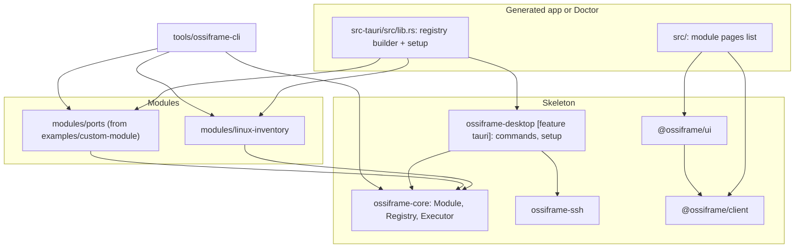
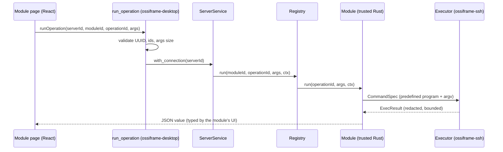

# Design Document: S02 Modules and Project Generator

## Overview

S02 turns the S01 foundation into a reusable framework. It adds a minimal public module contract to `ossiframe-core`, moves Doctor's inventory code into a module crate, moves the shared Tauri commands and connection UI out of Doctor into `ossiframe-desktop` and `@ossiframe/{client,ui}`, and adds a starter template, a repository-local generator (`ossiframe-cli`) and a custom module example.

Goal: a third-party developer runs one command, gets an independent app outside the Ossiframe repository, selects modules, adds their own module, and connects to an authorized server, without editing Core.

Scope boundaries: no provisioning, Laravel, Deploy app, auditing rules (S03), npm/crates.io publishing, dynamic plugins, or marketplace. New crates are only `ossiframe-mod-linux-inventory`, `ossiframe-cli`, and the example module crate.

Read first (S01 state this design builds on):
- `ossiframe-core`: `CommandSpec`, `Executor`/`CancelToken`/`ExecError`, validated identifiers. `serde_json` is a dev-dependency only today.
- `ossiframe-desktop`: no Tauri dependency. `ServerService::with_connection(id, |conn, cancel| ...)` serializes work per server, handles cancel and lost connection. `ipc::IpcError` is the serialized error type.
- `apps/doctor/src-tauri`: ten commands in `commands.rs`, `lib.rs` setup builds `Store` at `doctor.sqlite3`, `KeychainVault` with service `dev.ossiframe.doctor` (equal to the app identifier), `TauriEvents`. `build.rs` lists the commands in an `AppManifest`; `capabilities/main.json` grants `allow-<command>`. CSP is `default-src 'none'; script-src 'self'; style-src 'self'; ... connect-src ipc: http://ipc.localhost`.
- `inventory/{mod,parse}.rs` depend only on `ossiframe-core` (plus serde) and carry the probe tests.

## Architecture



Dependency direction stays App → Modules → Core. Modules depend only on `ossiframe-core` (never on `ossiframe-desktop` or `ossiframe-ssh`). Doctor never depends on Deploy.

### Request path for a module operation



## Components and Interfaces

### 1. Module contract in `ossiframe-core` (`module.rs`, `registry.rs`)

Added dependency: `serde_json` (moved from dev-dependencies). No other new dependency.

```rust
/// Lowercase ASCII `[a-z][a-z0-9-]{0,62}`; validated on construction.
pub struct ModuleId(String);
/// Same character rules as ModuleId. Operation names are fixed per module.
pub struct OperationId(String);

pub struct ModuleManifest {
    pub id: ModuleId,
    pub name: String,
    pub version: String,            // module crate version
    pub description: String,
    pub dependencies: Vec<ModuleId>,
}

pub struct OperationInfo { pub id: &'static str, pub description: &'static str }

/// Everything an operation may use. There is no other way to reach a server.
pub struct OperationContext<'a> {
    pub exec: &'a dyn Executor,
    pub cancel: &'a CancelToken,
    pub observed_at: String,        // RFC 3339, set by the dispatcher
}

pub enum OperationError {
    InvalidArguments(String),       // module rejected args
    Exec(ExecError),                // Timeout, Cancelled, ConnectionLost, Channel
    Failed(String),                 // short, redacted message; never raw output
}

#[async_trait]
pub trait Module: Send + Sync {
    fn manifest(&self) -> ModuleManifest;
    fn operations(&self) -> &'static [OperationInfo];
    /// Called only with an `operation` listed in `operations()`.
    async fn run(
        &self,
        operation: &str,
        args: serde_json::Value,
        ctx: &OperationContext<'_>,
    ) -> Result<serde_json::Value, OperationError>;
}
```

Registry:

```rust
pub struct RegistryBuilder { modules: Vec<Box<dyn Module>> }
impl RegistryBuilder {
    pub fn register(self, m: impl Module + 'static) -> Self;
    pub fn build(self) -> Result<Registry, RegistryError>;
}
pub struct Registry { /* modules in resolved order */ }
impl Registry {
    pub fn builder() -> RegistryBuilder;
    pub fn manifests(&self) -> Vec<ModuleManifest>;           // resolved order
    pub async fn run(&self, module: &ModuleId, op: &OperationId,
                     args: serde_json::Value, ctx: &OperationContext<'_>)
        -> Result<serde_json::Value, RunError>;              // UnknownModule | UnknownOperation | Operation(OperationError)
}
pub enum RegistryError {
    DuplicateId(ModuleId),
    MissingDependency { module: ModuleId, dependency: ModuleId },
    Cycle(Vec<ModuleId>),
    DuplicateOperation { module: ModuleId, operation: String },
}
```

Dependency resolution: Kahn's algorithm over module ids. The ready set is a `BTreeSet`, so the order is deterministic (dependencies first, ties by id). Duplicate ids and missing dependencies are checked before ordering. Cycles are reported with the ids that remain unresolved. The generator reuses `RegistryBuilder::resolve(&[ModuleManifest]) -> Result<Vec<ModuleId>, RegistryError>`, a pure function over manifests, so the CLI and the runtime registry share one implementation.

The manifest is metadata. It grants nothing and restricts nothing. The `Module` trait has no `mutating`/`privilege` field in S02 because no operation is mutating; S04 revisits the contract through a spec update.

Registration is explicit in the app's `lib.rs`:

```rust
let registry = Registry::builder()
    .register(ossiframe_mod_linux_inventory::LinuxInventory)
    // {{modules}} generator inserts further `.register(...)` lines here
    .build()
    .expect("module registry");   // fails at startup with a readable message
```

### 2. How module operations reach the UI: decision

| | (a) Generic `run_operation` | (b) Per-module Tauri commands |
|---|---|---|
| Adding a module | Add dependency + one `register` line | Also edit `build.rs` command list, `capabilities`, `generate_handler!`, hand-written command wrappers |
| Generator complexity | Low (no ACL file edits) | High (rewrite three Rust/JSON files per module) |
| ACL granularity | One command; the allowed set is "registered modules" | Per-command Tauri permission |
| Typed IPC | Result is JSON; typed by module UI | Typed per command |
| Boilerplate for module authors | Implement `Module` only | Module + command + permission |

Recommendation: **(a)**. Command: `run_operation(serverId, moduleId, operationId, args) -> serde_json::Value`.

Security properties (stated as they are):
- The frontend can name only `(module, operation)` pairs compiled into the app. Unknown names return `NotFound`. It cannot pass a program, argv, shell string, file path to read, URL or privilege level at the IPC layer.
- `args` is opaque JSON validated by the module. A module that interprets `args` carelessly (for example building argv from a user string) is a defect in trusted code, not prevented by the framework. Modules must build `CommandSpec` from fixed programs and typed, validated values.
- All S02 operations are read-only because the included modules use only predefined read commands. This is a property of the modules, not enforced by the registry or manifest. Doctor includes only read-only modules.
- Per-operation Tauri ACL is lost compared with (b). Mitigation: apps choose which modules they include; the starter and Doctor include only read-only ones. S04 must add a privilege check in the executor and an explicit mutating-operation marker before any mutating module exists.
- Dispatcher limits: server id must be a UUID, module/operation ids must parse as `ModuleId`/`OperationId`, serialized `args` ≤ 16 KiB, result ≤ 1 MiB (larger result becomes `Failed`). Remote output is data and is rendered by pages as text.
- Approved boundaries: operations resolve only from the app's compiled registry, and unknown modules or operations are rejected. `args` are validated in Rust by the module. The frontend never supplies shell commands, executables or filesystem paths, and Executor functionality is not exposed through IPC. All S02 operations are read-only by design. Module metadata is not a sandbox. No privileged or mutating operation exists in S02, and no permission framework is added. S04 must add explicit authorization and approval boundaries before any mutating or privileged operation.

### 3. `modules/linux-inventory` (`ossiframe-mod-linux-inventory`)

- `git mv apps/doctor/src-tauri/src/inventory/{mod.rs,parse.rs}` into `modules/linux-inventory/src/{inventory.rs,parse.rs}`; `lib.rs` adds the `LinuxInventory` module struct. The probe table, parsers, bounds and both test modules move unchanged.
- Manifest: id `linux-inventory`, no dependencies. One operation: `server-info`, no args (any non-null `args` is `InvalidArguments`), returns the existing camelCase `ServerInfo` JSON, so `@ossiframe/client`'s `ServerInfo` type and the Overview page keep working.
- `run` calls `collect(ctx.exec, ctx.cancel, ctx.observed_at.clone())`; `ExecError` maps to `OperationError::Exec`.
- Crate dependencies: `ossiframe-core`, `serde`, `async-trait`; dev: `tokio`.
- Doctor change: `get_server_info` command and its `observed_now` helper are removed. The UI calls `runOperation(id, "linux-inventory", "server-info", null)`. The error mapping (timeout, cancelled, connection lost) is unchanged because it goes through the same `with_connection`.
- Module UI: the Overview page moves to `modules/linux-inventory/ui/` (section 6). Doctor consumes the module only through public interfaces. SSH transport, credential storage and inventory parsing are not rewritten, the move relocates code, and the Doctor UI is not redesigned.

### 4. Shared Tauri plumbing in `ossiframe-desktop` (feature `tauri`)

Cargo: `[features] tauri = ["dep:tauri", "dep:serde_json"]`; `tauri = { version = "2", optional = true, default-features = false }`. Default build has no Tauri and S01's tests still run without it. New file `src/tauri_support.rs` behind `#[cfg(feature = "tauri")]`, with `pub mod commands`.

```rust
pub struct AppSetup<'a> { pub db_file: &'a str, pub registry: Registry }

/// Opens the store in app_data_dir, uses the app identifier from tauri.conf.json
/// as the keychain service name, builds ServerService with TauriEvents, and
/// manages both ServerService and Arc<Registry> as Tauri state.
pub fn setup(app: &mut tauri::App, cfg: AppSetup) -> Result<(), Box<dyn std::error::Error>>;

/// Names for AppManifest::commands in the app's build.rs.
pub const COMMAND_NAMES: &[&str] = &[
    "list_servers", "add_server", "update_server", "remove_server", "connect_server",
    "disconnect_server", "trust_host_key", "replace_host_key", "cancel_operation",
    "run_operation", "list_modules",
];
```

- Moved from `apps/doctor/src-tauri/src/commands.rs` without behavior change: the nine server/connection commands, `is_uuid`, `server_id`, `token`, the `TauriEvents` struct and `StatePayload`/`LostPayload`, and the `ids_and_tokens_are_validated` test. Added: `run_operation` and `list_modules` (returns manifests and operation lists, so pages can show what a module offers).
- Doctor keeps `db_file = "doctor.sqlite3"` so existing local data stays valid. The starter uses `app.sqlite3`. The keychain service name equals the app identifier (Doctor already satisfies this: `dev.ossiframe.doctor`), so a generated app never shares secrets with another app.
- App wiring after the change:

```rust
// lib.rs of any app
tauri::Builder::default()
    .setup(|app| ossiframe_desktop::tauri_support::setup(app, AppSetup { db_file: "app.sqlite3", registry: build_registry() }))
    .invoke_handler(tauri::generate_handler![
        ossiframe_desktop::tauri_support::commands::list_servers,
        // ... same list as COMMAND_NAMES
    ])
```

- **Assumption (to verify in the first task, not yet verified):** commands defined in a library crate can be listed in an app's `generate_handler!`. Reading `tauri-macros 2.x` shows that `pub` commands get `#[macro_export]` for the `__cmd__*` macro, which suggests cross-crate paths work, but no build has confirmed it with Tauri 2.12.7. `AppManifest::commands` takes only names, so it is independent of where the functions live. The ACL requires the app's own `build.rs` and `capabilities/main.json` either way. Fallback if the spike fails: `ossiframe-desktop` exports a `macro_rules! ossiframe_commands` that expands to wrapper `#[tauri::command]` fns inside the app crate; if that also fails, apps keep thin one-line command wrappers (still sharing all logic).
- The `COMMAND_NAMES` list and the `allow-*` entries in each app's capability file can drift. Mitigation: a small unit test in the starter and Doctor crates reads `capabilities/main.json` and asserts every `COMMAND_NAMES` entry has an `allow-` permission and no other `allow-` entries exist beyond the app's own.

### 5. Shared React code

`@ossiframe/client` (non-visual): `api.runOperation(serverId, moduleId, operationId, args)`, `api.listModules()`, remove `getServerInfo`. New hook `useServerConnections()` holds the connection flow now in `apps/doctor/src/App.tsx`: server list refresh (15 s interval, `connection-state`/`connection-lost` events), `connect`, the in-memory pending credential rule (cleared when the flow ends or is superseded), dialog state machine (`form | credential | hostKey | changed | remove`), and per-server busy/error/warning maps. It returns state plus actions, and no JSX.

`@ossiframe/ui` (visual): moves `ServerForm`, `CredentialDialog`, `HostKeyDialog`, `HostKeyChangedDialog`, `ConfirmRemoveDialog`, `format.ts` (`errorMessage`, `duration`, `gib`, ...), `StateBadge`, plus a `ServerWorkspace` component: server list sidebar, add/edit/remove/connect/disconnect buttons, all dialogs, and a `children({ server, connected })` render slot. `@ossiframe/ui` gains a dependency on `@ossiframe/client` (types and `errorMessage`). No restyling and no new UI libraries; text rendering of remote data is unchanged and `react/no-danger` stays enforced.

Doctor's `App.tsx` shrinks to `<ServerWorkspace>{(ctx) => <ModulePages ... />}</ServerWorkspace>`, where the `linux-inventory` page is the Overview, imported directly from `modules/linux-inventory/ui/`. Behavior (connect, host key, changed key, credential prompts, cancel, stale marking) stays identical; it is moved, not rewritten.

### 6. Module UI (optional per module)

Frontend pieces are optional. A backend-only module is valid, and an app can build its own UI from operation results typed through the `@ossiframe/client` `runOperation` wrapper. A module that wants a page includes a plain `ui/` folder of `.tsx` files next to its crate (no pnpm package, no `package.json`). The page entry file exports:

```ts
export interface ModuleUi {
  id: string;                 // equals the Rust module id
  title: string;
  Page: (p: { serverId: string; connected: boolean }) => ReactNode;
}
export const moduleUi: ModuleUi;
```

The app lists pages explicitly in `src/modules.ts`: `export const pages: ModuleUi[] = [linuxInventory, ports]`. `ServerWorkspace` shows them as tabs. Pages call `api.runOperation` themselves and own their result types. Alternatives (a pnpm package per module, Rust-side UI descriptors, runtime-loaded bundles) are rejected as extra machinery or dynamic loading.

- Doctor imports `modules/linux-inventory/ui/` directly by relative path. The files import `@ossiframe/ui` and `@ossiframe/client`; task 7.3 verifies that these resolve from that location (otherwise add a Vite alias and tsconfig `paths` entry in Doctor).
- The Generator copies a selected module's `ui/` files into `<app>/src/modules/<id>/` and adds the import and `pages` entry only if the folder exists (section 8). There the imports resolve through the app's vendored `packages/`.

### 7. Starter template `templates/starter/`

```text
templates/starter/
  package.json  pnpm-workspace.yaml  tsconfig.json  eslint.config.js  .gitignore  README.md
  index.html  vite.config.ts
  src/{main.tsx,App.tsx,modules.ts,index.css}
  src-tauri/{Cargo.toml,build.rs,tauri.conf.json,capabilities/main.json,src/{main.rs,lib.rs},icons/*}
  .kiro/steering/{product.md,tech.md,structure.md}
  .kiro/skills/ossiframe-module/SKILL.md
```

- `tauri.conf.json`: `productName` and `identifier` from placeholders; CSP strings, `freezePrototype`, `withGlobalTauri: false` and capability `main` copied from Doctor character for character (a unit test in the CLI compares the CSP value with Doctor's `tauri.conf.json` so they cannot diverge silently). `capabilities/main.json` grants `core:event:default` and the `allow-*` for `COMMAND_NAMES` only.
- Placeholders: `{{product_name}}`, `{{identifier}}`, `{{package_name}}` (kebab-case), `{{lib_name}}` (snake_case), `{{ossiframe_deps}}` (whole-line token expanding to the `ossiframe-core` and `ossiframe-desktop` dependency lines: git with `rev` in Standalone_Mode, plain `path` in Local_Mode), `{{module_deps}}`, `{{module_registrations}}`, `{{module_ui_imports}}`, `{{module_ui_list}}`. Files only contain these tokens in places where they are plain strings or comments.
- `App.tsx`: `ServerWorkspace` with a built-in `Connection` tab and one tab per selected module that has a page. The starter generates and builds with zero modules (`Registry::builder().build()`). The `Connection` tab shows server profile, endpoint, connection state and pinned fingerprint from the existing server list data (task 8.1 confirms the fingerprint field is available). `linux-inventory` is optional: its registration, dependency and Overview page appear only when selected.
- `.kiro/steering` for the generated app: short files: product (what the app is, local-first, read-only default), tech (Tauri 2, Rust, React, how Ossiframe crates are pinned), structure (where modules live, "do not edit vendored `packages/`"). They state the rules the app inherits: structured commands only, secrets only in keychain, typed operations only.
- `SKILL.md` (`ossiframe-module`): how to write a module with the public SDK: implement `Module`, manifest rules, build `CommandSpec`, bound and parse output, validate args, tests with a fake `Executor`, register, add a UI page, rebuild. Under ~120 lines, with the ports module as the worked example.
- Icons: copied from Doctor's `icons/` into the template (binary files copied by the generator without substitution).

### 8. Generator `tools/ossiframe-cli`

```text
cargo run -p ossiframe-cli -- new <dir> --name "<Product Name>" --identifier <reverse.dns.id>
    [--modules linux-inventory,...] [--with-example-module]
    [--rev <sha|tag>] [--ossiframe-local <path>]
```

Crate dependencies: `ossiframe-core`, `ossiframe-mod-linux-inventory`, `ossiframe-mod-ports-example` (to read manifests), `clap` (derive) for arguments. No template engine: a ~30 line function replaces `{{key}}` tokens and fails if any unknown token or leftover `{{` remains in a text file.

Steps in `new`:

```pascal
PROCEDURE generate(args)
  name       <- validate_name(args.name)          // 1-64 chars, starts with a letter, [A-Za-z0-9 _-] only
  identifier <- validate_identifier(args.identifier) // >= 2 dot-separated segments, each [a-z][a-z0-9-]*, <= 128 chars, not ending ".app"
  dir        <- validate_dir(args.dir)            // absent, or an existing EMPTY directory; else refuse. Never writes into a non-empty dir
  selected   <- explicitly named module ids (may be empty); add example if --with-example-module
  manifests  <- builtin manifests (from the module crates) + example manifest
  selected   <- selected plus required dependencies from manifests   // nothing else is included
  order      <- RegistryBuilder::resolve(manifests of selected)   // same code as runtime
  IF resolve fails (unknown id, unknown dependency, cycle) THEN abort, nothing written
  rev        <- args.rev OR `git rev-parse HEAD`; IF working tree is dirty AND no --rev AND no --ossiframe-local THEN refuse
  render templates/starter into a temp sibling directory
  copy vendored packages: packages/ui, packages/client -> <dir>/packages/ ; selected modules' ui/ files (if present) -> <dir>/src/modules/<id>/
  IF example selected THEN copy examples/custom-module -> <dir>/modules/ports (crate + ui) with path deps
  rename temp dir to <dir>                         // all-or-nothing
```

- The template is read from `templates/starter/` at run time (the CLI is repo-local), which settles the ADR-0007 question "embedded vs read from disk". The repo root is found from `CARGO_MANIFEST_DIR`.
- Module paths and names go through the validated types before use. Output paths are built from validated components only; no `..` or absolute segments from user input beyond `<dir>` itself, which the user chose.
- Module lines per selected module `m` (in resolved order): Cargo dependency (git for built-in, path for the vendored example) and `.register(...)` line, plus TS import and `pages` entry only if the module has a `ui/` folder.

### 9. Distribution of generated apps

- Rust (Standalone_Mode): `ossiframe-core`, `ossiframe-desktop` (`features = ["tauri"]`) and each built-in module are Git dependencies:
  `ossiframe-core = { git = "https://github.com/shojibur/Ossiframe", rev = "<40-hex>" }`. All crates use the same `rev`, so Cargo clones once and the workspace-inherited versions resolve.
- Frontend: `@ossiframe/ui` and `@ossiframe/client` are copied into `<dir>/packages/` and `pnpm-workspace.yaml` lists `packages/*`. Dependencies use `workspace:*`. No relative path points outside `<dir>`.
- Two modes. **Local development**: `--ossiframe-local`. **Standalone**: exact public Git `rev`, no monorepo checkout. No npm or crates.io publishing in either mode.
- `rev` default is the local HEAD. If the working tree has uncommitted changes and neither `--rev` nor `--ossiframe-local` is given, the generator refuses. The generated app builds only if the commit is a Published_Rev. The CLI does not check the remote (no network). The README and the CLI output state this.
- Each generated app gets its own name, identifier, data directory and keychain service namespace (both from the validated identifier), selected modules, build config, README and `.kiro` guidance. Frontend packages are copied, not published.
- `--ossiframe-local <path>`: Cargo `[patch]` does not avoid fetching the original git source, so the generator renders plain path dependencies in the app's `src-tauri/Cargo.toml`, with no git source and no `[patch]` section:

```toml
ossiframe-core = { path = "<canonical local checkout>/crates/ossiframe-core" }
# ...one line per Ossiframe crate used; module crates use their local paths
```

  Standalone mode renders `{ git = "https://github.com/shojibur/Ossiframe", rev = "<40-hex>" }` instead. This is Local_Mode. Its success is not proof that Standalone_Mode works. The generated README marks it "local testing only; remove before sharing", and the CLI prints the same warning. The path must be an existing Ossiframe checkout (checked for `crates/ossiframe-core/Cargo.toml`).
- Completion needs a generated app built outside the repo from a Published_Rev, with every dependency (including selected modules) resolving without the monorepo. A dirty local checkout is not proof. Pushing the commit needs the user's explicit approval: the task stops and requests it, and the agent never pushes.

### 10. Custom module example `examples/custom-module/`

Crate `ossiframe-mod-ports-example`, module id `ports`, depends on `ossiframe-core` only, with manifest dependency list empty.

- Operation `listening-tcp`: runs `ss -Htln` (fixed program and args, 10 s timeout) via `ctx.exec`, parses each line into `{ localAddress, port, process: null }`. The `-p` flag is not used because process names need privilege (S02 is unprivileged). Parser bounds: input cut at 64 KiB, at most 512 entries, address field ≤ 128 chars, control characters stripped, unparsable lines skipped and counted in `skipped`. Result: `{ observedAt, sockets: [...], skipped, truncated }`.
- Args: `null` or `{ "family": "ipv4" | "ipv6" | "all" }` (default `all`). Any other shape, unknown key or unknown value is `InvalidArguments`, validated in Rust with a typed enum (`serde(deny_unknown_fields)`). The filter applies to parsed sockets and never reaches argv; the `ss` command stays fixed.
- Boundaries: the module lives outside Core, consumes only the public SDK, is registered explicitly in the app, imports nothing from Doctor, and adding it requires no Core change. Results are structured; discovery is real, through the predefined `ss` command.
- Tests (plain): parser on sample `ss` output for IPv4, IPv6 (`[::]:22`), `*:80`, wildcard, malformed lines, oversized input; module test with a fake `Executor`.
- UI (optional custom page): `examples/custom-module/ui/` holds `.tsx` files (no package): a family selector and a table using `@ossiframe/ui` (`KeyValue`, `Mono`, `Notice`) that renders addresses and ports as text. The generator copies them to `src/modules/ports/` when the example is selected.
- Use of public APIs only is checked by its `Cargo.toml` (depends only on `ossiframe-core`, `serde`, `async-trait`). With `--with-example-module` the generator copies it to `<dir>/modules/ports/` and rewrites its dependency on `ossiframe-core` to the same source as the app (git `rev` in Standalone_Mode, local `path` in Local_Mode). The app always references it as `path = "../modules/ports"` inside the generated app, in both modes. The example stays in the monorepo workspace as a normal member so it is compiled and tested in CI.

### 11. Workspace and Doctor changes

- Root `Cargo.toml`: `members = ["crates/*", "modules/*", "examples/*", "tools/*", "apps/doctor/src-tauri"]`, `exclude = ["templates"]`. Root `pnpm-workspace.yaml` is unchanged: module `ui/` folders are plain source folders, not packages.
- Doctor `src-tauri/Cargo.toml`: depends on `ossiframe-desktop` (`features = ["tauri"]`), `ossiframe-mod-linux-inventory`, and drops `serde_json`, `time` and the inventory code. `build.rs` uses `COMMAND_NAMES` copied as a literal list (a `build.rs` cannot depend on the library it builds without pulling heavy crates; the drift test above covers it).
- Doctor keeps its `tauri.conf.json`, CSP and identifier unchanged.

### 12. Developer quick-start doc

One file, `docs/developer-guide.md` (README gets a two-line link, not a copy). Sections: generate an app, pin Ossiframe or use a local checkout, run `pnpm install && pnpm tauri dev`, write a module (links to the skill), register it, add its page, test with a fake executor, build. Under ~150 lines. Reason for a separate file: the README stays product-level, and the guide can be linked from generated apps.

## Data Models

- `ModuleId`/`OperationId`: validated string newtypes (`[a-z][a-z0-9-]{0,62}`), `Display`, no `Deserialize` shortcut that bypasses validation.
- `ModuleManifestDto` for `list_modules`: `{ id, name, version, description, dependencies: string[], operations: [{ id, description }] }` (camelCase).
- Operation results are `serde_json::Value`; each module documents its JSON shape and mirrors it in its UI package types.
- No new SQLite tables. No secrets in any new type.

## Error Handling

| Condition | Result |
|---|---|
| Registry build: duplicate id, missing dependency, cycle | App fails at startup with the typed error text; generator aborts before writing |
| Unknown module or operation from the frontend | `IpcError::NotFound` (module and operation ids carry no secrets) |
| Invalid server id | `NotFound` (existing behavior) |
| `args` too large or module rejects args | `IpcError::Validation { field: "args", message }` |
| `ExecError::{Timeout, Cancelled, ConnectionLost}` | Mapped to existing `commandTimeout`, `cancelled`, `connectionLost` kinds. Timeout still says the command may still be running |
| `OperationError::Failed` | `IpcError::Internal`-class error with a short message; raw command output is never included |
| Result larger than 1 MiB | `Failed("result too large")` |
| Generator: bad name/identifier, non-empty directory, unknown module, bad `--ossiframe-local` path | Exit non-zero with one-line reason; nothing is written or the temp directory is removed |
| `git` unavailable and no `--rev` | Exit with a message asking for `--rev` |

`IpcError` and `@ossiframe/client`'s `KINDS` need no new kinds.

## Testing Strategy

Small plain unit tests only, for high-risk logic. No property-testing framework, fixtures suites or e2e suites.

- `ossiframe-core`: registry rejects duplicate ids, missing dependency, cycle; order is dependencies-first and deterministic; `ModuleId` rejects uppercase, empty, `..`, spaces, over-length; unknown operation is not dispatched.
- `ossiframe-desktop` (tauri feature): moved `ids_and_tokens_are_validated` test; `run_operation` rejects non-UUID server id, bad ids and oversized args before touching the service.
- `linux-inventory`: all S01 inventory and parser tests moved unchanged and passing.
- `ports` example: parser bounds and malformed input; `family` args validation (valid, unknown value, unknown key, wrong type); fake-executor module test.
- `ossiframe-cli`: zero-module generation, required dependencies auto-included, refusal on a dirty tree without `--rev`/`--ossiframe-local`, name/identifier/dir validation with hostile inputs (`../x`, quotes, `\`, `"; rm`, empty, unicode control chars), refusing a non-empty dir, token replacement rejects leftovers, generated `tauri.conf.json` CSP equals Doctor's, generated `Cargo.toml` has no `path =` entry pointing outside the project (unless `--ossiframe-local`).
- Capability drift test in Doctor and the starter (section 4).

## Security Considerations

- IPC remains intent-level and typed. `run_operation` is not a generic shell: it dispatches only to compiled-in `Module::run` implementations.
- Secrets handling, host key pinning, and the keychain-service-per-app-identifier rule are unchanged. A generated app's identifier is validated, so its keychain service and data directory cannot collide with Doctor's unless the user chooses the same identifier; the CLI rejects `dev.ossiframe.*` unless `--allow-ossiframe-namespace` is given (only for maintainers).
- Modules are trusted code. A third-party module can do anything its process can. The README and `SKILL.md` say so. The manifest is not a sandbox.
- Generated apps pin an exact commit, so a moving branch cannot change their dependencies. `pnpm` and `cargo` lockfiles are created on first build and should be committed by the app's owner.
- CSP and capabilities of generated apps are as strict as Doctor's: no fs, shell, http, opener or dialog plugins.
- Remote output, including `ss` output, is data: bounded, parsed in Rust, rendered as text.

## Performance Considerations

No new runtime cost beyond one JSON serialization per operation. The generated app's size and memory match Doctor (same stack). The generator copies fewer than ~100 small files and is not performance-sensitive.

## Dependencies

New: `serde_json` (core, runtime), `tauri` (optional feature in `ossiframe-desktop`), `clap` (CLI only). Each is maintained and permissively licensed (MIT/Apache-2.0); confirm with `cargo audit`/`cargo deny`-style review in the verification step. No new frontend runtime dependency.

## Verification Plan

Quality gates (all must pass): `cargo fmt --all --check`, `cargo check --workspace --all-targets`, `cargo clippy --workspace --all-targets -- -D warnings`, `cargo test --workspace`, `pnpm -r typecheck`, `pnpm -r lint`, `cargo audit`, `pnpm audit`, production builds of Doctor (`pnpm --filter @ossiframe/doctor tauri build`) and of the generated app, plus `shellcheck` for any scripts added.

Manual verification, recorded in `docs/verification/s02-modules-and-generator.md` with real output only:
1. Spike: build Doctor with commands in `ossiframe-desktop` (answers the section 4 assumption). Record the result either way.
2. Build Doctor and confirm same UI behavior against the AWS Lightsail Ubuntu 24.04 server (`<server-ip>`, user `ubuntu`, key `<key-path>`; read-only, a disposable server the user named): connect, host key prompt, overview with real data.
3. Local_Mode: with `--ossiframe-local`, generate outside the repository a minimal app (`... new ~/ossiframe-test/min --name "Min Ops" --identifier dev.example.min`) and an app with modules (`... new ~/ossiframe-test/acme --name "Acme Ops" --identifier dev.example.acme --modules linux-inventory --with-example-module`). Run `pnpm install` and `pnpm tauri build` in each.
4. Connect both apps to the Lightsail server. Minimal app: basic connection info. Acme app: `linux-inventory` overview and the `ports` page with real listening sockets (user compares with `ss -tln` run on the server). Record as Local_Mode only.
5. Confirm Doctor's registry contains only `linux-inventory`, and that each generated app exposes only the eleven `COMMAND_NAMES` (inspect `capabilities/main.json`).
6. Standalone_Mode: stop and ask the user to approve pushing the commit (the agent never pushes). After the user publishes, generate with `--rev <published sha>` and no `--ossiframe-local`, in a directory with no monorepo checkout, run `pnpm install` and `pnpm tauri build`, and `grep` the manifests to confirm every Ossiframe dependency, including selected modules, resolves from the Git rev. A dirty local checkout is not proof.
7. Record what was not verified, including the open S01 checks (independent fingerprint comparison through the Lightsail console pending; password authentication unverified and disabled). These do not block S02 completion.

Nothing is claimed as verified until recorded here.

## Open Decisions

| Decision | Recommendation | Needs user approval |
|---|---|---|
| IPC dispatch: generic `run_operation` vs per-module commands | Generic `run_operation`; per-operation ACL is traded for simpler module addition; revisit before S04 mutating operations | Approved, with the boundaries in section 2 |
| Distribution | Two modes: `--ossiframe-local` for development, exact public Git `rev` for standalone | Approved. Publishing the commit still needs explicit user approval at task 14.1 |
| Shared Tauri commands in `ossiframe-desktop` behind a `tauri` feature | Yes, matches structure.md; fallback macro or thin wrappers if cross-crate `generate_handler!` fails the spike | No, unless fallback is used |
| Module UI | Optional `ui/` folder of `.tsx` files per module, copied by the generator to `src/modules/<id>/` only when selected; no per-module package | Approved |
| `linux-inventory` in generated apps | Optional; the starter works with zero modules | Approved |
| `--allow-ossiframe-namespace` flag | Include, to stop accidental keychain/data collisions with Doctor | No |
