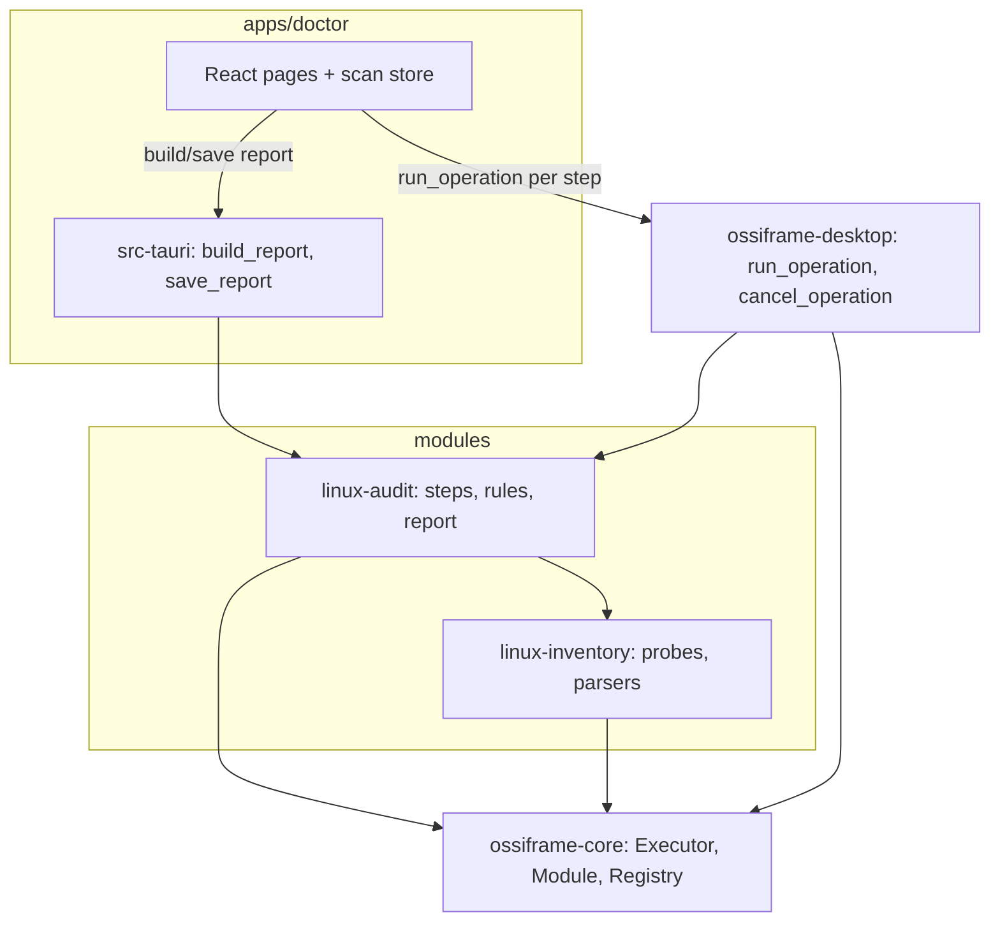
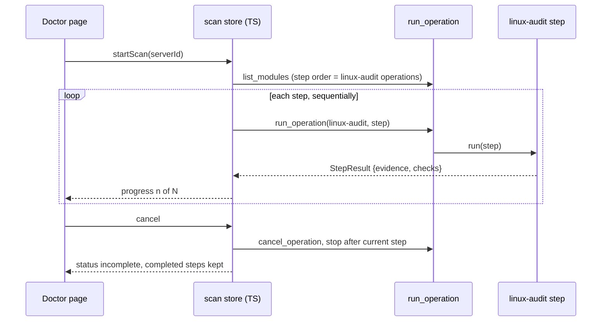

# Design Document: Ossiframe Doctor (S03)

## Overview

Doctor is an independent, local-first, read-only diagnostics and auditing app for existing Linux servers. It already exists as a shell (`apps/doctor`) that connects over SSH and shows `linux-inventory` `server-info`. S03 turns it into a real assessment tool: extended discovery (resources, services, listening sockets, installed software), a fixed set of evidence-based checks, and a reviewable JSON/HTML report.

No new framework layer is added. The work reuses the S02 `Module` contract, `Registry`, `run_operation`, the Core `Executor`, `ServerWorkspace` and the generator. Two module changes carry the feature:

1. `modules/linux-inventory` gains discovery operations and an extended `server-info` (additive; existing fields stay).
2. A new crate `modules/linux-audit` (`ossiframe-mod-linux-audit`) depends on `linux-inventory` as a Rust library and holds all audit rules as plain functions.

The only Doctor-specific Rust additions are two Tauri commands for reports (`build_report`, `save_report`). Every remote command is a predefined `CommandSpec` run through the existing executor. No sudo, no mutation, no remediation.

Out of scope: provisioning, package install, config editing, service/firewall/SSH mutation, remediation, AI diagnostics, continuous monitoring, backends, multi-user, alerting, dynamic plugins, Deploy, PDF.

## Architecture



Dependency direction stays App → Modules → Core. `linux-audit` has `dependencies: [linux-inventory]` in its manifest, so `Registry::build` and the generator resolve it. Doctor registers both modules explicitly in `src-tauri/src/lib.rs`.

### Scan flow



## Components and Interfaces

### 1. `linux-inventory` additions

Operations (all take `null` args, as `server-info` does today):

| Operation | Commands (fixed argv, 10 s timeout each) | Result |
|---|---|---|
| `server-info` (extended) | existing probes plus `cat /proc/stat` twice with a cancel-aware `tokio::time::sleep(1s)` between, `df -P -B1 -x tmpfs -x devtmpfs -x squashfs -x overlay -x efivarfs -x proc -x sysfs -x cgroup2 -x devpts -x ramfs` | existing fields plus `swapTotalKb`, `swapFreeKb` (from `/proc/meminfo`), `filesystems[]`, `filesystemsTruncated`, `cpuUsagePercent` |
| `services` | `systemctl list-units --type=service --all --no-pager --output=json`, `systemctl list-unit-files --type=service --no-pager --output=json` | `services[]` merged by unit name: unit, description, installed, load, active, sub, enablement (`unknown` when systemd reports none); `truncated` |
| `listening-sockets` | `ss -H -tulnp` | `sockets[]`: protocol, local address, port, family, binding class, process (name, pid) or null |
| `software` | `dpkg-query -W -f '${Package}\t${Version}\t${db:Status-Abbrev}\n' <fixed names>` | `packages[]`: name, version. Only status `ii`. |

Decisions:
- Filesystems: only meaningful ones. Pseudo types are excluded by `df -x`; zero-size entries and mounts under `/snap/` or `/var/lib/snapd/snap/` are dropped in the parser.
- Services: `list-units --all` gives loaded units with active/sub state; `list-unit-files` gives installed units with enablement. The two lists are merged by unit name. A unit that is installed but not loaded has `load`, `active` and `sub` of `unknown`, never a guessed value. Inactive and disabled units are normal and are never findings.
- `rootFs` stays and is derived from `filesystems`, so the existing Overview and generated apps keep working. `cpuUsagePercent` is `null` when either sample is missing, unparsable, or the delta is zero. It is never estimated. `server-info` now takes about 1 s longer.
- systemd JSON: `--output=json` for `list-units` and `list-unit-files` is expected on systemd 255 (Ubuntu 24.04). This is confirmed against the official systemd docs and on the real server in task 5. A `--plain --no-legend` fallback is not built unless that check fails. Unparsable output yields an `unavailable` result, not a guess.
- `ss -p` shows process names only for sockets visible to the SSH user. Others have `process: null` and are never described as "no process".
- Binding class: `loopback` (`127.0.0.0/8`, `::1`), `wildcard` (`0.0.0.0`, `::`, `*`), `specific` (anything else). Zone suffixes such as `%lo` are stripped before classification.
- Package list: `nginx apache2 php*-fpm php*-cli composer nodejs python3 mysql-server mariadb-server postgresql redis-server docker.io docker-ce git`. Exit code 1 with partial stdout is normal (some names not installed). The evidence is the dpkg database. Software installed outside dpkg (nvm, phar files, source builds) is not detected and the UI says so. Version commands (`nginx -v`) are not run.
- The example `ports` module keeps its own parser. It is a standalone third-party example and is not made to depend on inventory.
- Caps: 500 services, 300 sockets, 50 filesystems. Worst-case results stay far below `MAX_RESULT_BYTES` (1 MiB). Truncation sets a `truncated` flag and adds a limitation string; rules read the flag so a truncated list never yields `passed`.

New dependency: `tokio` (`time`, `macros`) as a normal dependency of `linux-inventory` (already a workspace dev-dependency). Nothing else.

### 2. `linux-audit` module

```text
modules/linux-audit/src/
  lib.rs        Module impl: manifest, OPERATIONS (= step order), dispatch
  model.rs      CheckResult, StepResult, enums, summary counts
  steps.rs      one async fn per step: collect evidence once, run rules, return StepResult
  rules.rs      pure rule functions: evidence -> Vec<CheckResult>
  sshd.rs       sshd_config reader: Include expansion, first-value-wins, Match detection
  certs.rs      nginx ssl_certificate discovery and openssl expiry parsing
  report.rs     ReportInput -> JSON string / HTML string
```

Operations, in scan order, all with `null` args: `resources`, `services`, `network`, `software`, `ssh`, `firewall`, `updates`, `certificates`. The order of the `OPERATIONS` slice is the step order. Doctor reads it from `list_modules`, so the UI has no second copy of the list.

```rust
pub struct StepResult {
    pub step: String,              // operation id
    pub observed_at: String,       // from OperationContext
    pub evidence: serde_json::Value, // typed per step, see below
    pub checks: Vec<CheckResult>,
}

#[derive(Serialize)]
#[serde(rename_all = "camelCase")]
pub struct CheckResult {
    pub rule_id: &'static str,     // stable, e.g. "mem.low-available"
    pub title: String,
    pub category: Category,        // resources | services | network | security | updates
    pub outcome: Outcome,          // passed | finding | unavailable | incomplete | notApplicable | error
    pub severity: Option<Severity>,// critical|high|medium|low|info, only when outcome = finding
    pub resource: Option<String>,  // mount, unit, port, config key
    pub evidence: Vec<String>,     // <= 10 lines, each <= 200 chars
    pub explanation: String,
    pub recommendation: Option<String>, // advice text only, never executed
    pub observed_at: String,
    pub limitations: Vec<String>,
    pub inferred: bool,            // true when the conclusion goes beyond observed facts
}
```

Step evidence: `resources` → `ServerInfo`; `services` → `{services}`; `network` → `{sockets}`; `software` → `{packages}`; `ssh` → `{files[], values{}, matchBlocks}`; `firewall` → `{ufwConfEnabled}`; `updates` → `{pendingUpdates, pendingSecurity, metadataAgeSeconds, rebootRequired}`; `certificates` → `{certs[]}`. All use the inventory parsers where they overlap. Each step collects its evidence once; a completed scan therefore also fills the Services, Network and Software pages without re-collection.

Error handling inside a step: a failing probe becomes a `CheckResult`, not an operation error.
- `Permission denied` in stderr, or a missing file → `unavailable` (or `notApplicable` when the thing legitimately does not exist, such as no nginx config).
- Unexpected exit status, unparsable output, or `truncated` output → `error` with a short message. Raw output is never returned.
- `Timeout` of one command → `error` for the affected checks; the step continues.
- `Cancelled` and `ConnectionLost` abort the step and propagate as `OperationError::Exec`, so IPC reports them as usual.
- Missing permission is never a pass. Missing data never produces a `passed`.

Outcome `incomplete` is added (chosen over "unavailable plus limitation") so the UI and reports can tell "no usable evidence" (`unavailable`) from "some evidence, limited" (`incomplete`: truncated list, skipped include, skipped certificate, `Match` block, stale cache). Evidence limits stay, but truncated, missing or inaccessible evidence never yields `passed`. Findings found before a limit are kept; when no finding exists and evidence was limited, the outcome is `incomplete`.

Scan execution and assessment coverage are separate. `scanStatus` is `complete` (every step ran to the end) or `incomplete` (cancelled, aborted, or a step failed). `coverage` is counts of assessed (`passed` + `finding`), not assessed (`unavailable` + `incomplete` + `error`) and `notApplicable`. A complete scan with unassessed checks is shown as "Scan complete, N checks not assessed", never as a comprehensive or clean result.

There is no security score. The summary is counts by outcome and by severity, plus coverage.

### 3. Rules (only those with real evidence)

| Rule ID | Evidence | Logic | Notes |
|---|---|---|---|
| `mem.low-available` | `/proc/meminfo` | `MemAvailable` < 10% of total: medium; < 5%: high | A single snapshot, not sustained exhaustion (explanation and limitation). Swap shown as evidence only |
| `disk.low-space` | `df`, one result per meaningful filesystem | used ≥ 80%: medium; ≥ 90%: high; ≥ 95%: critical; available < 100 MiB: high, only for filesystems of at least 1 GiB total size. Highest applicable severity wins | Truncated filesystem list and no finding: `incomplete` |
| `svc.failed` | merged `services` list | each unit with active state `failed`: medium. Complete list and none failed: one passed result. Truncated list and none failed: `incomplete` | Max 20 findings, then a limitation. Inactive, disabled and `unknown` are never findings |
| `net.database-exposed` | `ss` | Potential database listener on port {3306, 5432, 6379, 27017, 11211, 9200}. `loopback`: no finding. `specific` private or link-local (RFC1918, `169.254/16`, `fc00::/7`, `fe80::/10`): low. `wildcard`: medium. Other `specific`: medium, address as evidence | `inferred = true` unless the process is visible and matches. Wording: "listens on a non-loopback address". Never "publicly reachable"; never `high` from port and binding alone; firewalls and cloud rules are not inspected; no external scan. Truncated socket list and no finding: `incomplete` |
| `ssh.password-auth` | `sshd_config` (global part) | first value `yes`, or directive absent in fully read files (default `yes`): medium. `no`: passed with limitation "global setting only; per-user and Match settings not assessed". Never claims it is disabled for every user | `Match` seen: a would-be pass becomes `incomplete` |
| `ssh.root-login` | `sshd_config` (global part) | `yes`: high. `no`: passed. `prohibit-password`, `without-password`, absent (default `prohibit-password`): passed with limitation, text "root login allowed with public key only". `forced-commands-only`: passed with limitation, text "root login allowed for forced commands only" | These values are never described as "root login disabled". Unknown value: `error`, never a safe default. `Match` seen: a would-be pass becomes `incomplete` |
| `fw.ufw-config` | `/etc/ufw/ufw.conf` | `ENABLED=yes`: passed with limitation. `ENABLED=no`: low. File absent or unreadable: `unavailable` | Effective state needs root, so it is never claimed. nftables, iptables and cloud firewalls are not visible |
| `upd.security-pending` | `/var/lib/update-notifier/updates-available` | security updates > 0: medium. Pending non-security: info. Zero pending with stale or unknown metadata age: `incomplete` | File absent: `unavailable`. Labelled "cached update-notifier data, not live repository state", with cache age. Never "fully patched" |
| `upd.metadata-stale` | `stat -c %Y /var/lib/apt/periodic/update-success-stamp`, `date -u +%s` | age > 7 days: low. Stamp missing: `unavailable` | `updates-available` is only as fresh as this stamp; stated as limitation |
| `upd.reboot-required` | `stat -c %Y /var/run/reboot-required` | file exists: info | |
| `tls.cert-expiry` | `openssl x509 -enddate -noout -in <path>` | expired: high; < 14 days: high; < 30 days: medium; discovery or path limits hit with no finding: `incomplete` | See Certificates |

Thresholds are constants at the top of `rules.rs` (approved). No CPU rule exists: one 1 s sample is shown as a value, not judged.

Updates decision (cached data, labelled as such): the step reads the `updates-available` text file and `stat` stamps. It does not run `apt list --upgradable` or `apt-check`, because they load the package cache (tens of MB, seconds of CPU) on a 512 MB host and add little over the file. It never runs `apt update`.

### 4. SSH configuration reader (`sshd.rs`)

- Start at `/etc/ssh/sshd_config` via `cat`. `Include` patterns are expanded the way OpenSSH does: relative paths resolve under `/etc/ssh`, matching files are processed in lexical order, at the position of the `Include` line. Nesting depth ≤ 4, files ≤ 32.
- An include pattern must be absolute (after resolution), match `^/etc/ssh/[A-Za-z0-9._/*-]+$`, and contain no `..`. Files are listed with `find <dir> -maxdepth 1 ( -type f -o -type l ) -name <pattern>` using fixed argv; only the directory part is passed to `find`, the last segment as the `-name` value. Anything else is skipped and recorded as a limitation.
- Keywords are case-insensitive; `Keyword value` and `Keyword=value` are accepted; quotes are stripped. The first value seen wins (OpenSSH semantics).
- This is a limited reader, not a full OpenSSH parser. Unsupported include patterns, and reaching the depth, file-count or size limit, record a limitation and make both SSH rules `incomplete` (a finding already seen is kept). A skipped include is never a pass.
- Once a `Match` line is seen in the flattened stream, directives after it are not collected. Evidence records `matchBlocks: true` and the result says "Match blocks not fully assessed; global value only". The effective setting for matched users is never claimed, and a would-be `passed` becomes `incomplete`.
- If any file in the include chain is unreadable, both SSH rules return `unavailable`, because an unreadable earlier file could have set the value.
- An unrecognized value for a read keyword gives `error` for that rule, never a safe default. Defaults (`PasswordAuthentication yes`, `PermitRootLogin prohibit-password`) apply only when all files were read in full and the directive is absent; the evidence says "default (not set)".
- Always-present limitation: this describes global configuration on disk, not effective per-user settings and not the running daemon. `sshd -T` is not used because it needs root.
- Evidence lines contain only `keyword value` for the two keywords plus the file name. No other config content is returned.

### 5. Certificates (`certs.rs`)

- Discover config with `find /etc/nginx/nginx.conf /etc/nginx/conf.d /etc/nginx/sites-enabled -maxdepth 1 ( -type f -o -type l )` (fixed argv; a missing path is not an error) and `cat` each file (≤ 32 files, 256 KB cap each).
- Extract `ssl_certificate <path>;` directives (not `ssl_certificate_key`). A path is accepted only if it is absolute, ≤ 255 chars, matches `^[A-Za-z0-9._/-]+$`, has no `..` component, and starts with `/etc/letsencrypt/live/`, `/etc/letsencrypt/archive/`, `/etc/ssl/` or `/etc/nginx/`. Paths with variables or other prefixes are skipped with a limitation. ≤ 20 certificates.
- `openssl x509 -enddate -noout -in <validated path>` runs once per certificate. The parsed `notAfter` is compared with `date -u +%s`.
- Scope: only certificates referenced in inspected, readable nginx config. The result never claims a certificate is actively served. Private key files (`ssl_certificate_key`) are never read; whole configs are never returned. A hit file or path limit, an unreadable config file or a skipped path makes the assessment `incomplete` unless a finding exists. No TLS endpoint scanning.
- No nginx config → `notApplicable`. On Ubuntu `/etc/letsencrypt/live` is root-only, so Let's Encrypt certificates are usually `unavailable` without root. That is reported honestly. TLS endpoints are not probed from the desktop.

### 6. Doctor frontend (`apps/doctor/src`)

Navigation (tabs via `ServerWorkspace` `pages`): Overview, Diagnostics, Services, Network, Software, Security, Reports. No page exists for an unimplemented feature.

| Page | Content |
|---|---|
| Overview | Scan controls (Run assessment, Cancel, progress "step n of N"), summary counts, completeness label, then the existing inventory Overview (extended with swap, filesystems, CPU usage) |
| Diagnostics | `FindingsView` over all check results: severity and outcome filters, text search, detail panel with evidence, explanation, recommendation, limitations, `inferred` badge, observed time |
| Services | Searchable table from the `services` step evidence (unit, state, enablement) |
| Network | Searchable table from the `network` step (port, protocol, binding, process or "not visible") |
| Software | Table from the `software` step plus the "packages only" limitation text |
| Security | `FindingsView` preset to categories `security`, `network`, `updates`. Same component and data as Diagnostics, no separate logic |
| Reports | Preview, redaction toggle, Export JSON / Export HTML |

- `scan-store.ts` (module-level, like `info-store.ts`) keeps per server: `scanId` (counter), `endpointKey` (`host:port`), `status` (`idle | running | complete | incomplete`), `stale`, `current`, `results` by step, `stepErrors`, `startedAt`, `finishedAt`. It runs steps one at a time and never in parallel.
- Lifecycle: starting a scan increments `scanId` and clears the old results. Every step response carries the `scanId` it was started under and is dropped if it no longer matches, so late responses from a cancelled or older scan cannot overwrite newer data. Results are stored under `serverId` and the page only reads the entry whose `endpointKey` matches the server's current host and port; editing host or port clears the entry. Disconnect keeps completed results, marks them stale and the scan `incomplete`. Remove clears the entry. Partial results are labelled "Partial".
- The UI shows scan status and coverage separately (for example "Scan complete, 3 checks not assessed").
- Cancel calls `api.cancelOperation(serverId)` and sets a flag so no further step starts. The in-flight command ends with `cancelled`. Completed steps stay visible and the scan is labelled "Incomplete: cancelled before <step>". A `connectionLost` error also ends the scan as incomplete. A single step failing with a timeout is recorded and the scan continues; the scan is still labelled incomplete because that step is missing.
- On disconnect or connection loss, `onStale` marks results stale with the age shown. Remove clears them. Results live in memory only; nothing is persisted.
- Layout: summary cards on Overview (severity counts, coverage, scan status), clear heading hierarchy, severity and outcome filters, searchable tables, detail panel, progress bar. Existing shared UI components and Tailwind only; no new dependencies, animations or charts. Services shows installed, loaded, active, failed, enabled and `unknown` as separate columns.
- Every table and detail shows loading, `unavailable` with reason, and connection-failure states. Remote strings render as text.
- TypeScript types for step results are in `apps/doctor/src/audit-types.ts`. They move into a module `ui/` folder only when a second app needs them.
- `@ossiframe/ui` gains only what is reusable: a small severity badge. Tables and filters stay in Doctor.

### 7. Reports

`linux-audit::report` is pure and unit-tested.

```rust
pub struct ReportInput { pub server: ServerIdentity, pub steps: Vec<StepResult>,
                         pub completed_steps: Vec<String>, pub redact_host: bool }
pub fn build_json(input: &ReportInput, generated_at: &str) -> String;
pub fn build_html(input: &ReportInput, generated_at: &str) -> String;
```

JSON (`schemaVersion: 1`): `generatedAt`, `server` (profile name, port, hostname, OS; `host` omitted when redacted; no key path, no username), `scan` (`startedAt`, `finishedAt`, `status`, `coverage`, `missingSteps`, `stale`), `infrastructure` (OS, kernel, resources, filesystems, services, sockets, packages), `summary` (counts), `results` (all `CheckResult`), plus convenience arrays `findings`, `unavailable`, `limitations` (deduplicated).

HTML: one self-contained file, every dynamic value escaped by one `esc()` function, no scripts, `<meta http-equiv="Content-Security-Policy" content="default-src 'none'; style-src 'unsafe-inline'">`.

Doctor-only Tauri commands in `apps/doctor/src-tauri` (added to `build.rs`, `capabilities/main.json` and `invoke_handler`; the capability test is extended to "shared commands + `build_report` + `save_report`"):
- `build_report(request) -> String`: pure. `request = { format: "json" | "html", server, scan, steps, redactHost }` is a typed Rust struct (`#[serde(deny_unknown_fields)]`) validated for size (≤ 4 MiB), step count (≤ 8), checks per step (≤ 100), and string lengths; only the intended fields are serialized into the report. No I/O. Used for the review step.
- `save_report(request) -> bool`: builds the report again from the same request, opens a native save dialog from Rust (the dialog confirms overwriting an existing file), writes only the chosen path, returns `false` if the user cancels and a short error if the write fails. The frontend never passes a path or content.
- Preview/export equality: chosen mechanism is deterministic rebuild (simpler than a backend cache and token). The frontend freezes one assessment snapshot and one `redactHost` value when the Reports page builds the preview and sends the same object to both commands. `build_json` and `build_html` are pure functions of the request plus `generated_at`, so preview and file differ only in `generatedAt`. A unit test builds twice with different timestamps and compares after removing that field.
- Report contents: the report contains server-derived text (hostname, OS, service and package names and versions, ports, process names, config file names, evidence lines). It is not claimed to be free of sensitive data; the Reports page tells the user to review it before sharing. The redaction toggle removes only the configured connection address (`host`); it does not anonymize hostnames, service names or paths, and the UI label says so.

HTML: every dynamic value goes through one `esc()` function, no JavaScript, no remote assets, CSP meta tag as above.

Dialog: use `tauri-plugin-dialog` through its Rust API only (it is maintained by the Tauri project and handles the macOS main-thread requirement). The JS package is not installed and no `dialog:*` permission is added to the capability, so the webview cannot call it. A test asserts `capabilities/main.json` lists no `dialog:` or `fs:` entries. The alternative is the `rfd` crate directly; it is smaller but needs manual main-thread handling. The choice is confirmed in task 1 of the Doctor work (see decisions table).

Reports never contain passwords, passphrases, keys, or config content beyond the specific evidence lines. A unit test checks that a known secret-like string placed in server fields is not emitted and that `<script>` in a hostname or evidence is escaped.

### 8. Generator and docs

- `tools/ossiframe-cli/src/plan.rs` `catalog()` gets a `linux-audit` entry: `crate_name: "ossiframe-mod-linux-audit"`, `type_path: "ossiframe_mod_linux_audit::LinuxAudit"`, `crate_dir: "modules/linux-audit"`, `ui_dir: None`. `resolve_modules` adds `linux-inventory` automatically through the manifest dependency. The CLI crate adds the new crate as a dependency (needed to read its manifest).
- Generated apps get the Rust operations, and call them through `runOperation`. They get no Doctor UI.
- `docs/developer-guide.md`: module catalog lists `linux-inventory` and `linux-audit`; `--modules` text updated. `examples/custom-module` stays as the simple third-party example.
- `docs/architecture.md` keeps its "auditing" box; it is renamed `linux-audit`.

## Data Models

- `ServerInfo` (additive): `swapTotalKb`, `swapFreeKb`, `cpuUsagePercent`, `filesystems: DiskInfo[]`. `@ossiframe/client` `types.ts` is updated with optional-safe fields (`number | null`).
- Rust enums serialize camelCase: `outcome` = `passed | finding | unavailable | incomplete | notApplicable | error`; `severity` = `critical | high | medium | low | info`; `category` = `resources | services | network | security | updates`.
- Evidence strings: ≤ 10 per check, ≤ 200 chars each, control characters stripped. Remote text is data, never instructions.
- Limits: ≤ 100 checks per step; per-rule caps as above.

## Error Handling

| Scenario | Response |
|---|---|
| Command exits non-zero with permission error | `unavailable` check with reason; not a pass |
| Unparsable output, truncated output | `error` check; short message only |
| Single command timeout | `error` for dependent checks; next step continues; scan labelled incomplete |
| Cancel | Current command ends `cancelled`; no further steps; partial results kept; incomplete |
| Connection lost | Scan stops, incomplete, results marked stale; reconnect and rescan |
| Hostile paths in config (traversal, variables, shell characters) | Skipped with a limitation; never passed to a command |
| Report save cancelled or write error | Short error in Reports page; nothing else changes |

An `ExecError::Timeout` message states the command may still run on the server. These read-only commands are safe to leave running. Results are never auto-retried.

## Testing Strategy

Plain unit tests only, inline strings, no fixture suites, no property or e2e frameworks.

- Parsers: `ss` (IPv4, IPv6, `%lo`, `*`, with and without process), `systemctl` JSON, `dpkg-query` (partial results, non-`ii` status), `/proc/stat` delta (zero delta, missing sample), `df`, `updates-available` text, `openssl -enddate`.
- `sshd.rs`: first-value-wins across Include order, `Keyword=value`, case-insensitivity, Match stops collection, unreadable include → `unavailable`, depth and file limits, hostile include patterns.
- Rules: threshold boundaries and highest-severity-per-filesystem; missing data gives `unavailable` and truncated or skipped evidence gives `incomplete`, never `passed`; database severity by binding class; `inferred` set for database exposure; root-login wording for `prohibit-password`.
- Scan store: the stale-`scanId` check is plain store logic with no new test framework; it is checked in the manual UI verification.
- Certificates: path validation (traversal, variables, quotes, newlines, `-` prefix, wrong prefix).
- Steps with a fake executor: argument rejection for non-null args, permission denied → `unavailable`, cancel and connection loss propagate, no command outside the fixed list runs.
- Report: HTML escaping, host redaction, absence of secret-like strings, JSON schema fields.
- Doctor: capability and `build.rs` lists match, no `dialog:`/`fs:` permission. Generator: `linux-audit` resolves with its dependency; license notice is written (see below).

Quality gates: `cargo fmt --check`, `cargo clippy --workspace --all-targets -- -D warnings`, `cargo check`, `cargo test --workspace`, `pnpm typecheck`, `pnpm lint`, production builds (`pnpm tauri build` for Doctor), `pnpm audit`, `cargo audit`, `shellcheck` for any script touched.

## Security Considerations

- Read-only comes from exposed operations and predefined commands. The `linux-audit` manifest is not a sandbox. `run_operation` stays the path for trusted read-only modules; S04 adds authorization before any mutation exists. Doctor registers no module with mutating or privileged operations.
- No `sudo`. Data that needs root is reported `unavailable`. Root-only reads remain an opt-in for a later spec.
- Server-derived values used in argv (include patterns, certificate paths) are validated into typed values first. Arguments are quoted by the Core `CommandSpec`.
- Remote output is size-capped (256 KB by the executor), parsed in Rust, and rendered as text. HTML reports escape all values.
- Evidence is limited to the specific lines needed. No file bodies, environment values or keys are returned over IPC or written to reports.
- The frontend gains no new generic capability: two typed report commands, no fs or dialog permission.

## Performance Considerations

Target host has 512 MB RAM. Commands run strictly sequentially, one at a time. No `apt` commands, no `find /`, no full-filesystem scans. Each command has a 10 s timeout; the CPU sample is the only deliberate delay (1 s). A full scan is about 30 short commands. Results are held in the frontend only.

## Dependencies

- New Rust: `tokio` (`time`, `macros`) in `linux-inventory`; `tauri-plugin-dialog` (Rust API only) in `apps/doctor/src-tauri`. Both are maintained and permissively licensed. `serde`, `serde_json`, `async-trait` already exist in the workspace.
- New JS: none required.
- Workspace: `modules/*` already globs, so `modules/linux-audit` is picked up. `apps/doctor/package.json` `lint` script adds the audit module path only if it gains a `ui/` folder.

## Maintenance corrections (first task, no planning)

1. Generated projects contain copied Ossiframe source: the shared packages (`packages/ui`, `packages/client`), every copied module UI directory (for example `src/modules/linux-inventory`, `src/modules/ports`) and every copied module crate (for example `modules/ports`). The generator writes `OSSIFRAME-LICENSE` at the project root with the MIT text and copyright line from the repository `LICENSE` (`include_str!`), plus a short note naming all copied directories. The list is built from the generation plan (what the generator actually copies), not hard-coded. The developer's own app license is not touched or forced to MIT. A generator unit test checks the file exists and contains the MIT text. The starter README mentions it.
2. `docs/developer-guide.md`: state that an explicit `--rev` must be compatible with the current generator, frontend packages and starter template.
3. Sanitize `docs/verification/*.md` (and any other tracked public doc found by grep): server IP → `<server-ip>`, SSH key path → `<key-path>`, personal paths such as `/Users/<name>/...` → `<home>/...`. Observations and results stay unchanged; no evidence is added or invented; git history is not rewritten. Other documentation inconsistencies found in the edited files are fixed and listed.
4. `docs/roadmap.md` risk table: the keychain row currently reads "Checked in S01". The S01 checklist item is unchecked. Change it to say the unsigned-macOS keychain behavior is not yet verified.

## Verification Plan

Manual, read-only, on the existing Lightsail Ubuntu 24.04 server (low memory), and only after the user confirms the host fingerprint through the Lightsail browser console. `ssh-keyscan` alone is not trust; this closes the S01 open item. The missing confirmation blocks live verification only; implementation, unit tests and quality gates do not wait for it. Only that disposable server is used, and it is never changed. Checks that cannot be verified are recorded as not verified.

1. Compare representative Doctor results with real command output for the same host: memory, filesystems, one failed or inactive unit if any, listening sockets (including one with no visible process), installed packages, `sshd_config` plus `sshd_config.d`, `updates-available`.
2. Do not induce or fabricate findings. If the server has none, record that.
3. Check cancel mid-scan, a disconnect mid-scan (incomplete label), and `unavailable` outcomes for root-only data.
4. Export JSON and HTML; check the schema, escaping, redaction toggle, and that no password, passphrase or key material appears (`grep` on the file).
5. Generate an app with `--modules linux-audit`, confirm `linux-inventory` is added, build it, and run one `runOperation` call through the public `@ossiframe/client` interface.
6. Run all quality gates.

Evidence goes in `docs/verification/s03-ossiframe-doctor.md`, sanitized as above. Anything not run is listed as not verified.

## Material Unresolved Decisions

| Decision | Current choice | Resolve by |
|---|---|---|
| Update evidence on low-memory hosts | `updates-available` file plus apt stamps; no `apt list --upgradable` | Check file presence on the target server; revisit only if absent |
| Firewall check without root | `ufw.conf` `ENABLED` as configuration evidence only | Real server check; root-only reads are a later opt-in |
| systemd JSON on Ubuntu 24.04 | JSON only, no plain fallback | Official docs and real server in the services task |
| Export dialog dependency | `tauri-plugin-dialog` Rust API | Spike at task start; fall back to `rfd` if the plugin needs frontend permissions |
| Certificate discovery scope | readable nginx `ssl_certificate` paths under four prefixes | Real server; expect mostly `unavailable` without root |
| Process visibility without root | Process shown only when `ss -p` returns it | Documented limitation; no change planned |
| Disk and memory thresholds | Approved constants in `rules.rs` (80/90/95% used, < 100 MiB available, 10/5% memory available) | Resolved |
