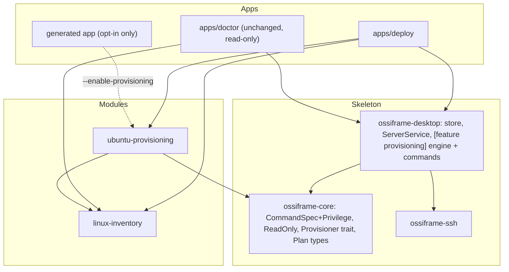
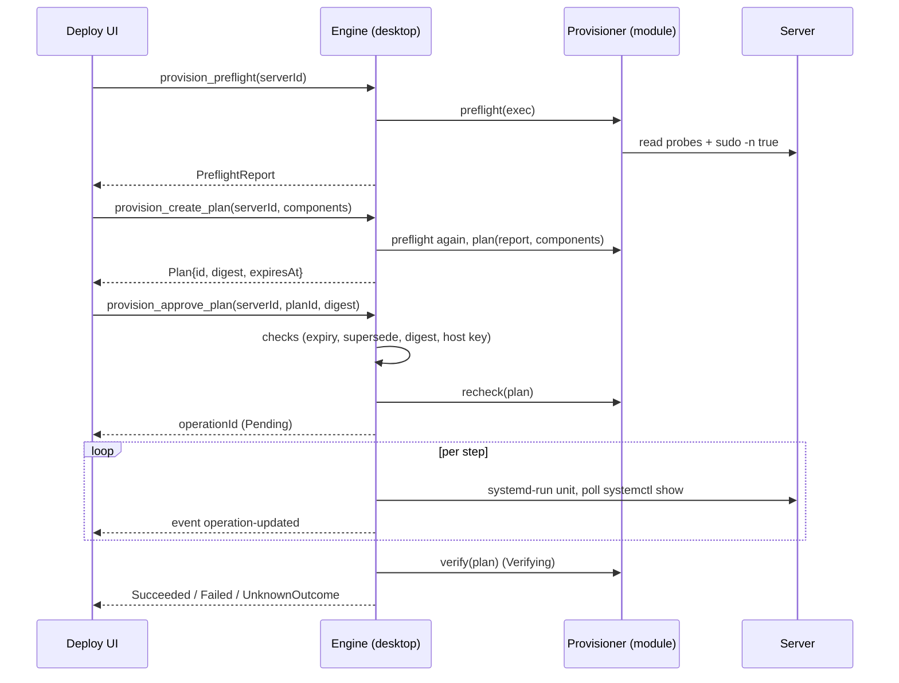
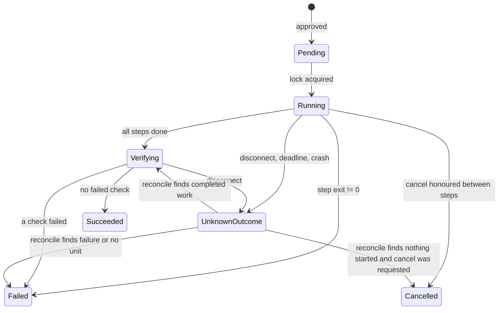

# Design Document: Infrastructure Provisioning (S04)

## Overview

S04 adds the first server mutations: installing a base stack (Git, NGINX, PHP 8.3 CLI and FPM, Composer, MySQL, optional Redis) on a fresh Ubuntu 24.04 server. It follows the flow preflight, plan, explicit approval, execution, verification. It reuses the S01 to S03 stack: `Executor`/`CommandSpec`, russh transport, `ServerService` connections, the module `Registry`, `ServerWorkspace` and `@ossiframe/client`.

Three artifacts are new: a privilege on `CommandSpec`; a module crate `modules/ubuntu-provisioning` with preflight, component data and plan building; and a generic plan/approval/operation engine in `ossiframe-desktop`, compiled only with the `provisioning` feature. A new minimal app `apps/deploy` consumes them. Doctor enables none of it and stays read-only.

Scope decisions made here (details in the sections and the decision table):

- Passwordless sudo only (`sudo -n`). No sudo password in S04.
- Long apt steps run as transient systemd units (`systemd-run`) so they survive an SSH disconnect.
- `apt-get update` is a visible, approved plan step.
- Config-file writes and stdin plumbing are deferred to S05. S04 writes no files and sends no stdin, because the distro defaults need no change.
- Plan digest uses `sha2` (already in `Cargo.lock` through russh).

Out of scope: Laravel and app lifecycle, vhosts and FPM pools for apps, database users and databases, SSL/Certbot, firewall or SSH changes, multi-PHP and PPAs, Node/Python/container adapters, adoption of existing servers, monitoring, automatic cloud creation.

## Architecture



Layering constraint: `ossiframe-desktop` is skeleton and must not depend on a module. So the engine is generic and the module plugs in through a small `Provisioner` trait defined in Core. S05 (Laravel deploy plans) reuses the same engine, which is the concrete reuse need that justifies the trait.

Flow:



## Privilege model and Core changes

`CommandSpec` gets a privilege and nothing else new. Argv-only, every word quoted, as today.

```rust
// ossiframe-core/src/command.rs
#[derive(Debug, Clone, Copy, PartialEq, Eq)]
pub enum Privilege { User, Root }

impl CommandSpec {
    /// Rendered as: 'sudo' '-n' '--' '<program>' '<arg>'...
    /// `program` must be an absolute path (no PATH or secure_path ambiguity).
    pub fn privileged(program: &str, args: &[&str], timeout: Duration) -> Result<Self, ValidationError>;
    pub fn privilege(&self) -> Privilege;
}
```

- `CommandSpec::new` keeps its signature and yields `Privilege::User`. `to_command_line()` adds the `sudo -n --` prefix only for `Root`.
- `sudo -n` fails instead of prompting. A sudo password prompt can never hang a channel.
- No stdin, no sudo password. The sudo password path (`sudo -S -p ''`, secret over stdin, redaction, one-operation lifetime) is listed as a decision. Deferring it removes the only S04 caller of stdin. When S05 needs stdin for file content, it is an additive `CommandSpec` field and a change to `SshExecutor`, which today sends EOF right after exec.
- Privilege detection happens in preflight, never assumed (see Preflight).
- New `ExecError::PrivilegeDenied` (command was not run). `IpcError` maps it to `operationFailed` with a fixed message.

`ossiframe-core` also gains `OperationState` (the seven ADR-0004 states), the `Plan` types and the `Provisioner` trait in a new `provision.rs`. They carry no NGINX, PHP or MySQL knowledge: a plan is packages, services, files, steps and checks.

```rust
// ossiframe-core/src/provision.rs
pub struct Plan {
    pub target: PlanTarget,              // server_id, "user@host:port", pinned host key sha256
    pub os: String,                      // "ubuntu 24.04"
    pub components: Vec<String>,         // resolved order, requested + dependencies
    pub already_present: Vec<String>,
    pub packages: Vec<PackageChange>,    // name, installed_version: Option<String>
    pub files: Vec<FileChange>,          // empty in S04
    pub services: Vec<ServiceEffect>,    // unit, "started by package scripts"
    pub resources: Resources,            // disk_mb_needed, mem_mb_min
    pub privileges: Vec<String>,         // e.g. "root via sudo -n"
    pub limitations: Vec<String>,        // recovery limits shown before approval
    pub steps: Vec<PlanStep>,
    pub preconditions: Preconditions,    // material facts re-checked before run
}
pub struct PlanStep { pub id: String, pub title: String, pub command: CommandSpec, pub mode: StepMode, pub deadline: Duration }
pub enum StepMode { Foreground, Durable }  // Durable = transient systemd unit

#[async_trait]
pub trait Provisioner: Send + Sync {
    fn components(&self) -> Vec<ComponentInfo>;           // id, title, description, requires, optional
    async fn preflight(&self, exec: &dyn Executor, cancel: &CancelToken) -> Result<PreflightReport, OperationError>;
    fn plan(&self, report: &PreflightReport, selection: &[String]) -> Result<Plan, PlanError>;
    async fn recheck(&self, exec: &dyn Executor, cancel: &CancelToken, plan: &Plan) -> Result<(), Vec<Drift>>;
    async fn verify(&self, exec: &dyn Executor, cancel: &CancelToken, plan: &Plan) -> Vec<CheckResult>;
}
```

`Plan` derives `Serialize` with `Vec`/`BTreeMap` only, so its JSON is deterministic.

## Enforcement

Module metadata is not a sandbox. Enforcement is structural and layered:

1. **Read-only path cannot become privileged.** Core adds `ReadOnly<'a>(&'a dyn Executor)`, whose `run` returns `ExecError::PrivilegeDenied` for any spec whose privilege is not `User`. `dispatch::run_operation` builds `OperationContext { exec: &ReadOnly(&*conn), .. }`. This holds for every app and every module, including future ones. The `ubuntu-provisioning` module registers with zero `OperationInfo` entries, so `run_operation` has nothing in it to reach. `OperationInfo` and `Module` do not change (S02 contract stays stable).
2. **Privileged path only through typed engine commands.** Eight `provision_*` commands (below) exist only with `ossiframe-desktop` features `tauri` and `provisioning`, and only an app that calls `provisioning::setup(app, Arc<dyn Provisioner>)` has state for them. The commands take ids, component ids and a digest, never a program, argv, path or privilege.
3. **Privileged execution only after approval.** The engine's `execute(ApprovedPlan)` takes a type whose only constructor is `PlanStore::take_approved`, which performs the approval checks. The privileged `CommandSpec`s are built by trusted `Provisioner` code and are executed only by the engine. The one privileged command outside approval is the fixed preflight probe `sudo -n -- /usr/bin/true`.
4. **App composition.** A command is reachable only when it appears in the app's `generate_handler!`, its `build.rs` `AppManifest`, and its capability file. Doctor has none of the `provision_*` names in any of the three. With Cargo feature unification, `cargo build --workspace` compiles the engine into Doctor's dependency graph when Deploy enables the feature. Dead code in Doctor is acceptable only because of the three-way gate, so the gate is what the tests assert. Release builds use `cargo tauri build` per app.
5. **Drift tests** (Doctor): capability, `build.rs` and handler lists equal `COMMAND_NAMES` plus report commands exactly (existing tests). New: no permission contains `provision`; Doctor `Cargo.toml` names neither `ossiframe-mod-ubuntu-provisioning` nor the `provisioning` feature. Deploy has the mirror tests against `COMMAND_NAMES + PROVISION_COMMAND_NAMES + inventory`.

## Preflight

Read-only apart from the sudo probe. It reuses `linux-inventory` library functions (`collect` for server info, `software`, `services`, `sockets`) and adds a small number of fixed probes. All commands use absolute paths.

| Fact | Source | Rule |
|---|---|---|
| OS, arch | inventory `server-info` (`/etc/os-release`, `uname -m`) | `ubuntu` + `24.04` supported. `26.04` reported as "pending verification" and blocked. Other OS or version blocked. `x86_64` and `aarch64` accepted, only tested architectures claimed in docs |
| Memory, swap, disk | inventory | Block if RAM < 900 MB and MySQL selected. Warn below ~1.8 GB. Block if free disk on `/` < estimated need + 1 GB |
| Connectivity, uid | the session itself, `/usr/bin/id -u` | Connected required |
| Sudo | `sudo -n -- /usr/bin/true` | exit 0 gives `Passwordless`. Stderr "password is required" gives `PasswordRequired`. "not in the sudoers" or "may not run" gives `NotPermitted`. Exit 127 gives `Unavailable`. Anything but `Passwordless` blocks, with an actionable message. Matching is on English text only as a hint; the exit code decides the block |
| Package states | `/usr/bin/dpkg-query -W -f '${Package}\t${db:Status-Abbrev}\t${Version}\n'` on planned packages | Per package: absent, `ii` (installed), or other state (blocker: broken dpkg state) |
| Package candidates | `/usr/bin/apt-cache policy <pkgs>` | `Candidate: (none)` is a warning before the update step (lists may be stale), a failure afterwards. Composer is in `universe`; warn if candidate missing |
| dpkg health | `/usr/bin/dpkg --audit` | Any output blocks (interrupted dpkg) |
| apt/dpkg busy | `/usr/bin/pgrep -x -l` for `apt`, `apt-get`, `dpkg`, `unattended-upgr`, plus `systemctl is-active apt-daily.service apt-daily-upgrade.service` | Warning only. Unprivileged `fuser` cannot see other users' lock holders, so process names are used. The install step waits with `-o DPkg::Lock::Timeout=300` |
| Reboot pending | `/usr/bin/test -f /var/run/reboot-required` | Warning |
| Web configs | `/usr/bin/find /etc/nginx/sites-enabled /etc/apache2/sites-enabled -maxdepth 1 -mindepth 1` | Any apache2 site, or nginx entry other than `default` and `ossiframe-*` blocks |
| Existing DB/web infra | inventory `software` + `services` | Installed or active `apache2`, `mariadb-server`, `postgresql` block. A different PHP minor than 8.3 blocks |
| Listeners | inventory `sockets` | Ports 80, 443, 3306, 33060, 6379 held by a process not belonging to a selected component block |
| Foreign operations | `/usr/bin/systemctl list-units --all --plain --no-legend 'ossiframe-op-*'` | Any unit blocks (another desktop or an earlier unreconciled run) |

`PreflightReport` carries `observedAt`, the facts above, a list of `Conflict { id, severity: Blocker|Warning, message }`, and a derived `canProvision`. Blockers prevent plan creation: S04 provisions only fresh servers, and there is no adoption path. Existing servers can still be inspected with Doctor.

Components already installed from our own earlier run are not conflicts. They appear in `already_present` and are skipped in the install step.

## Components and Interfaces

### The ubuntu-provisioning module

One new crate, `modules/ubuntu-provisioning` (`ossiframe-mod-ubuntu-provisioning`), depending on `ossiframe-core` and `ossiframe-mod-linux-inventory` (the manifest declares `linux-inventory`). A second crate is not justified: components are data plus verification functions of the same shape. Optional `ui/` directory holds the React pages (below).

```rust
struct ComponentDef {
    id: &'static str, title: &'static str,
    packages: &'static [&'static str],
    requires: &'static [&'static str],
    units: &'static [&'static str],            // expected active after install
    est_disk_mb: u32, min_mem_mb: u32,
    blocks_on_packages: &'static [&'static str],
    optional: bool,
}
```

| id | Packages (Ubuntu 24.04 archive only, no PPAs) | Requires | Units | Notes |
|---|---|---|---|---|
| `git` | `git` | | | |
| `nginx` | `nginx` | | `nginx` | Package starts nginx with the distro default site on port 80. Blocks on `apache2` |
| `php` | `php8.3-cli php8.3-common php8.3-opcache php8.3-mbstring php8.3-xml php8.3-curl php8.3-zip php8.3-bcmath php8.3-intl php8.3-mysql php8.3-sqlite3 php8.3-gd` | | | CLI and Laravel extensions. Names to be re-checked with `apt-cache policy` on a noble host before coding. `php8.3-opcache` and `composer` 2.7.1 confirmed in the noble archive |
| `php-fpm` | `php8.3-fpm` | `php` | `php8.3-fpm` | Default pool and socket `/run/php/php8.3-fpm.sock`. Not wired to NGINX (S05) |
| `composer` | `composer` | `php` | | Archive package (universe, 2.7.1-2). Official installer rejected: it downloads and executes code from the network and needs checksum handling, against the "archive only" rule |
| `mysql` | `mysql-server` | | `mysql` | MySQL 8.0 from noble. Local root via `auth_socket`. Blocks on `mariadb-server`. Hard memory minimum |
| `redis` (optional) | `redis-server` | | `redis-server` | Unchecked by default |

Default selection: `git nginx php php-fpm composer mysql`. PostgreSQL, Node.js, Supervisor and Certbot use the same `ComponentDef` pattern later and are not implemented now. Versions are whatever noble provides and are recorded in docs only after verification. Servers stay general-purpose: any subset can be chosen and more components can be added in a later operation. No runtime-typed server profile exists.

Plan building (`plan(report, selection)`, pure and synchronous):

1. Resolve the selection with dependencies (reuse `RegistryBuilder::resolve_selection` over component manifests, or a ten-line equivalent if the types do not fit). Unknown id: `PlanError::UnknownComponent`.
2. Refuse if the report has any blocker, or a selected component's own rule fires (for example MySQL on low RAM).
3. Subtract packages already `ii`. Sort the rest.
4. Emit steps (none when everything is present, in which case the operation only verifies):
   - `apt-update`: durable, privileged `/usr/bin/apt-get update`, deadline 5 min. It modifies only package lists and is listed in the plan.
   - `apt-install`: durable, one dpkg transaction for all missing packages, deadline 20 min. It runs `/usr/bin/apt-get install -y --no-install-recommends -o DPkg::Lock::Timeout=300 <pkgs>`.
5. Fill `services`, `resources`, `privileges`, and `limitations`: no rollback; a failed install can leave partial packages; recovery is re-planning, which is idempotent; services start automatically on install; no firewall changes; the default NGINX page is publicly reachable if port 80 is open.

## Plan and approval

`PlanStore` (desktop, in memory) holds at most one plan per server, which makes "superseded" automatic.

```rust
struct StoredPlan { plan: Plan, id: Uuid, digest: String, created: Instant, expires: Instant }
// digest = hex(sha256(serde_json::to_vec(&plan)))   // id and timestamps are not part of the plan body
```

- **Digest:** SHA-256 over the canonical JSON of the `Plan` (deterministic field and `Vec` order; no maps with unordered keys). Add `sha2` to `ossiframe-desktop` (optional, `provisioning` feature). It is RustCrypto, MIT/Apache-2.0, maintained, and already in `Cargo.lock`. No custom cryptography. The digest is a consent binding and integrity check for what the user saw, and it is re-verified when a stored plan is read back from SQLite. It is not the security boundary against a hostile frontend. That boundary is that the backend executes only its stored plan.
- **Binding:** `plan.target` holds server id, endpoint and the pinned host key SHA-256 at preflight. Approval compares them with the current server record and the live connection.
- **Lifetime:** 10 minutes, single use, replaced by any newer plan for the same server.
- **Approve:** `provision_approve_plan(serverId, planId, planDigest)`. In order: validate ids; take the stored plan (`UnknownPlan`); plan id equal (`Superseded`); not expired (`Expired`); `planDigest` equals stored digest and a recomputed digest (`Mismatch`); server and pinned key unchanged (`WrongServer`); connected; no active operation or unresolved `UnknownOutcome` for the server (`Busy`). The plan is consumed at this point. Then `Provisioner::recheck` re-runs the material probes. Any `Drift` aborts with `RePlanRequired{reasons}` and nothing runs. Material means OS version, package states of the planned packages, blockers (including foreign `ossiframe-op-*` units), free disk, sudo mode and nginx site list. Memory, uptime and apt-busy are not drift.
- A plan with zero steps is valid and results in a verify-only operation (this also serves as re-verification).

## Operation engine

### State machine



The transition function is a pure `fn next(OperationState, Event) -> Result<OperationState, IllegalTransition>` with a unit test. Terminal states: Succeeded, Failed, Cancelled. A server with an operation in Pending, Running, Verifying or UnknownOutcome accepts no new plan.

### Durable execution: recommendation

Evaluated options:

| Option | Survives SSH loss | Complexity | Verdict |
|---|---|---|---|
| Foreground exec over the channel | No. A closed channel may or may not kill apt | Lowest | Rejected for apt steps. Used for short checks |
| `nohup`/`setsid` plus status file | Yes | Needs a shell string or script, file cleanup, own bookkeeping | Rejected |
| Transient systemd unit (`systemd-run`) | Yes, owned by systemd | Moderate, all argv, state held by systemd | Recommended |

Durable step protocol (Ubuntu 24.04 has systemd 255; behaviour to be confirmed in live verification):

1. Persist the step with `unit_name = ossiframe-op-<first 8 hex of op id>-<idx>` and status Running **before** launch. The name is deterministic, so reconcile can find the unit without any stored remote state.
2. Launch (privileged, 15 s timeout): `/usr/bin/systemd-run --unit=<name> --service-type=exec --remain-after-exit --quiet -E DEBIAN_FRONTEND=noninteractive -E NEEDRESTART_SUSPEND=1 -- /usr/bin/apt-get ...`. `--remain-after-exit` keeps the finished unit loaded so its result can be read; without it a successful transient unit is garbage-collected and its exit status lost.
3. Poll every 3 s with `systemctl show <name> --property=LoadState,ActiveState,SubState,Result,ExecMainStatus` (unprivileged). Done when `Result` is set and the unit is `active/exited` or `failed`. Success only if `Result=success` and `ExecMainStatus=0`.
4. Every 15 s and at completion run `sudo -n /usr/bin/journalctl -u <name> -o cat --no-pager -n 200` and replace the stored output (journal read needs privilege on non-`adm` users).
5. Cleanup, best effort and non-fatal: `sudo -n /usr/bin/systemctl stop <name>` and `reset-failed`.
6. A poll that times out is retried up to 3 consecutive times. This retries only read-only polls, never the mutation.

Behaviour on disconnect, step deadline, launch timeout or app crash: the step and operation become `UnknownOutcome`. The engine never relaunches. The unit keeps running on the server. After reconnecting, `provision_reconcile(operationId)` runs read-only queries: `systemctl show` on the recorded unit and `dpkg-query` on the plan's packages. It then resolves as follows:

| Observation | Result |
|---|---|
| Unit still active | Stay UnknownOutcome ("still running") |
| Unit finished success, all steps accounted for | Verifying, then Succeeded or Failed |
| Unit finished failure | Failed, with the capped journal tail |
| Unit not found (never launched, or server rebuilt) | Failed with "no remote activity found" (a fresh preflight and plan are then the recovery) |

Reconcile never mutates and never launches a step. Continuing a half-finished plan means creating a new plan from fresh preflight, which is idempotent because installed packages are skipped.

Foreground steps (verification, short probes) use `Executor::run` with 30 s timeouts. Failures there also end in UnknownOutcome if the connection drops mid-run, otherwise Failed.

### Cancellation and locking

- `provision_cancel(operationId)` sets `cancel_requested` and signals the engine. The engine checks the flag before launching each step. Between steps it moves to Cancelled and marks remaining steps skipped. During a step it never stops apt or dpkg or the unit; the request is recorded, shown as "cancel requested, waiting for current step", and honoured after the step ends. The shared `cancel_operation` command also trips the session token passed by `with_connection`. The engine treats that token as the same cancel request and does not feed it to the polling commands.
- Engine commands use `ServerService::with_connection` per command (launch, each poll), not one long call. The per-profile guard is therefore held only briefly. `disconnect_server` during an operation is allowed and results in UnknownOutcome, matching "user abandoned the session".
- **Local lock:** an in-memory per-server set plus the persisted rule that blocks new plans while any operation is non-terminal or UnknownOutcome.
- **Remote lock:** none in S04 (decision). Protection comes from the dpkg/apt lock serializing apt, the `ossiframe-op-*` unit scan in preflight and recheck, and the plan-time binding to server state. `flock` on the server is listed as an alternative.

### Events

`OperationEvents` trait (Tauri-free, like `SessionEvents`) with `operation_updated(server_id, operation_id, status)`. The Tauri glue emits `operation-updated`. The UI refetches via `provision_get_operation`. The task runs on the Tokio runtime and writes to SQLite on state changes and on output refresh only.

## Data Models

In-memory and IPC models are the `Plan`, `PreflightReport`, `CheckResult` and `OperationState` types above and in the IPC section. Persisted models are below (migration 2, unconditional so Doctor and Deploy share one schema history; the tables stay empty and unused in Doctor).

```sql
CREATE TABLE operations (
  id TEXT PRIMARY KEY, server_id TEXT NOT NULL REFERENCES servers(id) ON DELETE CASCADE,
  kind TEXT NOT NULL, plan_digest TEXT NOT NULL, plan_json TEXT NOT NULL,
  status TEXT NOT NULL, cancel_requested INTEGER NOT NULL DEFAULT 0,
  created_at TEXT NOT NULL, started_at TEXT, finished_at TEXT,
  error TEXT, verification_json TEXT);
CREATE TABLE operation_steps (
  operation_id TEXT NOT NULL REFERENCES operations(id) ON DELETE CASCADE,
  idx INTEGER NOT NULL, step_id TEXT NOT NULL, title TEXT NOT NULL,
  unit_name TEXT, status TEXT NOT NULL, started_at TEXT, finished_at TEXT,
  exit_code INTEGER, output TEXT, PRIMARY KEY (operation_id, idx));
CREATE INDEX operations_server ON operations(server_id, created_at);
```

No secret column exists (the S01 schema test is extended). `output` is redacted, valid UTF-8, capped at 64 KiB per step (the last 200 journal lines). `error` is capped with `ipc::cap`. `plan_json` contains no secrets by construction. On startup the engine marks every Pending/Running/Verifying operation `UnknownOutcome`, because the app died and the remote unit may still be running.

## Configuration safety primitive: deferred to S05

S04 changes no config files: NGINX, PHP-FPM, MySQL and Redis run with distro defaults, and `ossiframe-*` managed files do not exist yet. The primitive (backup, write through stdin with fixed argv such as `sudo -n install -m 0644 -o root -g root /dev/stdin <path>`, validate with `nginx -t` or `php-fpm8.3 -t`, reload, verify, restore on failure) has no S04 caller, so it is not built now. S05 (first vhost) builds it together with the stdin field on `CommandSpec`, with the unit tests listed in ADR-0005: managed prefix, never overwrite unmanaged files, rollback on failed validation. This keeps S04's attack surface at argv-only commands. S04 also verifies, and does not edit, that MySQL binds to loopback.

## Post-install verification

Run in the `Verifying` state through `Provisioner::verify`. Each check yields `CheckResult { component, id, title, status: Pass|Fail|Warn|Skipped, detail }`. Details are capped at 200 characters and rendered as text. Succeeded requires no `Fail`. Results are stored in `operations.verification_json`.

| Component | Checks |
|---|---|
| all | every package `ii` through `dpkg-query` |
| git | `/usr/bin/git --version` |
| nginx | `/usr/sbin/nginx -v`; `systemctl is-active nginx`; `sudo -n /usr/sbin/nginx -t`; if `/usr/bin/curl` exists, `curl -sS -o /dev/null -w '%{http_code}' http://127.0.0.1/` returns 200 (other HTTP code is `Warn`, connection failure is `Fail`) |
| php | `/usr/bin/php -v` is 8.3; `php -m` contains ctype, curl, dom, fileinfo, mbstring, openssl, pdo, pdo_mysql, pdo_sqlite, tokenizer, xml, zip, bcmath, intl, gd |
| php-fpm | `/usr/sbin/php-fpm8.3 -v`; unit active; `sudo -n /usr/sbin/php-fpm8.3 -t`; `/usr/bin/test -S /run/php/php8.3-fpm.sock`; `php-fpm8.3 -m` includes the same modules (catches enable-ordering problems) |
| composer | `/usr/bin/composer --version --no-ansi` starts with `Composer version 2.` |
| mysql | unit `mysql` active; `/usr/sbin/mysqld --version`; inventory sockets show 3306 and 33060 bound only to loopback (otherwise `Fail`); `sudo -n /usr/bin/mysql -N -B -e 'SELECT 1'` over `auth_socket` returns 1 |
| redis | unit active; `redis-server --version`; 6379 bound to loopback only; `redis-cli ping` returns `PONG` |

## IPC surface and desktop changes

`PROVISION_COMMAND_NAMES` (feature `tauri` + `provisioning`), all in `ossiframe-desktop::provisioning::commands`:

| Command | Arguments | Returns |
|---|---|---|
| `provision_components` | none | `ComponentInfo[]` |
| `provision_preflight` | `serverId` | `PreflightReport` |
| `provision_create_plan` | `serverId`, `components: string[]` | `PlanDto` (id, digest, expiresAt, plan body) |
| `provision_approve_plan` | `serverId`, `planId`, `planDigest` | `operationId` (runs in the background) |
| `provision_cancel` | `operationId` | `void` |
| `provision_reconcile` | `operationId` | `OperationDto` |
| `provision_get_operation` | `operationId` | `OperationDto` (steps, bounded output, verification) |
| `provision_list_operations` | `serverId`, `limit?` (max 50) | `OperationSummaryDto[]` |

All inputs are validated at the boundary (UUID ids via the existing `is_uuid`, component ids through `ModuleId`-style parsing, digest as 64 lowercase hex). `IpcError` gains one variant, `plan { reason, message }`, with reasons `unknownPlan, superseded, expired, mismatch, wrongServer, busy, blocked, rePlanRequired, notSupported`. The TypeScript `KINDS` set is extended to match. Output sent to the UI is already redacted and capped.

Desktop additions: `provisioning/{plans,engine,store_ops,commands}.rs`, `Store` methods for the two tables (feature-gated), `ServerService::with_connection` unchanged. `tauri_support::setup` and `AppSetup` are not modified (Doctor and the starter still compile as is); apps opt in by calling `provisioning::setup(app, provisioner)` after `setup`.

## Deploy app (`apps/deploy`)

Independent of Doctor; workspace member `apps/deploy/src-tauri`. Identifier `dev.ossiframe.deploy` (separate data directory and keychain service), database `deploy.sqlite3`. Registry: `LinuxInventory`, `UbuntuProvisioning`. It does not depend on `linux-audit` or Doctor.

- `lib.rs`: `Registry::builder().register(LinuxInventory).register(UbuntuProvisioning)`, `setup(...)`, then `provisioning::setup(app, Arc::new(UbuntuProvisioning))`. The handler lists the 11 shared commands plus 8 `provision_*` commands. `build.rs` and `capabilities/main.json` list the same. Unit tests mirror Doctor's: capability and build manifest equal `COMMAND_NAMES + PROVISION_COMMAND_NAMES`; no `dialog:` or `fs:` permissions.
- Frontend: `ServerWorkspace` shell with tabs Overview (inventory UI), Preflight, Software, Plan, Operation, History. These pages are exported from `modules/ubuntu-provisioning/ui/` so generated apps that opt in get them too. Page behaviour:
  - Software lists components with installed state from preflight and checkboxes; default selection as above; Redis unchecked.
  - Plan shows packages, services, steps, resources, privileges, limitations, the full digest and expiry countdown. The approve button is enabled only for an unexpired plan and requires the user to type the first 8 hex characters of the digest.
  - Operation shows step status, bounded log text, "cancel requested" state, and the verification table. For UnknownOutcome it shows a Reconcile button and states that nothing is retried automatically.
  - Nothing mutates unless a plan was explicitly approved. No mock data.
- `@ossiframe/client` gains `provisioning.ts` with typed wrappers and types, exported separately from `api`, so Doctor does not import it.

## Developer reuse

- `tools/ossiframe-cli`: `CatalogEntry` gains `privileged: bool`. `ubuntu-provisioning` is `true`. `new --modules ubuntu-provisioning` fails with a clear message unless `--enable-provisioning` is also given. Without the flag the starter stays read-only and unchanged. With it, the generated app adds the `provisioning` feature on `ossiframe-desktop`, the `provisioning::setup` call, the eight commands in handler, `build.rs` and capability, and the matching drift tests. How these blocks are injected follows what `render.rs` already does for module registration and is settled in implementation.
- Docs updated: `docs/architecture.md` (execution and operations), `docs/security.md` (privilege table, enforcement layers), ADR-0004 and ADR-0005 "open questions" get resolved notes, `docs/compatibility.md` (24.04 components after verification), `docs/developer-guide.md` (opt-in), `docs/roadmap.md`. Evidence goes in `docs/verification/s04-infrastructure-provisioning.md`.

## Error handling

| Scenario | Response |
|---|---|
| Sudo not passwordless | Plan blocked. Message names the exact state and says passwordless `sudo -n` is required. No prompt, no password path |
| Blocking conflict (existing apache, mariadb, custom sites, other listeners) | Plan creation refused, conflicts listed. Doctor can inspect the server |
| Plan expired, superseded, altered or for another server | `plan` error. The plan is gone. User re-plans |
| Drift at recheck | `rePlanRequired` with reasons. Nothing executed |
| Apt lock held (unattended-upgrades) | Warning at plan time. The install waits up to 300 s through `DPkg::Lock::Timeout`. Beyond the step deadline: UnknownOutcome, reconcile |
| Step exits non-zero | Step and operation Failed with capped journal tail. No rollback and no package removal. Recovery is a fresh preflight and plan |
| Disconnect or crash mid-step | UnknownOutcome. No retry. Reconcile after reconnect |
| Verification failure | Operation Failed with the failing checks. Installed packages stay |
| Server removed during an operation | Rows cascade-delete. The engine stops without further writes |

## Security considerations

- Privilege: `sudo -n` argv only, absolute program paths, no shell strings, no stdin and no secrets in S04. The connection user's passwordless sudo is root-equivalent and the UI and docs say so.
- No credential or secret is stored, sent over IPC or logged. Plan JSON, outputs and errors contain none. Remote output is untrusted: capped, redacted through the existing path, stored and rendered as text.
- No SSH, firewall or user changes. Packages come only from the Ubuntu archive. No PPAs and no network-fetched scripts.
- The host key pin is part of plan binding. A changed key blocks connect (S01) and invalidates plans.
- Never run commands against servers from hooks. Development testing uses only the disposable server the user names.

## Correctness Properties

*A property is a characteristic or behavior that should hold true across all valid executions of the system. Per project rules, these are checked with small plain unit tests over representative and hostile inputs. No property-testing framework is added.*

### Property 1: Privileged rendering keeps words intact

For any privileged `CommandSpec` with an absolute program and any argument strings, the rendered command line starts with `'sudo' '-n' '--'` and each argument is exactly one quoted word. A relative program is rejected.

**Validates: Requirements 1.2, 1.3, 1.4, 1.6**

### Property 2: Read-only guard rejects privilege

For any `CommandSpec` with Privilege `Root` submitted through `ReadOnly`, the result is `PrivilegeDenied` and the wrapped executor records zero runs. For any `User` spec, it is passed through.

**Validates: Requirements 2.6, 3.1, 3.2, 3.3**

### Property 3: Sudo classification follows the exit code

For any sudo probe result, a non-zero exit never classifies as Passwordless, and any classification other than Passwordless yields a Blocker.

**Validates: Requirements 2.1, 2.2, 2.3**

### Property 4: Blockers prevent plans

For any Preflight_Report with at least one Blocker, `canProvision` is false and plan building is refused.

**Validates: Requirements 6.4, 7.2, 7.3, 7.4, 7.6, 7.7, 7.8, 7.9, 7.10, 7.11, 9.7**

### Property 5: Selection resolution is closed and ordered

For any selection of known component ids, the resolved list contains every required component before its dependents. For any selection with an unknown id, resolution fails with `UnknownComponent`.

**Validates: Requirements 8.7, 8.8, 8.9**

### Property 6: Plans are deterministic and complete

For any equal report and selection, the Plan_Digest is equal. For any change to the package list, the digest changes. Installed packages never appear in install steps, and a plan with every package installed has zero steps.

**Validates: Requirements 9.2, 9.3, 9.6, 9.10, 9.11**

### Property 7: Approval invalidation

For any stored plan, approval succeeds only when the plan id matches, the plan is unexpired, the digest matches, and the server and pinned host key are unchanged. Each failing condition yields its own reason and nothing executes. A plan approves at most once, and a newer plan for the same server supersedes it.

**Validates: Requirements 10.1, 10.2, 10.3, 10.4, 10.5**

### Property 8: Drift forces re-planning

For any change to OS version, planned package states, blockers, free disk, sudo mode or the NGINX site list between plan and approval, recheck returns drift and no step runs. Changes in memory, uptime or apt activity return no drift.

**Validates: Requirements 10.6, 10.7, 10.8**

### Property 9: State transitions stay within the diagram

For any pair of Operation_State and event, `next` either returns a state allowed by the state diagram or an `IllegalTransition`. Terminal states accept no event. Startup marks every non-terminal in-flight Operation UnknownOutcome.

**Validates: Requirements 11.3, 11.4, 11.5**

### Property 10: Interruption never relaunches

For any scripted disconnect, deadline or exhausted poll retry during a step, the Operation ends in UnknownOutcome and the fake executor records no second launch of that step. A cancel request before a later step yields Cancelled with that step never launched.

**Validates: Requirements 12.7, 12.8, 12.9, 14.3**

### Property 11: Reconcile is read-only and total

For any recorded unit observation (active, finished success, finished failure, not found), reconcile maps to exactly one outcome from the decision table and issues no mutating command.

**Validates: Requirements 15.1, 15.2, 15.3, 15.4, 15.5, 15.6**

### Property 12: Stored output is bounded and redacted

For any remote output, the stored step output is valid UTF-8, at most 64 KiB, and contains no redacted secret pattern.

**Validates: Requirements 13.1, 13.3, 13.4**

### Property 13: Success requires no failed check

For any set of CheckResults, the Operation is Succeeded if and only if no result has status Fail.

**Validates: Requirements 17.11, 17.12**

### Property 14: Command surfaces match exactly

For Doctor, the handler, `build.rs` and capability lists equal the expected command names and contain no `provision` name. For Deploy, they equal the shared plus provisioning commands. For a generated project without `--enable-provisioning`, no provisioning command appears.

**Validates: Requirements 5.1, 5.3, 5.4, 19.3, 20.4**

## Testing strategy

Small plain unit tests only (no property framework, no fixture or e2e suites):

- `command.rs`: privileged rendering (`'sudo' '-n' '--' ...`), hostile args stay one word (extends the real-shell round trip), relative program rejected for privileged.
- `ReadOnly`: rejects `Root`, passes `User`; `dispatch::run_operation` with a probe module that attempts a privileged command is rejected and the fake connection records zero runs.
- `PlanStore`: expiry, supersede, digest mismatch, wrong server (endpoint or pinned key changed), single use, unknown plan.
- Plan determinism: same report and selection give the same digest; changing any package changes it.
- Plan building: dependency resolution (php-fpm pulls php), blocker refusal, mysql on 512 MB refusal, already-present skipped, zero-step plan.
- Preflight parsing: sudo classification, dpkg-query lines, nginx site classification (`default` and `ossiframe-*` allowed), listener conflicts.
- `next()` transition table and startup recovery marking in-flight operations UnknownOutcome. Reconcile decision table with scripted `systemctl show` outputs.
- Engine with a scripted fake executor: step Failed on exit 1; disconnect during poll gives UnknownOutcome with no relaunch; cancel before step 2 gives Cancelled; poll timeout retried 3 times then UnknownOutcome.
- Store: migration idempotent, no secret column, output cap.
- Drift tests for Doctor and Deploy as above.

Required checks: `cargo fmt --check`, `cargo clippy -- -D warnings`, `cargo check`, `pnpm typecheck`, `pnpm lint`, production builds of Doctor and Deploy, `shellcheck` for any scripts, generator build of an opt-in project outside the repo.

### Real-server verification plan (evidence in `docs/verification/s04-infrastructure-provisioning.md`)

| Target | Check |
|---|---|
| Existing Doctor Lightsail server (512 MB) | Read-only preflight only. Expect blockers (RAM for MySQL, existing configuration). No stack is installed without explicit user approval |
| Fresh disposable Ubuntu 24.04, 2 vCPU, 2 to 4 GB, created by the user | Preflight, plan, approve, full default stack. Every verification check passes. Record package versions and unit behaviour of `systemd-run --remain-after-exit` |
| Same server, second run | Plan has zero install steps and verifies only (idempotency) |
| Same server | Edit state between plan and approval (install a package), expect `rePlanRequired`; wait out expiry, expect rejection; alter digest, expect rejection |
| Same server | Kill the SSH connection or app during `apt-install`: UnknownOutcome, unit keeps running, reconcile resolves, no automatic retry |
| Fresh image right after boot | Observe unattended-upgrades holding the lock and the `DPkg::Lock::Timeout` wait; confirm NEEDRESTART settings do not break the run |
| Doctor build | Still exposes no provisioning commands; read-only inspection of the provisioned server |

Results are written only from real runs. If a check cannot be run, the doc says so.

## Performance considerations

Polling is 3 s with two cheap commands, journal refresh every 15 s, and output capped at 64 KiB per step. The engine holds no large buffers and does one SQLite write per state change or refresh. A 2 GB server is the verification target; the 8 GB desktop constraint is unaffected.

## Dependencies

- New Rust: `sha2` (optional, `ossiframe-desktop` feature `provisioning`). `tokio`, `serde`, `uuid`, `time`, `rusqlite` already present. The module crate adds nothing beyond `ossiframe-core`, `ossiframe-mod-linux-inventory`, `async-trait`, `serde`, `serde_json`, `tokio`.
- New workspace members: `modules/ubuntu-provisioning` (covered by `modules/*`), `apps/deploy/src-tauri`.
- Frontend: no new packages. Deploy uses the same Tauri, React, Tailwind and `@ossiframe/ui` set as Doctor.
- Server: Ubuntu 24.04 with systemd, `sudo`, `apt-get`, `dpkg`, `systemctl`, `journalctl` and the Ubuntu archive (`main` and `universe`). Nothing is installed on the server beyond the chosen packages. No agent.

## Material unresolved decisions

| Decision | Recommendation | Alternative | Resolve by |
|---|---|---|---|
| Sudo password support | Not in S04: require passwordless `sudo -n`, report clearly otherwise | `sudo -S -p ''` with the password over stdin, held in memory for one operation, optional keychain opt-in. Needs stdin plumbing in `SshExecutor` and redaction | Before S04 tasks; revisit in S05 with bootstrap |
| Durable execution method | `systemd-run --remain-after-exit` with polling | Foreground only (simpler, loses outcome on disconnect) | Live check of unit semantics on noble |
| `apt-get update` in the plan | Yes, a visible approved step | Run implicitly before install | Settled here |
| Redis in initial set | Optional, unchecked | Drop from S04 to cut one verification path | User |
| Composer source | Archive package 2.7.1-2 (universe) | Official installer with checksum verification (newer Composer, network code execution) | Settled here; revisit if Laravel needs Composer newer than 2.7 |
| Plan digest dependency | `sha2` | Random plan id only (no digest, no tamper check on stored history) | Settled here |
| Remote lock | None; dpkg lock plus `ossiframe-op-*` unit scan | `flock` file on the server | Revisit if multi-desktop use appears |
| Config write primitive and stdin | Defer to S05 | Build now with no caller | Settled here |
| `needrestart` handling | Pass `NEEDRESTART_SUSPEND=1` in the unit | Leave default (may restart services mid-run) | Live check on fresh image |
| Engine location | Generic engine in `ossiframe-desktop` behind `Provisioner` trait in Core | Engine inside the module crate with a `tauri` feature depending on desktop (module to skeleton edge, S05 would duplicate it) | Settled here |
| Delete operation history with server profile | Cascade delete (matches host keys) | Keep history without FK | User, low impact |
