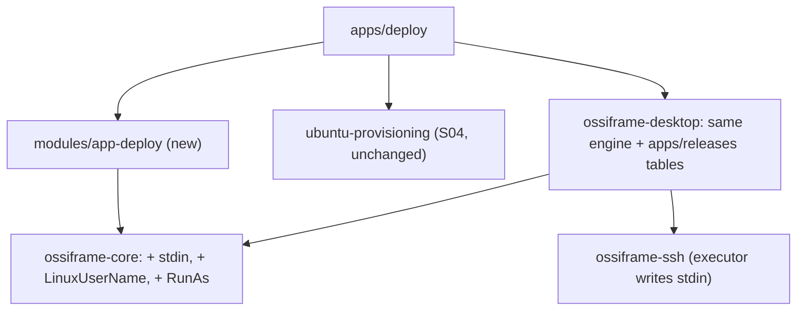

# Design Document: Application Deployment and Management (S05)

## Overview

S05 turns Ossiframe Deploy into a general-purpose application deployment tool. It reuses the S04 engine (plan, digest, approval, operation states, durable steps, remote lock, reconcile, mark-resolved) unchanged and adds: create/list/remove an application, deploy from Git, an Ossiframe-owned NGINX site per domain, a PHP-FPM pool per app, a Linux user per app, a MySQL database and user, safe `.env` editing, a pre-switch boot check, and rollback to a previous release.

Three application types: **Laravel**, **generic PHP**, **static HTML**. Each is data plus step-building functions inside one new crate, `modules/app-deploy` (`ossiframe-mod-app-deploy`). Core gains three small generic primitives: a `stdin` field on `CommandSpec`, a validated `LinuxUserName` type, and `Privilege::RunAs(LinuxUserName)`. Core has no Laravel, PHP, NGINX, MySQL or `ossi-` naming knowledge.

Everything mutating goes through preflight → plan → digest → explicit approval → durable engine → verify, exactly as in S04. No new approval mechanism, operation state or lock.

Scope decisions:

- Private Git repositories use a **per-app SSH deploy key generated on the server** under the app's own user. The private key never leaves the server.
- **Git host keys are pinned, never trust-on-first-use.** See "Git access".
- The database password lives **only** in the app's server-side `.env`. No keychain copy, no reveal call. Password rotation is deferred.
- One remote lock per server (S04's `ossiframe-provision-lock` unit and engine rule, unchanged). App and provisioning operations exclude each other. There is no per-app concurrency.
- No user-defined deploy steps, TLS, queue workers or scheduler in S05.
- `pm.max_children = 5` is fixed in S05 (stated limitation, not tunable).
- App removal is minimal: remove the NGINX site and FPM pool; keep the user, files and database unless the user explicitly opts in to deleting them.
- Target stack is the verified S04 base: Ubuntu 24.04, nginx 1.24, php8.3-fpm, mysql 8.0 (root via `auth_socket`), composer, git. S05 installs no packages.

Out of scope: WordPress, Node.js, Python, Docker, TLS, queue/scheduler, user-defined deploy steps, multi-server migration, adopting apps Ossiframe did not create, firewall changes.

## Architecture



`app-deploy` implements the existing `Provisioner` trait (facts → deterministic plan → recheck → gated steps → verify), so no new engine code is needed. Operations use `kind = "app-deploy"`. Laravel/PHP/static are `AppType` data inside one crate, not a trait per type (ADR-0006: no abstraction before a second implementation).

## Components and Interfaces

### Core additions (`ossiframe-core`)

```pascal
STRUCTURE LinuxUserName          // new validated type
  // ^[a-z_][a-z0-9_-]{0,31}$ and never "root"
END STRUCTURE

ENUM Privilege { User, Root, RunAs(LinuxUserName) }

STRUCTURE CommandSpec            // existing fields unchanged
  + stdin: Option<Vec<u8>>       // set only via with_stdin(); #[serde(skip)]
END STRUCTURE
```

- `RunAs(u)` renders `'/usr/bin/sudo' '-n' '-u' '<u>' '--' ...`. Root stays `Privilege::Root`; `RunAs` can never name root because `LinuxUserName` rejects it.
- **Naming decision:** Core validates only the generic Linux user-name grammar. The `ossi-<slug>` convention lives in `app-deploy`, which builds a `LinuxUserName` from the validated `AppSlug`. Core stays free of app conventions, and no Core pattern needs to change if the convention changes.
- `ReadOnly` rejects `Root` and `RunAs`.
- `stdin` is capped at 1 MiB (`ValidationError` before any network call), is never part of `to_command_line()`, and is `#[serde(skip)]`: it is never written to plan JSON, SQLite, events or logs. Secret and file content is generated at plan time and held in memory with the plan; if Ossiframe restarts before approval, the plan is gone and the user re-plans.
- `ossiframe-ssh`'s executor writes `stdin` and then sends EOF before reading output. Without `stdin` it behaves as today.

`PlanTarget` gains `app_id: Option<String>` (`#[serde(default)]`), used only to filter history per app.

### Content-write primitive (in `app-deploy`)

Two fixed-argv root commands run back to back:

```text
sudo -n /usr/bin/install -m <mode> -o <owner> -g <group> -- /dev/stdin <path>.ossiframe-tmp   (content on stdin)
sudo -n /usr/bin/mv -T -- <path>.ossiframe-tmp <path>
```

`install` creates the temp file with the final mode and owner in one step; `mv -T` renames it atomically. If `install` fails, `mv` is not run. If either fails, `<path>` is unchanged. NGINX and FPM files are validated (`nginx -t`, `php-fpm8.3 -t`) before any reload, and a failed validation never reloads.

**`ManagedPath` lives in `app-deploy`** (decision). The module builds the plan steps; the desktop engine only runs the resulting commands and needs no path knowledge. A `ManagedPath` must start with `/etc/nginx/sites-available/ossiframe-`, `/etc/php/8.3/fpm/pool.d/ossiframe-`, or the app's own `app_root`.

### `app-deploy` module

Implements `Provisioner` with `kind = "app-deploy"`:

- `components()` returns the three `AppType`s (type picker only).
- `preflight()` checks the server: base stack present (git, nginx, php8.3-fpm, mysql, composer; otherwise "provision the base stack first"), free disk, domain already used by an `ossiframe-*` site, app user already exists, and for an SSH repo URL on a host outside the built-in list, the host's key (see "Git access").
- `plan()` returns one of four shapes: **create**, **redeploy**, **rollback**, **remove**.
- `recheck()` re-verifies the base stack, that the site and pool files still carry their marker (missing or altered marker means drift, `rePlanRequired`), disk, and that the app user, root and database still exist.
- `gate()` runs `deploy-key-check` for SSH repos.
- `verify()` runs the post-switch health checks.

#### Isolation

```text
sudo -n /usr/sbin/useradd --system --create-home --home-dir /srv/ossiframe/apps/<slug> \
  --shell /usr/sbin/nologin --comment 'ossiframe app: <slug>' ossi-<slug>
```

The home is `app_root`, owned `ossi-<slug>` mode 0750. Every clone, build, boot-check and artisan command runs as that user:

```text
sudo -n -u ossi-<slug> -- /usr/bin/git clone --branch <branch> --depth 1 -- <repo_url> <release_dir>
sudo -n -u ossi-<slug> -- /usr/bin/composer install --no-dev --no-interaction --working-dir=<release_dir>
```

`sudo -u` is argv-only, needs no new package, and composes with `Privilege`. `su`/`runuser` need a TTY or a wrapped shell string. A buggy build can write only inside that app's home.

#### PHP-FPM pool

```ini
; /etc/php/8.3/fpm/pool.d/ossiframe-<slug>.conf  (0644 root:root)  # Managed by Ossiframe
[ossi-<slug>]
user = ossi-<slug>
group = ossi-<slug>
listen = /run/php/ossiframe-<slug>.sock
listen.owner = www-data
listen.group = www-data
pm = dynamic
pm.max_children = 5
pm.start_servers = 2
pm.min_spare_servers = 1
pm.max_spare_servers = 3
```

#### NGINX and domain

```text
# /etc/nginx/sites-available/ossiframe-<slug>  (0644 root:root)
# Managed by Ossiframe. Do not edit manually. app_id=<uuid>
server {
    listen 80;
    server_name <domain>;
    root <app_root>/current/<dirname of entry_file>;
    # Laravel/Php: fastcgi_pass unix:/run/php/ossiframe-<slug>.sock; Static: no PHP location
}
```

The marker line is checked before every overwrite of an existing file. A symlink in `sites-enabled` enables the site. App creation never touches the `default` site; an off-by-default checkbox adds a separate step to disable it. After each write: `nginx -t`, then reload. A domain already used by another `ossiframe-*` site is refused.

`entry_file` is a validated relative path (no `..`, no leading `/`, safe characters), stored per app: Laravel fixed `public/index.php`; Php default `public/index.php` (or `index.php`); Static default `index.html`. It determines the document root and the boot check.

#### Git access

**Public HTTPS repos:** `git clone` as the app user. No credential and no host key (TLS).

**SSH repos:** a deploy key is generated on the server as the app user (`ssh-keygen -t ed25519 -N ''`, mode 0600). Ossiframe reads back only the public half (shown with "add as a read-only deploy key") and never the private half. No Git credential is stored anywhere in Ossiframe.

**Host keys are pinned.** Ossiframe writes the app user's `<app_root>/.ssh/known_hosts` (0600, via the content-write primitive) before any SSH Git operation, and all Git SSH commands use `StrictHostKeyChecking=yes`. There is no `accept-new` anywhere.

- **github.com, gitlab.com, bitbucket.org:** the module ships their officially published host keys as a data file (`known_hosts` lines plus a source URL and retrieval date per host). **At implementation time the keys must be copied from each provider's official documentation page, and the source recorded in the file; this spec contains no key values.**
- **Any other host:** `preflight` runs `ssh-keyscan -t ed25519,ecdsa,rsa -- <host>` as the SSH login user (read-only, no secret). `app_create_plan` then fails with reason `gitHostKeyUnconfirmed` and the SHA256 fingerprints. The UI shows them, as for server host keys, and the user explicitly trusts them (compare with the host's published fingerprint). The command is called again with `trustedGitHostFingerprints`; only scanned keys matching the confirmed fingerprints are written. A changed key at recheck is drift (`rePlanRequired`).

**`GIT_SSH_COMMAND`** is run by git through `sh`, so it is a shell string. It is safe only because every component is a fixed or validated value: fixed options (`-o IdentitiesOnly=yes -o BatchMode=yes -o StrictHostKeyChecking=yes`) and paths derived from the validated app root (`-i <app_root>/.ssh/id_ed25519 -o UserKnownHostsFile=<app_root>/.ssh/known_hosts`). No user-supplied text is ever placed in it.

`deploy-key-check` (gate, before clone) runs `ssh -o BatchMode=yes -o StrictHostKeyChecking=yes -o UserKnownHostsFile=<..> -i <key> -T git@<host>` as the app user and treats the host's "authenticated, no shell" reply as success, so a missing deploy key fails with an actionable message instead of a cryptic clone error.

#### Database

Laravel apps get a MySQL database and user, both `ossi_<slug>`, through the `auth_socket` root connection:

```text
sudo -n /usr/bin/mysql --no-defaults        (script on stdin)
  SET @p = <password literal>;
  CREATE DATABASE IF NOT EXISTS `ossi_<slug>`;
  CREATE USER IF NOT EXISTS 'ossi_<slug>'@'localhost' IDENTIFIED BY 'x';
  ALTER USER 'ossi_<slug>'@'localhost' IDENTIFIED BY <password>;
  GRANT ALL PRIVILEGES ON `ossi_<slug>`.* TO 'ossi_<slug>'@'localhost';
```

Identifiers come only from the validated slug. The password literal is quoted by the module and appears only in stdin, never in argv. `GRANT ... ON db.*` limits the user to its own database. Using `ALTER USER` makes a re-planned create idempotent: it sets a fresh password that is then rewritten into `.env`.

The password is generated locally with a CSPRNG (random bytes, hex/base64 encoded), held in memory with the plan, sent over stdin, and lands only in the server's `.env` (`DB_PASSWORD`). It is never in SQLite, the keychain, logs or IPC responses. The UI shows that a database exists (from the app record), not the password. Password rotation is deferred.

PHP and Static apps get no database in S05.

#### Environment (`.env`)

`app_get_env` returns keys with values redacted for secret-like keys (`*_KEY`, `*_SECRET`, `*_PASSWORD`, `*_TOKEN`, `DB_PASSWORD`, `APP_KEY`). `app_set_env` goes through plan and approval and writes `<app_root>/shared/.env` with the content-write primitive, **mode 0600, owner and group the app user**. The FPM pool runs as the app user, so 0600 is the minimum that works; no group access is needed. The UI never re-sends a redacted placeholder as a value.

#### Releases, boot check, switch and rollback

```text
<app_root>/releases/<release-id>/   shared/.env   shared/storage/   current -> releases/<release-id>
```

A deploy always:

1. clones into a **new** release directory and runs the type's build steps;
2. links `shared/.env` (and Laravel `shared/storage`) into the release;
3. runs the **boot check** as the app user;
4. only if it passes, switches `current` (`ln -sfn` to `current.tmp`, then `mv -T`), then reloads php-fpm;
5. cleans up releases beyond the 5 most recent (never `current`'s target).

| Type | Build steps (in order) | Boot check (as app user) |
|---|---|---|
| Laravel | composer install → link shared → `artisan storage:link` → optional `artisan migrate --force` (per-deploy opt-in) → `config:cache` → `route:cache` → `view:cache` | `php <release_dir>/artisan --version` |
| Php | composer install if `composer.json` exists → link shared `.env` if present | `php -l <release_dir>/<entry_file>` |
| Static | none | `test -f <release_dir>/<entry_file>` |

If the boot check fails, `current` is **not** switched. The release directory is kept for inspection and the operation fails with `current` unchanged. A failure of any earlier step behaves the same way.

**Rollback** is its own plan: no clone or build, only the symlink switch to a validated prior release (one of this app's recorded releases that still exists on disk, re-read at preflight). Migrations are never reversed.

**Post-switch health check failure:** the operation is `Failed` and `current` stays on the new release. There is **no automatic rollback**; the UI shows "verification failed, roll back?" and the user rolls back manually. This is deliberate: automatic rollback would run a second mutation unattended, possibly after a migration.

#### Health checks (post-switch, via `verify()`)

| Check | Essential | Method |
|---|---|---|
| HTTP reachable | yes | `curl -sS --max-time 5 -o /dev/null -w '%{http_code}' -H 'Host: <domain>' http://127.0.0.1/` on the server; 2xx/3xx passes |
| FPM pool active | yes, Laravel/Php | `test -S /run/php/ossiframe-<slug>.sock` and `systemctl is-active php8.3-fpm` |
| Laravel `APP_KEY` set | yes, Laravel | `.env` has a non-empty `APP_KEY` |

The S04 essential/optional model and Succeeded rule are unchanged.

## Concurrency and the lock

There is **one remote lock per server**: S04's `ossiframe-provision-lock` unit and the engine's existing "one unresolved operation per server" rule, unchanged. An app-deploy operation and a provisioning operation on the same server exclude each other, and so do two app operations on the same server. Operations on different servers are independent. No engine or `remote_lock.rs` change is needed.

## Application removal

`app_remove_plan(appId, dropDatabase, deleteFiles)` is a normal plan.

- **Default:** remove the `sites-enabled` symlink and site file (`nginx -t`, reload), remove the FPM pool file (`php-fpm8.3 -t`, reload), mark the app `Removed`. The user, `app_root` and database are kept.
- `dropDatabase`: `DROP USER IF EXISTS` and `DROP DATABASE IF EXISTS` for `ossi_<slug>`.
- `deleteFiles`: `userdel --remove ossi-<slug>` (removes the whole `app_root`).

Both options default off and are two separate, named confirmations that state the data cannot be recovered. A server profile cannot be removed while it has any non-Removed app.

## Data Models

New SQLite tables (additive migration in `ossiframe-desktop`):

```sql
CREATE TABLE apps (
  id TEXT PRIMARY KEY,
  server_id TEXT NOT NULL REFERENCES servers(id) ON DELETE RESTRICT,
  slug TEXT NOT NULL, app_type TEXT NOT NULL,
  domain TEXT NOT NULL, repo_url TEXT NOT NULL, repo_branch TEXT NOT NULL,
  entry_file TEXT NOT NULL,
  linux_user TEXT NOT NULL, app_root TEXT NOT NULL,
  db_name TEXT, db_user TEXT,              -- NULL when the app has no database
  state TEXT NOT NULL, current_release_id TEXT,
  created_at TEXT NOT NULL, updated_at TEXT NOT NULL,
  UNIQUE (server_id, slug));
CREATE TABLE releases (
  id TEXT PRIMARY KEY, app_id TEXT NOT NULL REFERENCES apps(id) ON DELETE CASCADE,
  commit_sha TEXT NOT NULL, status TEXT NOT NULL, deployed_at TEXT NOT NULL);
CREATE INDEX releases_app ON releases(app_id, deployed_at);
```

No secret column. Generated values (`linux_user`, `app_root`, `db_name`, `db_user`, pool name) derive from the validated `AppSlug` and are never user input. `AppSlug`, `DomainName`, `GitUrl`, `BranchName` are new `ossiframe-core::ident` types parsed once at the IPC boundary; `entry_file` is a validated type in `app-deploy`. Release status: `Deployed | Failed | RolledBackFrom | RolledBackTo`. App state: `Provisioning | Active | Deploying | Failed | Removed`.

## IPC surface

Typed, intent-level, identifiers validated at the boundary, same pattern as `provision_*`.

| Command | Arguments | Returns |
|---|---|---|
| `app_types` | none | `ApplicationType[]` |
| `app_list` | `serverId` | `AppSummaryDto[]` |
| `app_get` | `appId` | `AppDto` (current release, `hasDatabase`, redacted env keys) |
| `app_create_plan` | `serverId`, `appType`, `slug`, `domain`, `repoUrl`, `repoBranch`, `entryFile?`, `disableDefaultSite`, `trustedGitHostFingerprints?` | `PlanDto` |
| `app_redeploy_plan` | `appId`, `repoBranch?`, `runMigrations` | `PlanDto` |
| `app_rollback_plan` | `appId`, `releaseId` | `PlanDto` |
| `app_remove_plan` | `appId`, `dropDatabase`, `deleteFiles` | `PlanDto` |
| `app_approve_plan` | `serverId`/`appId`, `planId`, `planDigest` | `operationId` |
| `app_get_env` | `appId` | `EnvVar[]` (secret-like values redacted) |
| `app_set_env` | `appId`, `EnvVar[]` | `PlanDto` (approved like any mutation) |
| `app_list_releases` | `appId` | `ReleaseDto[]` |

`app_approve_plan` reuses the S04 approval checks (unknown, superseded, expired, digest mismatch, identity mismatch, busy). New plan reasons: `appNotFound`, `domainInUse`, `slugInUse`, `gitHostKeyUnconfirmed`.

## Error Handling

| Scenario | Response |
|---|---|
| Base stack component missing | Plan refused, component named, "provision the base stack first" |
| Domain or slug already used | Plan refused (`domainInUse`, `slugInUse`) |
| Git host not in the built-in list, key not yet confirmed | `gitHostKeyUnconfirmed` with fingerprints; nothing is written |
| Git host key changed since confirmation | `rePlanRequired`; nothing is written |
| Private repo, deploy key not added | Gate fails before clone with the public key shown again; a re-plan reuses the key |
| `composer`/`artisan`/boot check fails | Step and operation Failed with capped output; release kept; `current` unchanged |
| Health check fails after switch | Operation Failed; `current` on the new release; user rolls back manually |
| Hand-edited Ossiframe site/pool file | `rePlanRequired`; nothing overwritten |
| Disconnect or crash mid-deploy | `UnknownOutcome`; same reconcile/mark-resolved path as S04, reading back where `current` points |
| Rollback target missing on disk | Plan refused |

## Security Considerations

- All commands are argv-only; the stdin-consuming helpers are `install` and `mysql`. The one shell string is `GIT_SSH_COMMAND`, built only from fixed and validated parts.
- `RunAs` takes a `LinuxUserName` that can never be root. Root-level work uses `Privilege::Root`. Doctor's `ReadOnly` rejects both.
- Secrets: the DB password is generated locally, sent once over stdin and stored only in the server's `.env` (0600, app user). The deploy private key never leaves the server.
- Git SSH uses pinned host keys with `StrictHostKeyChecking=yes`; unknown hosts need explicit fingerprint trust.
- File writes are confined to Ossiframe-owned prefixes, are atomic, and unmanaged NGINX/FPM files are never touched.
- Isolation is by Unix users and permissions, not containers (ADR-0006 caveat).

## Correctness Properties

*A property is a characteristic that should hold across all valid executions. Per project rules these are checked with small plain table-driven unit tests, not a property-testing framework. Plan digest determinism and approval-check reuse are S04's existing properties and are not restated.*

### Property 1: Typed identifiers accept only their grammar

For any string, AppSlug, DomainName, GitUrl, BranchName, EntryFile and LinuxUserName accept it if and only if it matches the stated grammar (slug: lowercase/digits/hyphens, 3 to 32 chars; domain: no wildcard, scheme or path; Git URL: `https://` or `git@host:path` only; branch and entry file: no path traversal or shell metacharacter; Linux user: the generic grammar and never `root`). A rejected input never reaches a command.

**Validates: Requirements 2.1, 2.2, 2.3, 2.4, 2.5, 3.1, 3.3**

### Property 2: RunAs never names root and is denied in ReadOnly

For any valid LinuxUserName, rendering a RunAs CommandSpec produces `'/usr/bin/sudo' '-n' '-u' '<user>' '--'` followed by individually quoted words. For the username `root` or any invalid name, construction fails. For any RunAs or Root CommandSpec submitted through ReadOnly, the result is PrivilegeDenied with zero recorded runs.

**Validates: Requirements 3.2, 3.3, 3.4**

### Property 3: Stdin never appears in rendered text or exceeds its bound

For any stdin content at or below 1 MiB, `to_command_line()` output is unchanged by its presence and serializing the CommandSpec omits it. For any content above 1 MiB, construction fails before any network call.

**Validates: Requirements 4.3, 4.4, 4.5**

### Property 4: Managed-path and marker checks are total

For any path, a write is allowed if and only if the path starts with one of the three Ossiframe-owned prefixes. For any existing file content at an allowed path, an overwrite proceeds if and only if the marker line is present and unaltered.

**Validates: Requirements 5.5, 5.7**

### Property 5: Database identifiers and password placement

For any valid AppSlug, the rendered database SQL names only `ossi_<slug>` as database and user and grants privileges only on that database. For any generated password, it never appears in a rendered command's program or argument words, only in stdin.

**Validates: Requirements 10.1, 10.2, 10.3, 10.6**

### Property 6: Release retention never removes the current target

For any set of release ids and any one designated as the `current` target, retention keeps at most 5 releases plus the current target and never removes the current target.

**Validates: Requirements 13.5**

## Testing Strategy

Small plain unit tests for high-risk logic only (quoting, hostile input, path and host validation, secret handling, config rendering, IPC validation). No property-testing framework and no e2e suite. The six properties above are table-driven `#[test]`s. Further example tests:

- Content-write sequencing: a scripted fake executor, 4 install/mv outcomes; `mv` never runs after a failed `install`.
- Build, boot-check and migration steps are wired with `RunAs(app user)`, never `Root`.
- Boot check: Laravel, Php and Static each produce the specified command; on a failing boot check no switch step is run (scripted fake executor).
- Known hosts: built-in hosts produce a `known_hosts` write with `StrictHostKeyChecking=yes`, and no rendered command contains `accept-new`; an unconfirmed other host returns `gitHostKeyUnconfirmed` and writes nothing; only keys matching confirmed fingerprints are written.
- `GIT_SSH_COMMAND` is built only from fixed options and paths derived from the validated app root.
- Schema: `apps` and `releases` have no secret column; `remove_server` refused while a non-Removed app exists.
- `.env` redaction table (`DB_PASSWORD`, `APP_KEY`, `STRIPE_SECRET` redacted; `MY_KEYBOARD_LAYOUT` not) and byte-identical round trip of non-secret values.
- NGINX/FPM templates always contain the marker line and cannot be made to inject an extra directive.
- Deploy-key gate output parser: success pattern vs connection refusal.
- Rollback target validation: unknown or missing-on-disk release refused.

## Dependencies

No new crate. All remote tools (`install`, `mv`, `useradd`, `userdel`, `ssh-keygen`, `ssh-keyscan`, `ln`, `mysql`, `curl`, `php`, `composer`, `nginx`, `php-fpm8.3`) are on the Ubuntu 24.04 base or in S04's package set. Password generation reuses the random source already in the workspace. No cryptography is implemented.
