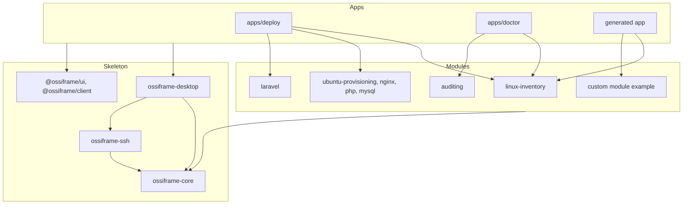

# Architecture

Decisions behind this page: [decisions/](decisions/README.md). Security details: [security.md](security.md).

## Layers and dependency direction

- **App → Modules → Core.** Core never depends on a module or app. Deploy and Doctor never depend on each other. No cycles.
- Core has no Laravel, PHP, NGINX or MySQL knowledge.

## Skeleton crates

| Crate | Contents |
|---|---|
| `ossiframe-core` | Shared types and validated identifiers, errors, the `Executor` trait and `CommandSpec`, argument quoting, redaction, operation record and states, module metadata and registry |
| `ossiframe-ssh` | russh-based executor: authentication, host key verification, sessions, command execution and streaming |
| `ossiframe-desktop` | Tauri integration, SQLite storage, keychain access, IPC command helpers, event forwarding |

Each crate keeps internal modules separate (for example `desktop::store`, `desktop::vault`). A crate is split only when a concrete need appears, such as a CLI that must not pull in Tauri.

Frontend: `@ossiframe/ui` (shared components) and `@ossiframe/client` (typed IPC calls and shared types).

## Modules

A module is a trusted Rust crate that an app registers explicitly at compile time. It declares an ID, version, dependencies and the capabilities it provides. The registry resolves dependencies and rejects missing ones and cycles. Modules run remote commands only through the Core executor and may expose typed IPC commands and UI pages to the app that includes them.

The module manifest is metadata. Security boundaries are enforced by the executor, the app's composition (which modules it includes) and IPC.

## Applications

Every app has the same shape: a React frontend in `src/`, a Tauri backend in `src-tauri/` that lists its modules, and its own build. Deploy uses inventory, provisioning, hosting and Laravel modules. Doctor uses inventory and auditing modules. It is read-only because its IPC exposes only typed discovery operations built from predefined commands; the frontend cannot supply programs, shell commands, file paths or privileged operations. Trusted compiled Rust code is not sandboxed from its own process privileges.

## SSH communication

Only the Rust backend talks to servers. The frontend never sees private keys or passwords after entry. Host keys are pinned on first trust; a changed key blocks the connection. No agent is installed on servers.

## Remote execution

- Trusted Rust code builds a `CommandSpec`: program, arguments, timeout. Core quotes arguments and assembles one command line.
- The executor returns exit status and bounded, redacted output, with timeout and cancellation. Output is not streamed to the frontend in S01.
- Privileged execution (`sudo -n`), secrets over stdin, and operation records are added in S04 when provisioning needs them.

### Operation record (introduced in S04)

ID, server ID, type, status, created/started/finished timestamps, sanitized output (size-capped), exit code, error.

States: `Pending → Running → Verifying → Succeeded`, plus `Failed`, `Cancelled`, `UnknownOutcome`.

- An SSH disconnect or app crash during `Running` leaves the operation `UnknownOutcome`. It is never retried automatically; the user inspects the server first.
- Conflicting mutating operations on the same server or app are blocked with a lock.
- Steps are idempotent where practical, and critical changes are verified after they run.
- Durable execution for long provisioning steps (for example `systemd-run` with status files) is investigated in S04, not built in advance.

## Runtime independence

A server is a set of observed facts and installed capabilities, never a "PHP server". Shared parts: NGINX as public entry point, database server. Per application: a Linux user, its directory, an FPM pool (for PHP) or a service on an internal port (future runtimes), its own `.env` and logs. Managed config files use an `ossiframe-` prefix; other files are discovered and never overwritten.

## Project generation

`tools/ossiframe-cli` (run with `cargo run -p ossiframe-cli -- create <name> --modules ...`, once implemented) resolves modules with the same registry code, renders `templates/starter/`, and writes a standalone project with its own steering and module-development guidance. How generated projects reference Core is decided in ADR-0007.

## Data ownership

| Data | Owner | Location |
|---|---|---|
| Server list, pinned host keys, operation records, app data | Each app separately | SQLite in the OS app-data directory |
| Private keys, passwords | User | OS keychain |
| Actual server state | Server | Read live; local copies are cache |
| Hosted application data | User | Server only |
