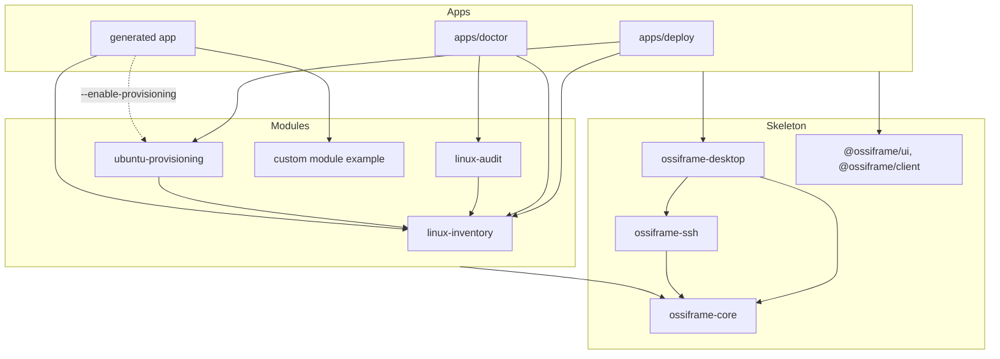
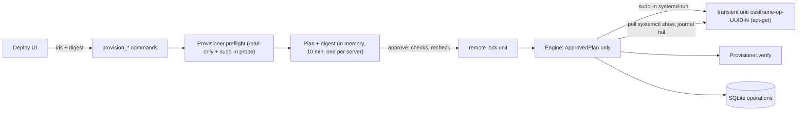

# Architecture

Decisions behind this page: [decisions/](decisions/README.md). Security details: [security.md](security.md).

## Layers and dependency direction

- **App → Modules → Core.** Core never depends on a module or app. Deploy and Doctor never depend on each other. No cycles.
- Core has no Laravel, PHP, NGINX or MySQL knowledge.

## Skeleton crates

| Crate | Contents |
|---|---|
| `ossiframe-core` | Shared types and validated identifiers, errors, the `Executor` trait and `CommandSpec`, argument quoting, redaction, operation record and states, module metadata and registry |
| `ossiframe-ssh` | russh-based executor: authentication, host key verification, sessions, command execution and streaming |
| `ossiframe-desktop` | Tauri integration, SQLite storage, keychain access, IPC command helpers, event forwarding |

Each crate keeps internal modules separate (for example `desktop::store`, `desktop::vault`). A crate is split only when a concrete need appears, such as a CLI that must not pull in Tauri.

Frontend: `@ossiframe/ui` (shared components) and `@ossiframe/client` (typed IPC calls and shared types).

## Modules

A module is a trusted Rust crate that an app registers explicitly at compile time. It declares an ID, version, dependencies and the capabilities it provides. The registry resolves dependencies and rejects missing ones and cycles. Modules run remote commands only through the Core executor and may expose typed IPC commands and UI pages to the app that includes them.

The module manifest is metadata. Security boundaries are enforced by the executor, the app's composition (which modules it includes) and IPC.

## Applications

Every app has the same shape: a React frontend in `src/`, a Tauri backend in `src-tauri/` that lists its modules, and its own build. Deploy (`apps/deploy`) registers `linux-inventory` and `ubuntu-provisioning`; Laravel and hosting modules do not exist yet. Doctor uses the `linux-inventory` and `linux-audit` modules; `linux-audit` declares `linux-inventory` as a dependency. It is read-only because its IPC exposes only typed discovery operations built from predefined commands; the frontend cannot supply programs, shell commands, file paths or privileged operations. Trusted compiled Rust code is not sandboxed from its own process privileges.

## SSH communication

Only the Rust backend talks to servers. The frontend never sees private keys or passwords after entry. Host keys are pinned on first trust; a changed key blocks the connection. No agent is installed on servers.

## Remote execution

- Trusted Rust code builds a `CommandSpec`: program, arguments, timeout, privilege. Core quotes arguments and assembles one command line. There is no stdin field yet.
- `Privilege::User` is the default. `CommandSpec::privileged` (`Privilege::Root`) requires an absolute program path and renders as `'/usr/bin/sudo' '-n' '--' '<program>' ...`. `sudo -n` fails instead of prompting.
- The executor returns exit status and bounded, redacted output, with timeout and cancellation. Output is not streamed to the frontend.
- `ReadOnly` wraps an executor and returns `PrivilegeDenied` for any non-`User` spec. `run_operation` hands modules this wrapper. See [security.md](security.md) for what it does and does not guarantee.

## Provisioning (S04)

`apps/deploy` is the only app that enables the `ossiframe-desktop` `provisioning` feature. The engine is generic and lives in `ossiframe-desktop`; it calls a `Provisioner` trait defined in Core. `modules/ubuntu-provisioning` implements that trait (Ubuntu 24.04 archive packages only) and registers zero `OperationInfo` entries, so `run_operation` cannot reach it. Core and desktop have no NGINX, PHP or MySQL knowledge; the component data lives in the module.

Ten typed `provision_*` IPC commands take only server, component, plan and operation ids, a digest and a limit. They never take a program, argv, path or privilege.

Flow: preflight, create plan, approve, execute, verify.

- **Plan.** A deterministic `Plan` (identity snapshot of the server, packages, steps, limitations) is held in memory with its SHA-256 digest. A newer plan for the same server replaces it. Approval consumes it. Approval checks, in order: plan exists, plan id, expiry, digest, server identity (host, port, user, pinned host key), connection, no active or `UnknownOutcome` operation. Then the module's `recheck` looks for drift and the engine takes the remote lock. The type `ApprovedPlan` can only be built by the plan store's approval path.
- **Steps.** `apt-update` and `apt-install` are durable: each runs as a transient systemd unit started with `/usr/bin/systemd-run --service-type=exec --remain-after-exit` under `sudo -n`, with `DEBIAN_FRONTEND=noninteractive` and `NEEDRESTART_SUSPEND=1` set through `/usr/bin/env`. The engine stores the unit name before launch, polls `systemctl show`, and stores a bounded journal tail. `candidate-check` is a read-only gate between them: package candidates and the full `apt-get install -s` set must come from allowlisted sources. A plan with every package present has zero steps and only verifies.
- **States.** `Pending`, `Running`, `Verifying`, `Succeeded`, `Failed`, `Cancelled`, `UnknownOutcome`, with a pure transition function. A disconnect, deadline, identity mismatch or crash gives `UnknownOutcome`. Nothing is relaunched or retried, and nothing stops apt, dpkg or the unit. Cancel is honoured between steps only.
- **Recovery.** `provision_reconcile` collects read-only evidence and settles only what the evidence proves. A missing unit alone never proves failure. `provision_mark_resolved` is a user action, allowed only when the backend's own fresh evidence shows no apt or dpkg process, free lock files and no active step unit. It sets `Failed` with resolution `markedResolved` and repairs nothing.
- **Remote lock.** The transient unit `ossiframe-provision-lock` (`sleep infinity`, owner record in its description) is taken at approval and kept until a terminal state other than `UnknownOutcome`. systemd refuses a second unit of the same name. It is cooperative: it excludes other Ossiframe instances, not people or other tools. apt and dpkg keep their own locks. A reboot clears it. A stale holder is released only by an explicit user action gated on backend evidence, and a holder owned by a local `UnknownOutcome` operation is released through mark-resolved.
- **History.** Migration 2 (shared with Doctor's database code) adds operation tables. Each operation keeps an identity snapshot, so history survives profile removal. A profile with an unresolved operation cannot be removed, re-pointed (host, port, user, auth) or have its host key replaced. On startup, in-flight rows become `UnknownOutcome`.
- **Verification.** `Provisioner::verify` returns per-check results with an `essential` flag. A component is verified only when all its essential checks pass; there are no scores.

Behaviours that depend on a real server are pending verification (task 8 of the S04 spec): `systemd-run --remain-after-exit` keeping a finished unit readable, refusal of a duplicate unit name, `NEEDRESTART_SUSPEND` effect, journal reads, and the verification checks.

## Runtime independence

A server is a set of observed facts and installed capabilities, never a "PHP server". Shared parts: NGINX as public entry point, database server. Per application: a Linux user, its directory, an FPM pool (for PHP) or a service on an internal port (future runtimes), its own `.env` and logs. Managed config files use an `ossiframe-` prefix; other files are discovered and never overwritten.

## Project generation

`tools/ossiframe-cli` (run with `cargo run -p ossiframe-cli -- create <name> --modules ...`, once implemented) resolves modules with the same registry code, renders `templates/starter/`, and writes a standalone project with its own steering and module-development guidance. How generated projects reference Core is decided in ADR-0007.

## Data ownership

| Data | Owner | Location |
|---|---|---|
| Server list, pinned host keys, operation records, app data | Each app separately | SQLite in the OS app-data directory |
| Private keys, passwords | User | OS keychain |
| Actual server state | Server | Read live; local copies are cache |
| Hosted application data | User | Server only |
